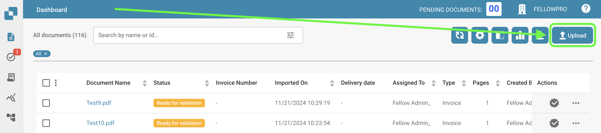

# 手动导入

如果您想在 DocBits 中手动导入文档，请按照以下简单步骤操作：


DocBits 导入教程：上传文档、拖放以及手动与自动分类


* 点击 DocBits 仪表板上的“上传”按钮。
* 将出现一个窗口，您可以通过文件浏览器上传文档，也可以拖放文档。每次最多可上传 10 份文档。
* 要通过文件浏览器上传文档，请点击“上传文档”按钮，然后选择要上传的文件。选择文件后，点击“确认”开始上传。
* 您也可以将文件拖放到 DocBits 导入窗口中。
* 文件上传后，初始状态为“正在运行”。在此期间，系统正在处理上传内容，无法编辑文件。处理时间可能因文件的大小和复杂程度而异。
* 文件处理完成后，状态将变为“准备验证”。此时，您可以开始验证流程。

<figure><figcaption></figcaption></figure>
