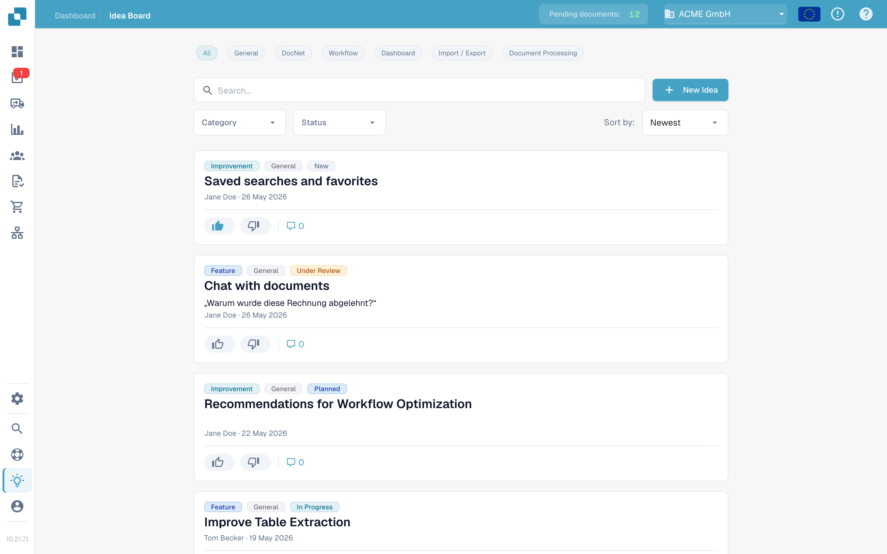
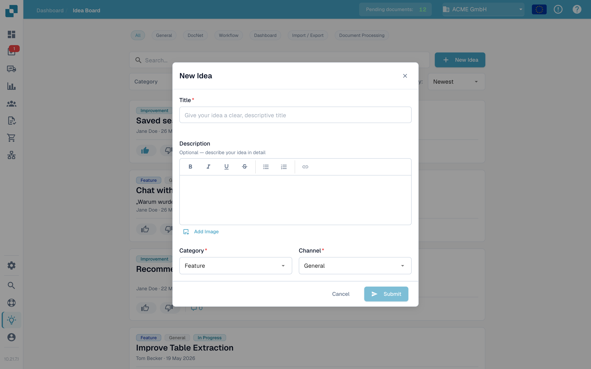

# 创意看板

创意看板用于提交功能请求、报告缺失的功能，以及为产品团队接下来应该开发的内容投票。创意按频道分类，并对组织中的所有人可见，大家可以评论和投票。

## 如何访问

打开侧边栏并点击 **Ideas**，或直接导航至 `/ideas`。

<figure><figcaption>
创意看板，显示频道标签、筛选器和创意卡片。
</figcaption></figure>

## 频道

看板顶部有一排频道标签：**All**、**General**、**DocNet**、**Workflow**、**Dashboard**、**Import / Export** 和 **Document Processing**。点击某个标签，仅显示对应产品领域中的创意；**All** 会清除频道筛选。每条创意都属于一个频道，该频道会以徽标形式显示在卡片上。

## 浏览创意

每条创意都显示为一张卡片，其中包含：

* 标题和富文本描述，描述中可以包含图片。
* 单独的 **upvote** 和 **downvote** 按钮，各自显示投票数。
* 类别徽标 — Feature、Improvement、Bug、Integration 或 Other。
* 频道徽标 — General、DocNet、Workflow、Dashboard、Import / Export 或 Document Processing。
* 状态标签 — New、Under Review、Planned、In Progress、Done 或 Declined。
* 提交者的姓名和所属组织，以及相对时间戳。
* 评论切换按钮，点击后可展开卡片下方的讨论内容。

列表底部的分页控件可用于切换页面。

## 提交新创意

点击标题栏中的 **New idea**。对话框会要求填写：

* **Title** — 简短且能说明创意的名称。
* **Description** — 可选的富文本编辑器，支持粗体、斜体、下划线、删除线、列表和链接。你还可以添加图片：直接粘贴图片，或使用 **Add image** 按钮将图片插入描述中。
* **Category** — 选择最接近的类别。产品团队会据此分派创意。
* **Channel** — 创意所属的产品领域。

点击 **Submit** 发布。创意会以 **New** 状态显示在列表中。

<figure><figcaption>
新建创意对话框，包含类别和频道选择器。
</figcaption></figure>

## 投票

每条创意都有单独的 **upvote** 和 **downvote** 按钮，各自显示投票数。点击按钮即可投票；再次点击同一按钮可取消投票；点击相反按钮则可切换投票方向。投票可以向产品团队反映需求，并影响 **Hot** 和 **Top Rated** 排序结果。

## 评论

展开创意的评论串，即可提问、补充背景信息或分享临时解决方法。你可以为评论投赞成票或反对票（但不能为自己的评论投票），也可以删除自己发布的评论。创意提交者和管理员也可以删除评论，以确保讨论切合主题。

## 筛选和排序

列表上方可以组合使用以下选项：

* **频道**标签。
* 搜索框，可匹配标题和描述。
* 类别下拉菜单。
* 状态下拉菜单。
* 排序选择器 — **Newest**、**Hot** 或 **Top Rated**。

筛选条件可以组合使用，因此只需点击几下，就能缩小范围，例如查找“评分最高且正在审核中的改进”。

## 编辑或删除自己的创意

卡片菜单（三点按钮）可用于编辑或删除你提交的创意。

<mark>创意看板用于收集产品反馈，不用于报告事件。如果问题正影响你当前的工作，请提交支持工单。</mark>
