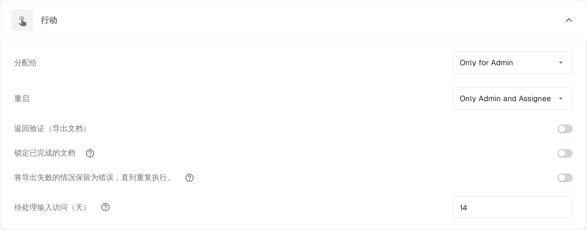

# Pending Input

**Pending Input** 会在等待同事答复期间暂停文档。您在文档的活动流中提出问题，并标记应当答复的人员。在对方答复之前，文档会离开活动队列；被标记的人员可以通过电子邮件中的链接以只读方式打开该文档。

该状态在[仪表板](dashboard/README.md)中显示为 **Pending Input**，您可以按该状态筛选工作列表。

## 请求输入

1. 在提供活动流的界面中打开文档——审批和复核界面都提供活动流——然后选择工具栏中的对话气泡图标。
2. 写下您的问题，输入 **@** 并跟上要询问的人员姓名。从出现的列表中选择该人员。标记即授予访问权限：只有被标记的人员才会收到文档链接。
3. 标记人员后，输入框下方会出现一个框，其中有两个选项：

* **Comment only**（仅评论）——问题发布到活动流中，状态保持不变。如果您只需要答复而不想扣住文档，请使用此选项。
* **Send & set to Pending Input**（发送并设为 Pending Input）——问题被发布，文档进入等待状态。文档离开活动队列并保持暂停，直到被标记的人员答复。

被标记的人员会收到一封包含文档链接的电子邮件。**Enter** 或发送图标仍会发布普通评论而不授予访问权限；**Shift+Enter** 换行。对于已经暂停的文档，或尚不能暂停的文档，该框只提供提问而不提供暂停选项。

## 答复请求

当同事在活动流中标记您时，即表示向您请求输入。

* 打开电子邮件中的链接。**Pending Input** 页面左侧显示文档各页，右侧显示活动流，并带有 **Pending Input** 标记。
* 您的访问权限为只读：可以阅读文档并在活动流中答复，但不能修改字段，也不能导出。
* 在活动流中写下答复并发送。提问者会收到通知，对话会保留在文档历史中。
* 页面顶部会显示您的访问期限，例如 **Read-only access until 09.11.2026**。文档继续流转时，访问也会立即结束。

如果在请求已被答复或您的访问已到期之后打开链接，页面会提示该请求已处理或已过期，无需操作。

## 处理请求

在负责人接手答复之前，文档将保持暂停。

1. 从仪表板打开该文档。已暂停的文档会直接打开其 **Pending Input** 页面。
2. 在活动流中阅读答复。
3. 选择 **Resolve & Proceed**（处理并继续）。文档以工作流中的下一个状态继续，因此您会直接回到继续处理工作的界面。

只有文档的负责人，或文档所分配到的群组成员，才能处理该请求。管理员和审批人可以只读方式打开暂停的文档，以查看其等待的原因。

## 设置访问期限

该功能在所有组织中均可使用。可配置的是被请求输入的人员保留文档访问权限的时长：

1. 打开 **设置 → 仪表板**。
2. 展开 **操作**。
3. 在 **待处理输入访问（天）** 中输入整数天数。默认值为 **14**，至少需要一天。
4. 保存更改。

期限从发送请求时开始计算。文档被处理完成或转入其他状态时，期限会提前结束。

<figure><figcaption>
仪表板设置“操作”区域中的“待处理输入访问（天）”。其上方的权限选项目前仍由产品以英文显示。
</figcaption></figure>
