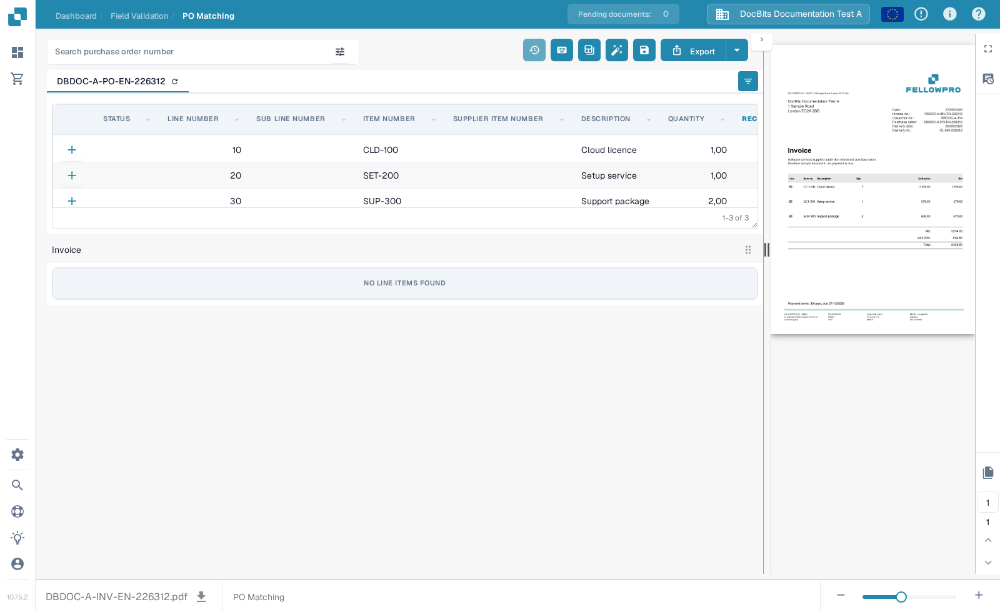
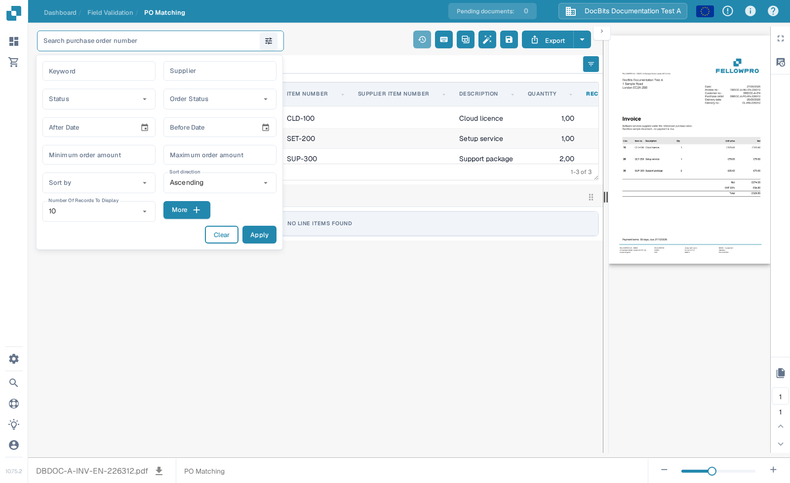
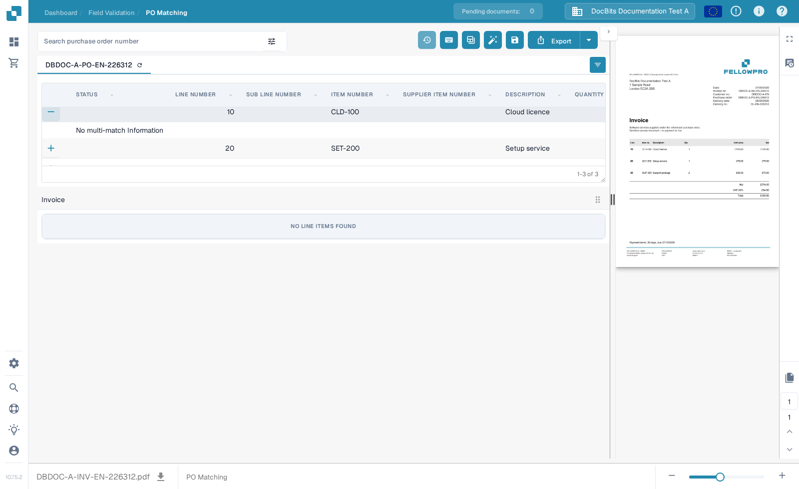

# 采购订单匹配界面

使用 **PO Matching** 比较为文档加载的采购订单行项目与提取出的发票行项目。采购订单数据可能来自 ERP 集成或其他已配置的导入方式。该界面会同时显示文档和两个表格，方便你在保存或导出前核对编号、数量、价格和差异。


以下示例使用 **DocBits Documentation Test A** 中的合成 FellowPro 发票和采购订单。其发票表格目前显示 **No line items found**。此示例演示了导航和搜索，但无法展示成功的行项目匹配。请勿将此示例作为已匹配的发票导出。


<figure><figcaption>
采购订单已加载；示例发票没有可关联的提取行项目。
</figcaption></figure>

## 查找并检查采购订单

1. 在 **PO Matching** 中打开一张发票。如果你的组织有多个采购订单，请在 **Search purchase order number** 中输入编号。
2. 选择搜索框旁的筛选图标，可按 **Keyword**、**Supplier**、**Status**、**Order Status**、日期、金额范围、排序方式以及显示的记录数进行筛选。选择 **More** 查看其他条件。选择 **Apply** 执行搜索，或选择 **Clear** 重置筛选条件。
3. 选择表格上方的采购订单编号，查看其行项目。编号旁的刷新图标会重新加载该订单的数据。重新加载可能取决于已配置的集成。
4. 将每个采购订单行项目与发票及其提取表格进行比较。行项目上的 **+** 可展开匹配详情；它本身不会将该行项目关联到发票。在示例中，由于不存在此类匹配，展开后会显示 **No multi-match Information**。

<figure><figcaption>
使用筛选面板缩小显示的采购订单范围。
</figcaption></figure>

<figure><figcaption>
有匹配详情时，展开的行项目会显示这些详情。
</figcaption></figure>

## 匹配行项目并查看结果

两个表格都包含行项目时，可通过拖动将发票行项目关联到对应的采购订单行项目，也可以使用行项目上下文菜单中的匹配操作。**Auto Match** 会根据组织的规则尝试关联符合条件的行项目。保存前请检查结果：仅行项目编号匹配，并不能证明数量、价格或交货条款一致。有关工具栏、列控件和手动操作，请参阅[采购订单匹配工具](purchase-order-matching-tools.md)；有关键盘操作，请参阅[键盘快捷键](keyboard-shortcuts.md)。

如果文档未匹配，请查看采购订单区域上方显示的原因。提示可能指出缺少 PO 编号、未找到订单、订单行项目不可用，或发票没有提取行项目。请根据提示修正文档或配置。如果没有显示发票行项目，管理员可以检查[匹配规则](../../../administration-and-setup/settings/global-settings/document-types/more-settings/purchase-order/purchase-order-matching-rules.md)和[表格提取](../../../administration-and-setup/settings/document-processing/classification-and-extraction/README.md)。

常见提示及后续步骤：

| 你看到的内容 | 检查内容 |
| --- | --- |
| No purchase order number | 在文档中输入或更正 PO 编号，然后保存。 |
| No purchase order was found | 检查编号，以及该订单是否已导入此组织。 |
| The order was found but is not connected | 尝试使用 **Auto Match**，或检查两个表格后手动关联行项目。 |
| No order lines match | 将发票值与订单进行比较，并检查匹配历史记录。 |
| No invoice line items | 尝试匹配前，请检查[表格提取](../../../administration-and-setup/settings/document-processing/classification-and-extraction/README.md)。 |
| No open order lines | 检查[已消耗行项目状态](../../../administration-and-setup/settings/global-settings/document-types/more-settings/purchase-order/consumed-po-line-status.md)和已排除的状态。 |


PO 编号发生更改或被新检测到后，保存操作可能会再次触发匹配。保存后请检查显示的结果。如果无法保存匹配结果，请阅读界面上显示的错误，并请管理员检查[转换](../../../administration-and-setup/settings/global-settings/document-types/transformation-rules.md)和[匹配规则](../../../administration-and-setup/settings/global-settings/document-types/more-settings/purchase-order/purchase-order-matching-rules.md)。


如果你的权限允许，可使用 **Matching history**（时钟图标）检查先前匹配的判定过程。此视图为只读。你可以查看运行了哪些规则，以及候选项为何未匹配；打开历史记录不会导出文档。

### 一次匹配多个行项目 

如果匹配规则允许，一条发票行项目可能对应多个订单行项目，反之亦然。展开行项目上的 **+** 详情，检查现有的多行匹配。请核对合计数量和价格，而不只是其中一条行项目。像上方合成示例中的空详情面板表示没有可检查的多行匹配。有关更改关联的信息，请参阅[采购订单匹配工具](purchase-order-matching-tools.md)。

### 数量、差异和折扣

根据配置，匹配时可以比较订购数量、已收货数量或剩余交货数量，以及单价、行项目编号和其他映射字段。如果文档类型配置了容差，差异可能会被接受。接受前请检查显示的不匹配项。[容差设置](../../../administration-and-setup/settings/global-settings/document-types/more-settings/purchase-order/purchase-order-tolerance-settings-additional-purchase-order-tolerance.md)和[折扣说明](discounts.md)介绍了这些情况。

如果提供了总计区域，可用它核对发票净额、已匹配行项目和费用。如果仍有 **Unsettled amount**，请检查各行项目的值，以及导出前是否有[成本要素](../../../administration-and-setup/settings/document-processing/classification-and-extraction/table-extraction-for-costing-element.md)。

## 检查总计并保存

查看右侧的发票预览，并比较行项目总计和任何费用。有关顶部工具栏中各项操作的完整说明，请参阅[采购订单匹配工具](purchase-order-matching-tools.md)。更改匹配后，请选择 **Save**。只有在检查文档和匹配结果后，才选择 **Export**；Export 旁边的箭头会显示其他已配置的导出选项。你的组织可能提供不同的导出操作。

预览工具栏可用于切换文档页面、缩放、下载原件以及打开较大的视图。使用这些功能确认发票上确实显示了采购订单编号和行项目值。如果离开时仍有未保存的匹配更改，这些更改可能会丢失。

可用的比较项和容差值取决于文档类型设置。有关管理员设置，请参阅 [PO Matching Rules](../../../administration-and-setup/settings/global-settings/document-types/more-settings/purchase-order/purchase-order-matching-rules.md)、[Tolerance Settings](../../../administration-and-setup/settings/global-settings/document-types/more-settings/purchase-order/purchase-order-tolerance-settings-additional-purchase-order-tolerance.md)、[Disabled Statuses](../../../administration-and-setup/settings/global-settings/document-types/more-settings/purchase-order/purchase-order-disable-statuses.md)和 [Consumed PO Line Status](../../../administration-and-setup/settings/global-settings/document-types/more-settings/purchase-order/consumed-po-line-status.md)。有关多对一行项目，请参阅 [Discounts](discounts.md)和[匹配工具](purchase-order-matching-tools.md)。
