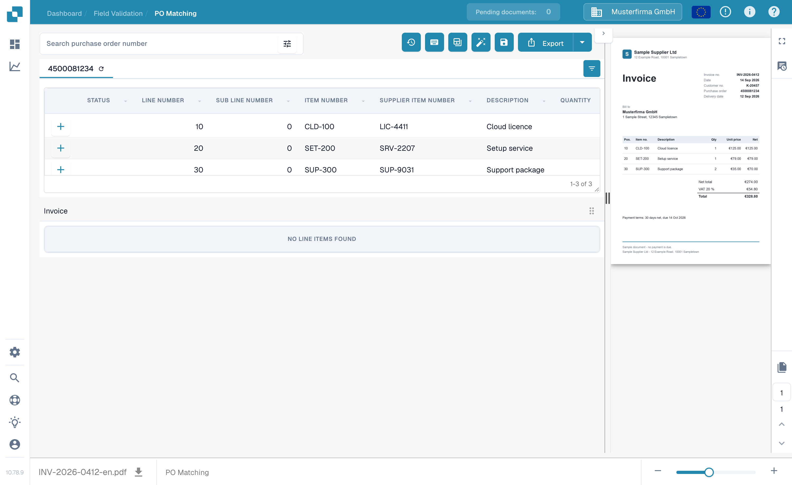
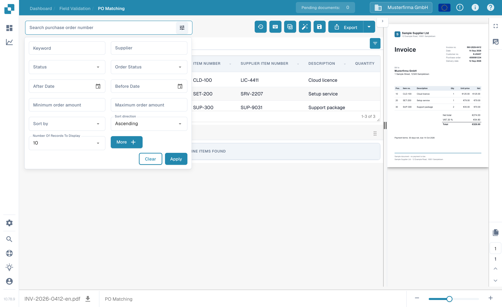
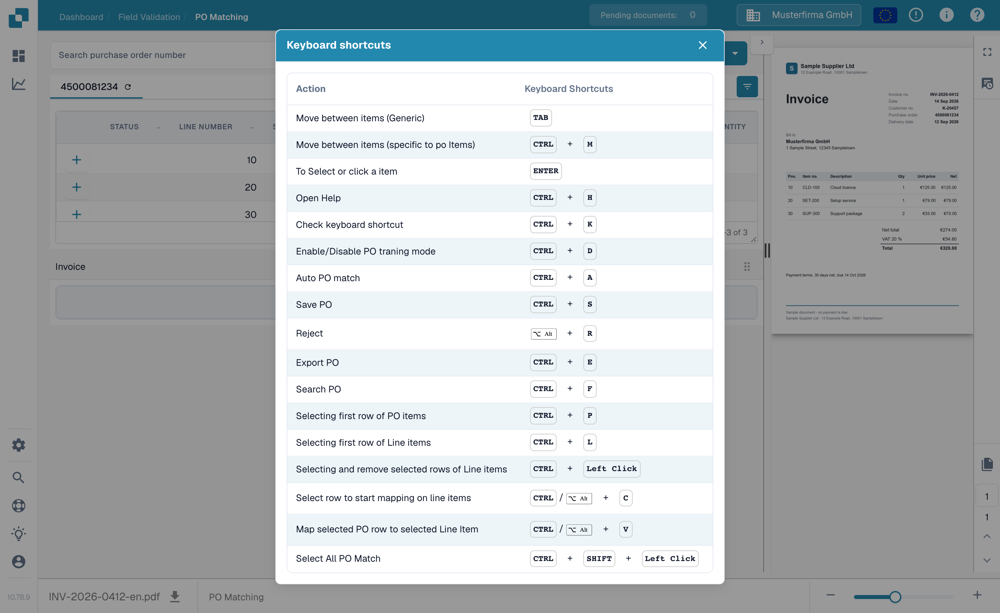

# 采购订单匹配工具

PO 匹配屏幕在 PO 行项目上方显示采购订单搜索栏和工具。发票预览仍位于右侧。可用操作可能因您的权限、文档数据和组织设置而异。

<figure><figcaption>
搜索栏和操作工具栏位于采购订单行项目上方。
</figcaption></figure>

## 查找正确的采购订单

在 **Search purchase order number** 中输入采购订单编号，然后选择一个结果。字段旁边的筛选图标可打开更多搜索选项：关键字、供应商、状态、订单状态、日期范围、订单金额、排序方式和记录数。选择 **Apply** 应用筛选条件，或选择 **Clear** 重置筛选条件。筛选列表不会匹配或导出发票。

<figure><figcaption>
选择 PO 搜索栏旁边的筛选图标，打开更多搜索选项。
</figcaption></figure>

## 工具栏操作

选择图标前，请先阅读其提示文本。工具栏可能显示以下操作：

| 操作 | 功能 |
| --- | --- |
| **Matching history**（时钟） | 打开此文档之前的匹配活动记录。此操作不会启动新的匹配。 |
| **Help**（?） | 在新的浏览器标签页中打开 PO 匹配帮助页面。 |
| **Keyboard shortcuts**（键盘） | 显示此屏幕上可用的快捷键。请参阅 [键盘快捷键](keyboard-shortcuts.md)。 |
| **Training mode**（表格） | 开启或关闭将 PO 行拖入发票表格的功能。仅当文档包含发票行项目时，此功能才有用；下方示例屏幕不包含发票行项目。 |
| **Tasks / Create task** | 打开文档任务，或在这些操作适用于您的文档和角色时创建任务。请参阅 [任务](../tasks.md)。 |
| **Auto Accounting** | 当此文档包含会计数据时，打开该文档的会计信息。 |
| **Auto PO match**（魔棒） | 运行自动匹配。如果组织已启用自动导出，且匹配结果符合相关条件，此操作也可能导出文档。使用前请先检查文档。请参阅 [自动采购订单数据匹配](automatic-purchase-order-data-matching.md)。 |
| **Save**（磁盘） | 将 PO 匹配更改保存到文档。 |
| **Sync Data** | 仅适用于相应的 PO 数量设置；从已连接的系统刷新所选 PO 数据。请使用显示的 PO 编号和可用的同步选项。 |
| **Export** | 匹配后导出文档。如果您的组织提供多个导出目标，请使用 **Export** 旁边的箭头选择目标。 |

PO 标签页还提供刷新图标，可重新加载该采购订单。表格标题栏右侧的列设置图标用于控制显示哪些 PO 列。这些设置会更改 PO 表格的视图，不会更改发票中提取的值。

## 键盘快捷键

选择键盘图标，查看当前快捷键列表。常见示例包括 **Ctrl+F** 将焦点移至 PO 搜索栏、**Ctrl+K** 重新打开快捷键对话框、**Ctrl+S** 保存，以及 **Ctrl+E** 导出。当前屏幕上的完整快捷键列表以该对话框显示的内容为准。

<figure><figcaption>
选择键盘图标，查看此屏幕支持的快捷键。
</figcaption></figure>


此截图使用 DocBits Documentation Test A 沙盒中的合成发票和采购订单。该发票没有提取的行项目，因此无法展示成功匹配。制作这些截图时未运行匹配、保存、同步或导出操作。

