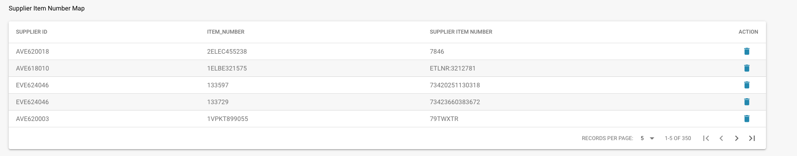

# 供应商物料编号映射

## **概述**

此功能可帮助您管理并核对系统与供应商之间的物料编号。您在内部使用的物料编号通常可能与供应商使用的编号不同。DocBits 可通过建立内部物料编号与供应商物料编号之间的映射，帮助您轻松处理这些差异。

<figure><figcaption></figcaption></figure>

## **工作原理**



1. **手动匹配：**
   * 首次遇到内部物料编号与供应商物料编号不一致时，您需要手动匹配。
   * 输入与内部物料编号对应的正确供应商物料编号即可完成匹配。
2. **自动匹配：**
   * 手动将物料编号与供应商物料编号匹配后，DocBits 会记住此映射关系。
   * 下次出现相同物料时，DocBits 会根据已保存的映射自动匹配，从而节省时间并减少错误。

## **界面说明**

* **供应商 ID：** 供应商的唯一标识符。
* **物料编号：** 产品在您内部使用的物料编号。
* **供应商物料编号：** 供应商使用的对应物料编号。
* **操作：** 用于管理映射的选项，例如删除错误的映射。


另请参阅[管理部分](../../../administration-and-setup/settings/global-settings/document-types/more-settings/purchase-order/supplier-item-number-map-admin-documentation.md)


## **优势**

* **效率：** 减少重复手动输入的需要，加快处理流程。
* **准确性：** 确保物料编号正确匹配，从而减少错误。
* **便捷性：** 首次手动输入后，匹配流程将自动完成，使工作流更加简便。
