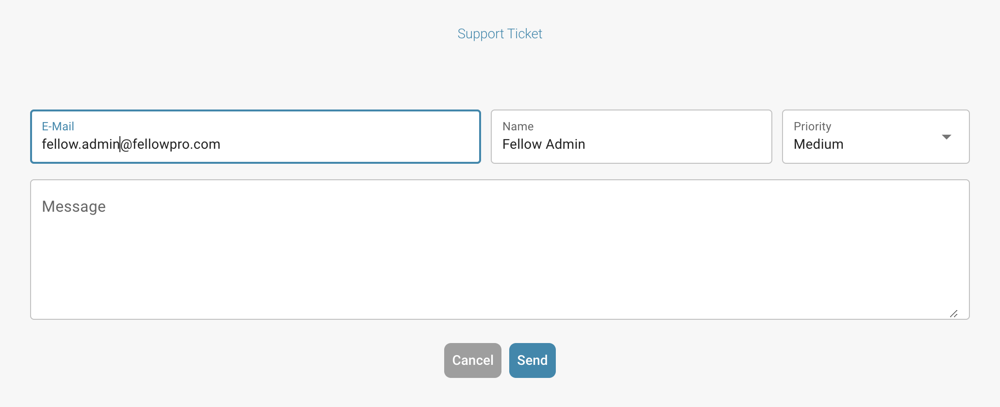

# 用户支持

### 用户支持 

如果您在使用 DocBits 时遇到任何问题或有任何疑问，请查阅本用户手册，或联系我们的支持团队寻求帮助。我们致力于为所有用户提供顺畅的使用体验。只需点击 DocBits 应用中的支持按钮，即可创建支持工单。

<figure><figcaption></figcaption></figure>

<figure><figcaption></figcaption></figure>

您也可以通过我们的 FELLOWPRO 页面联系我们：



在验证界面中，您可以直接为相关文档创建工单，并附上问题截图。只需点击“Create ticket”按钮，支持窗口便会打开，您可以立即开始操作。

<figure><figcaption></figcaption></figure>

<figure><figcaption>
发送前的支持表单。
</figcaption></figure>


