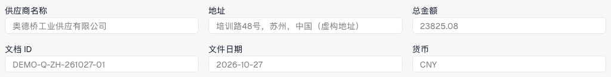

# 检查报价明细和行价格

报价视图适用于配置了报价处理的单据。文档类型、布局、权限与工作流决定可用字段和操作；该视图与采购订单匹配不同。

<figure><figcaption>
DocBits中一份虚构中国三页报价单的抬头，包含供应商、编号、日期、币种和总额。截图显示前六个抬头字段。
</figcaption></figure>

下载虚构三页报价单（PDF）



## 检查和修正明细

<figure><figcaption>
选中第一条明细后的描述和单价字段。未修改或保存任何数值。
</figcaption></figure>

1. 打开正确报价，核对供应商、参考号、日期和币种与原件是否一致。
2. 比较物料号、说明、数量、单位、价格与金额。物料号相同并不能证明价格或单位相同。
3. 选择一行，在表格下方查看其详细字段。
4. 如有配置主数据查找，使用它选择正确记录，检查选中内容及自动填入的值，并调查查找警告。
5. 修正该行，选择**保存**或**保存并转到下一行**。**取消**关闭行编辑器而不提交本次行更改。
6. 只有默认值也适用于下一行时，才使用复制默认值的保存并继续选项；检查复制后的值。
7. 重新打开单据及该行，确认已保存的实际值。对于被拒绝的行，阅读可用备注并解决业务原因。

## 特殊情况

允许编辑时，添加行会创建手工明细。将其与原件比较，补齐必填字段。移除手工行是另一项操作；不要为使合计相等而删除真实明细。

只读时，检查权限、锁定和处理阶段。没有明细时，检查原件、提取结果和布局。

针对管理价格、最近价格或合同价格的自动检查通过[报价比较卡片](../../administration-and-setup/workflow/cards-overview/quote-comparison-guide.md)配置。保存一行并不能证明这些检查已执行、报价已审批或 ERP 导出已完成。
