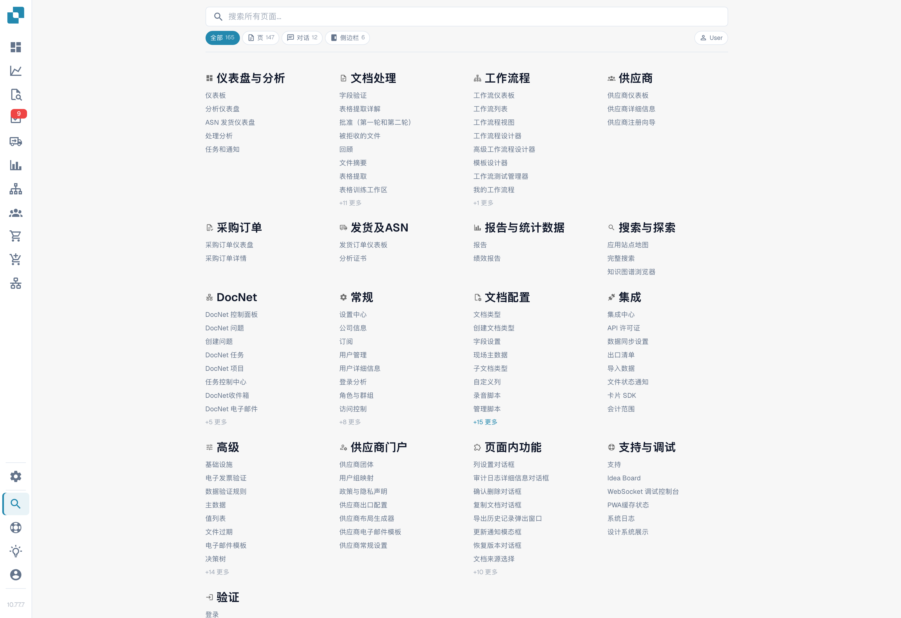
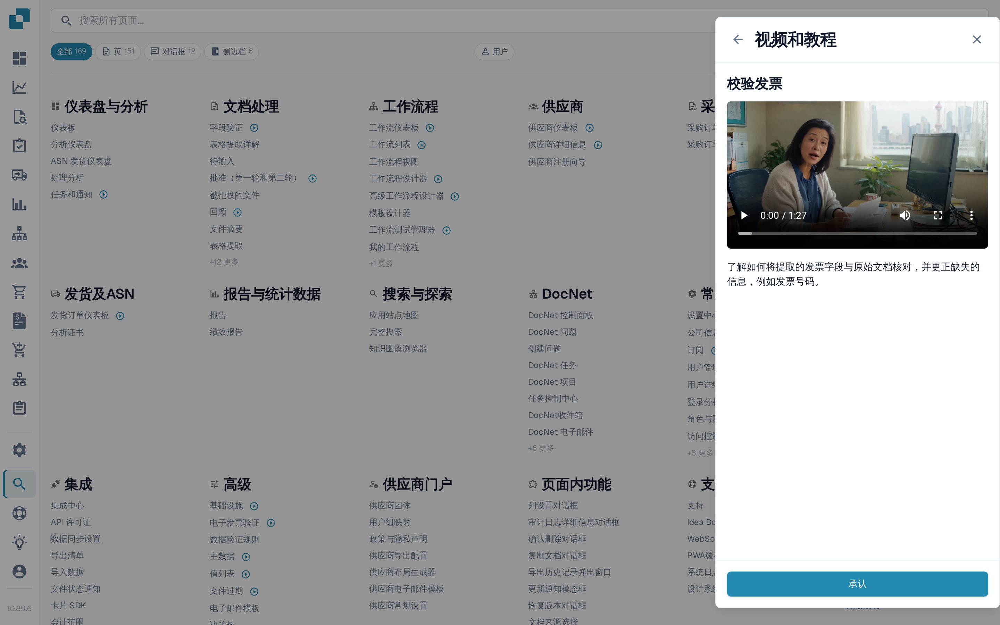

# 站点地图

站点地图是 DocBits 所有可用内容的完整可搜索索引，按类别分组列出每个页面、对话框、侧边栏条目、操作和页面内功能。它是 [全局快速搜索](global-quick-search.md) 的长篇补充。

## 如何访问

从侧边栏打开站点地图（靠近底部的条目），或按 <kbd>Cmd</kbd>/<kbd>Ctrl</kbd> + <kbd>K</kbd>，然后选择 **查看所有结果（View all results）**。直接访问 URL：`/sitemap`。

<figure><figcaption>
中文应用站点地图；User 角色标记仍为英文。“录音脚本”在此指创建脚本，非录音。
</figcaption></figure>

## 浏览目录

站点地图按类别分组，与应用的结构对应，例如“设置”“文档处理”“工作流”和“验证”。每个类别都列出其页面，并按子类别分组列出页面内功能。

条目按类型以不同颜色标示：

* **页面（Page）** — 可导航到的完整路由。
* **对话框（Dialog）** — 从应用某处打开的模态窗口。
* **侧边栏 / 面板 / 菜单（Sidebar / Panel / Menu）** — 导航区域或上下文面板。
* **操作（Action）** — 执行某项功能但不会跳转页面的按钮或快捷键。

点击任意条目即可直接跳转到相应位置。需要参数的条目（例如文档类型或文档 ID）会包含内嵌选择器；先选择值，再点击跳转。

## 列表中的培训视频

带有培训视频的页面条目会在名称后显示视频图标——不只出现在“设置”中，而是出现在整个目录里，例如仪表板、字段验证或工作流页面。选择该图标即可在**视频和教程**面板中播放该页面的视频，同时停留在站点地图上。

<figure><figcaption>
带培训视频的条目显示视频图标；选择后视频在面板中打开。
</figcaption></figure>

该面板仍按主题列出每个视频，因此您也可以通过顶栏中的图标浏览和搜索整个视频库。请参阅[视频和教程](videos-and-tutorials.md)。

## 搜索和筛选

页面顶部的固定标题栏包含搜索框和筛选标签。输入几个字符，即可根据标签和描述实时筛选列表。使用类型标签可缩小范围，只显示一种条目类型，例如仅显示 **对话框（Dialog）** 条目。

当前搜索和筛选条件会添加到 URL 中，因此可以为筛选后的视图添加书签或与他人分享。

<mark>站点地图遵循与 DocBits 其他部分相同的权限控制。您无权访问的页面不会显示。</mark>

## 开发者模式

标题栏中的 **用户 / 开发者（User / Dev）** 切换开关可显示合作伙伴开发者需要的额外详情：

* 每个条目的内部路由路径。
* 参数标签（`:docType`、`:docId`、深层链接键）。

开发者模式会保存在浏览器中。切换回用户模式，即可返回常规阅读视图。

## 返回顶部

站点地图较长。向下滚动超过首屏后，右下角会出现返回顶部按钮。
