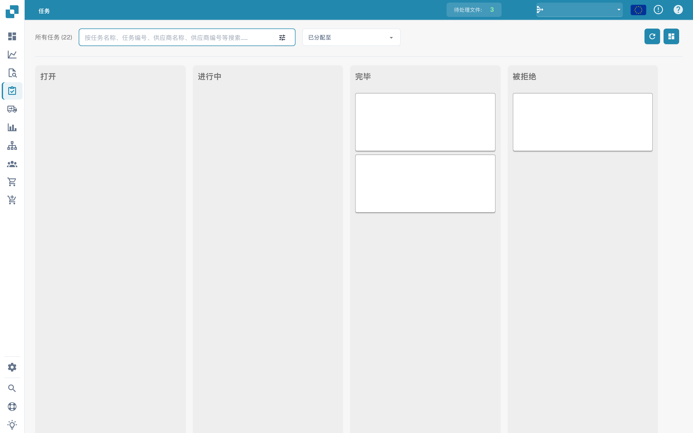
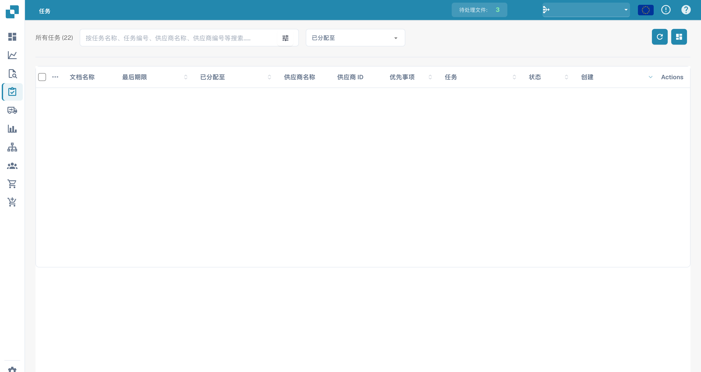

# 任务

你可以在这里查看自己的任务。你可以选择两种不同的布局，其中一种显示的信息更详细。你还可以按不同条件筛选任务，例如任务是否分配给你，或任务的状态。

<figure><figcaption>
按状态分组的任务看板；任务内容已隐藏。
</figcaption></figure>

<figure><figcaption>
任务列表；文档数据已隐藏。
</figcaption></figure>
