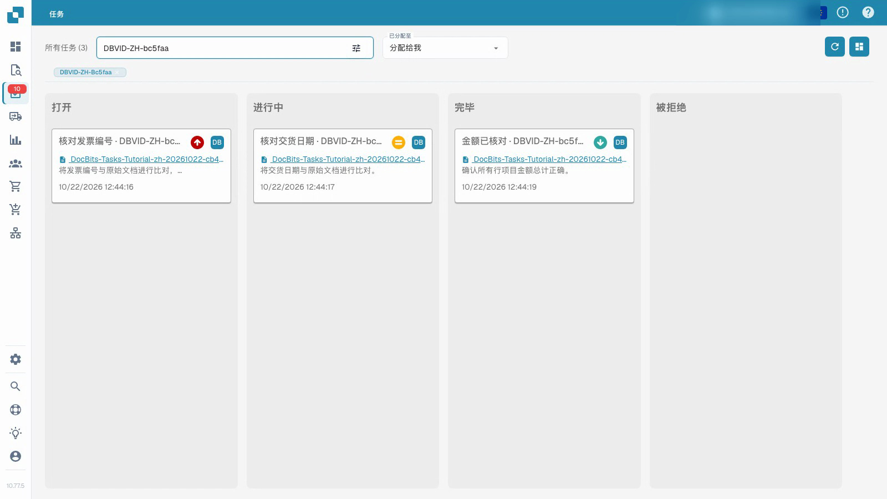
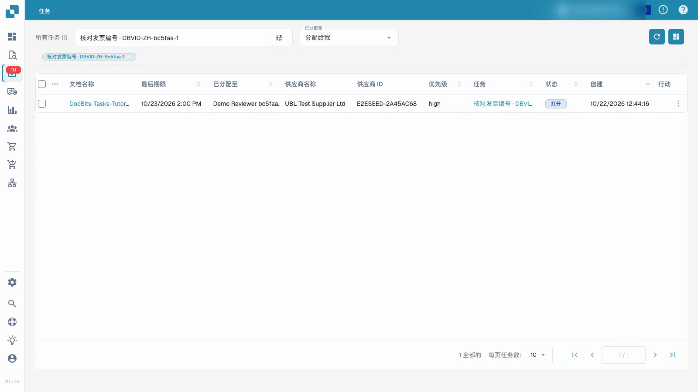

# 任务

视频显示普通测试用户正在处理带有合成文档的任务。


任务


[带字幕观看](https://docbits-videos.fra1.cdn.digitaloceanspaces.com/settings-assistant/document-tasks-customer/v1/zh.html)

注意：某些原生产品标签可能未翻译。录像保留了实际的用户界面。

使用任务概览查找分配的工作并跟踪其进度。看板按状态对任务进行分组；列表提供更多详细信息。按分配过滤并使用搜索来定位特定任务。优先级和截止日期有助于规划工作顺序。

## 处理分配的文档任务

1. 打开任务并阅读其描述和分配。
2. 检查链接的原始文档。仅凭任务标题不能证明文档是正确的。
3. 将任务设置为进行中，并在执行工作时保存。
4. 在任务描述中记录结果。
5. 完成任务，保存并重新加载以确认存储的状态和反馈。检查其在任务概览中的位置。

视频使用普通测试用户和合成文档。完成任务与批准或导出其发票是分开的。可用操作取决于帐户的权限。

## 无法将任务标记为完成时

您的组织可以限制谁可以关闭任务，即将任务设置为**完毕**或**被拒绝**。如果设置了此限制，对于您无权关闭的任务，系统不会提供**完毕**按钮、**完毕**和**被拒绝**状态以及**标记为完成**，任务看板也不允许您将此类任务拖入**完毕**或**被拒绝**列。分配给您的任务仍然可以编辑、保存，并在**未结**和**进行中**之间移动。

谁可以关闭和删除任务，由您组织的管理员决定。请参阅[任务和通知](../../administration-and-setup/settings/document-processing/module/tasks-and-notifications.md)。

<figure><figcaption>
使用合成数据的任务概览。
</figcaption></figure>

<figure><figcaption>
使用合成演示数据的任务列表。
</figcaption></figure>
