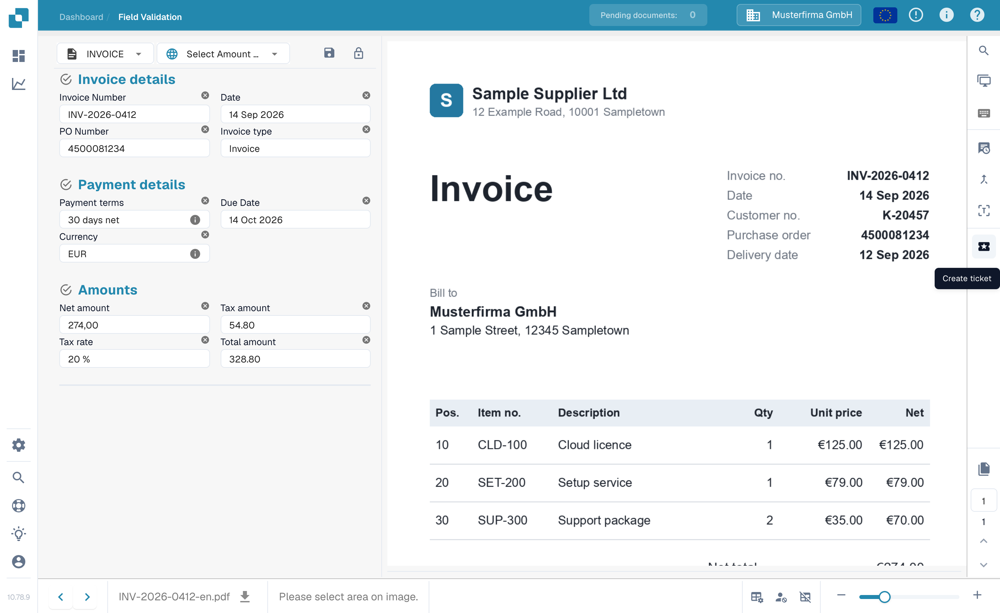
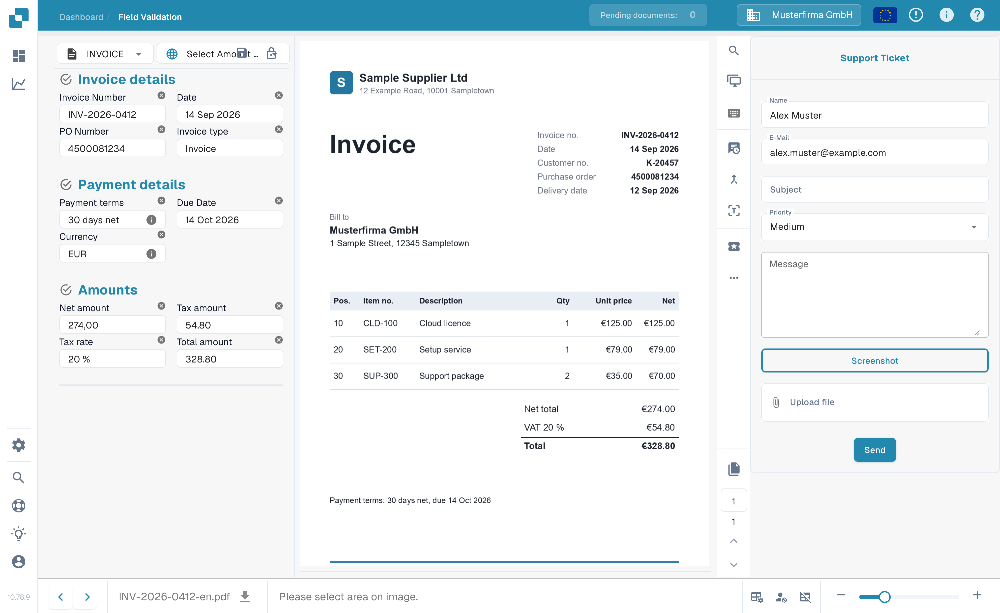

# 创建工单

在 DocBits 中验证文档时，如果遇到问题，可以在验证屏幕上使用此工具。

此功能位于文档预览区域上方的菜单中，如下所示

<figure><figcaption>
验证屏幕操作栏中的 Create ticket 按钮。
</figcaption></figure>

点击后，将显示以下工单表单。

<figure><figcaption>
Support Ticket 表单。
</figcaption></figure>

在此填写您的详细信息并描述错误。您也可以（如适用）附上问题截图和相关文件。
