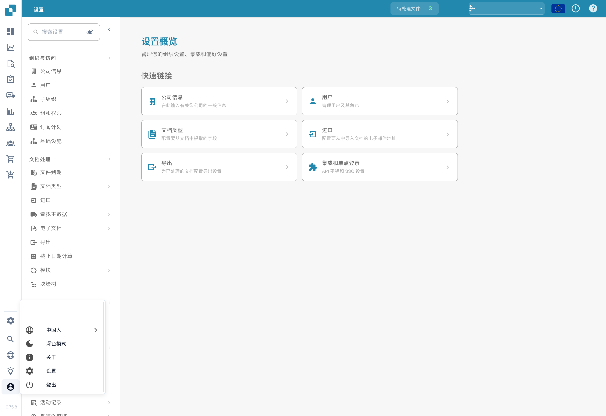
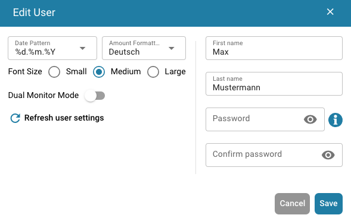

# 用户配置选项

要配置设置，请点击屏幕左下角的用户图标。您可以在此自定义多项选项：



<figure><figcaption></figcaption></figure>

<figure><figcaption>
用户菜单和语言选择。
</figcaption></figure>

**语言**

* **选择首选语言：** 从可用选项中选择您希望使用的语言。

**深色模式**

* **切换到深色模式：** 启用或禁用深色模式，获得更舒适的观看体验。

**用户设置**

在此部分，您可以调整以下偏好设置：

* **日期格式：** 自定义日期的显示方式。
* **金额格式：** 设置您偏好的数值格式。
* **姓名：** 更新您的姓名。
* **密码：** 更改密码以保障账户安全。
* **字体大小：** 调整文字大小，以便更轻松地阅读。
* **双显示器模式：** 如果您使用两台显示器，请启用此功能。

<figure><figcaption></figcaption></figure>

**退出登录**

* **退出登录：** 点击此处安全地退出您的账户。
