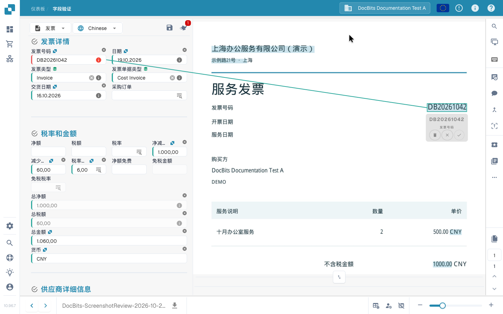

# 验证界面

## 以审核人员身份更正并保存发票

将发票原件与字段和三条行项目进行比较，更正发票号码，保存后重新加载以确认存储的值。录屏使用合成电子发票和普通审核账户。保存本次更正与提取训练、审批和导出是不同操作。



[观看带字幕的视频](https://docbits-videos.fra1.cdn.digitaloceanspaces.com/settings-assistant/invoice-validation-customer/v1/zh.html)

## 核对发票并完成审核

从仪表板打开发票，对照原始单据核对供应商、日期、发票号码、金额和币种，并查看必填字段提示。直接在原始单据上选择发票号码，确认字段对应，再通过 **Save Rules**（保存提取规则）保留这条提取规则。本示例随后将核对完成的发票提交审批。可执行的操作取决于你的权限和企业配置的流程。



## 打开并使用验证界面

从仪表板打开文档。在**字段验证**界面中，将可编辑字段与旁边的原始单据进行比较。显示哪些字段、表格和操作按钮，取决于文档类型及其布局配置。拖动分隔线可以为字段区或单据区留出更多空间。

多页文档使用页码控件翻页，小字可通过缩放查看。底部用于切换文档的箭头与单据翻页控件是不同的操作。

### 文件来源

核对日期和金额之前，先检查**文件来源**。它决定 DocBits 如何解释日期和数字格式，不会翻译单据，也不会改变界面语言。请选择与单据相符的来源，并对照原件核对显示的值。

更改来源会打开确认对话框。确认继续后，系统会重新处理文档。处理完成后，请再次核对新提取的值。

## 修正字段并让 DocBits 学习读取位置

如果发票号码读取错误：

1. 选择**发票号码**字段。
2. 在原始单据上双击完整号码，或框选包含号码的区域。
3. 检查建议的字段对应关系；如出现确认提示，点击勾号确认。
4. 核对字段值和单据上高亮的来源区域。如果号码不完整或对应了错误字段，请重新选择区域。
5. 保存文档。如需保留提取训练，还应点击**Save Rules**并确认对话框。

<figure><figcaption>
在原始单据上选中的发票号码及其字段对应关系。保存规则前请先确认该对应关系。
</figcaption></figure>


手动输入替换值只能修正当前文档，不会建立这种提取训练所需的单据区域对应关系。请在原件上选择值、确认字段对应并保存规则，以便在该供应商的匹配文档中复用。直接从电子发票结构化数据读取的文档不提供这种基于图像的训练。


## 保存、保存规则和继续处理

| 操作 | 作用 |
| --- | --- |
| **软盘图标（保存文档）**——位于字段上方 | 保存当前文档的修改；仅执行此操作不会批准或导出文档。 |
| **Save Rules** | 根据文档及其来源区域对应关系保存提取规则，与保存字段值是不同操作。 |
| **导出操作（示例按钮：Export）**、审批或其他已配置操作 | 在完成相关检查后，将文档交给配置的下一处理步骤。操作及最终状态取决于流程和你的权限。 |

视频中的流程会将核对完的发票提交审批。按钮标为 **Export**，并不代表发票已经成功进入目标 ERP 系统。请在仪表板检查新状态及可能出现的处理错误。

## 必填字段和验证提示

红色边框或警告图标提示某个字段需要关注。请阅读信息提示，确认是缺少必填值、需要复核提取结果，还是某项配置的检查未通过。字段中有值，并不能单独证明该字段有效。

对照原件核对供应商、发票号码、日期、金额和币种。涉及总额时，还要检查相关抬头字段和明细行。在继续处理前修正提示指出的原因。具体检查由文档类型和组织配置决定，参见[自动检查](automatic-checks-on-the-validation-screen.md)。

## 使用助手

字段上方的**助手**按钮显示尚未解决的验证问题。打开助手，点击**转到字段**检查相关字段。AI 问答和建议是否可用，取决于组织是否启用助手及你的权限。如不可用，请阅读面板中的说明。建议会修改表单；请核对后保存文档，才能保留更改。

## 通过查询选择主数据

配置了查询功能的字段可以搜索供应商、采购订单或其他主数据。打开字段的查询控件，筛选结果并选择正确记录。一次选择可能同时填入多个关联字段，请一并复核。这些值来自主数据，可能与单据上的印刷文字不同。参见[模糊数据](fuzzy-data.md)。

## 核对发票明细

如果布局包含表格，请对照原件检查各行、描述、数量、价格和金额。**提取表**与 **AI提取表**是不同的提取视图，是否显示取决于启用的提取方式和布局。某个标签页为空或未显示，本身不足以说明提取问题的原因。

使用可用的表格控件修正单元格、缺失行或重复行。这些修改针对当前文档。可复用的表格训练、AI 标签和抬头字段训练是不同操作。参见 [AI 表格标签](../ai-table/ai-table-tags.md)和[表格训练](../../../administration-and-setup/setup/document-training/training-line-fields-table-training/README.md)。

阅读有关必填列、行计算和总额的提示。应用新的 AI 提取或重新提取表格之前，请阅读确认对话框：已有的采购订单匹配关系可能需要移除并重新建立。

## 文档查看与协作工具

将鼠标悬停在工具图标上可查看名称。部分工具仅在特定模块、文档类型或权限下可用。

| 工具 | 用途 |
| --- | --- |
| **放大镜**和缩放 | 查看原件中的小字和细节。 |
| **在新窗口中打开图片** | 在独立窗口显示同一单据图像，例如放到另一个显示器上。界面将其标为 Chrome 功能。 |
| **键盘快捷键** | 打开快捷键帮助，参见[键盘快捷键](keyboard-shortcuts.md)。 |
| **任务** | 创建并跟踪分配给个人或小组的内部工作。 |
| **活动流** | 查看已记录的文档活动。 |
| **批准历史** | 在功能启用时查看批准和拒绝记录。 |
| **注释模式** | 在批注功能启用时为单据添加备注。 |
| **合并／添加页面** | 通过可用的合并对话框组合文档或补充缺页。确认前检查所选页面。 |
| **OCR视图** | 查看已经识别出的文字；打开此视图不会启动新的 OCR 提取。部分电子文档不提供此功能。 |
| **创建工单** | 准备带有文档上下文和问题描述的支持请求。内部任务与支持工单分别处理。 |
| **脚本日志** | 在脚本模块启用时查看文档脚本消息。这是日志查看器，不是脚本编辑器。 |

## 更多选项与管理员设置

对于发票，**更多选项 → 文档流**可打开处理流程。根据权限和配置，菜单还可能包含文档拆分、布局模板入口及供应商提取偏好。

**如果可用，请使用电子文本**、**使用结构化提取（人工智能）**和 **人工智能模型**是供应商提取设置，不是普通字段修正。只有获授权的管理员可以更改。若更改需要重新处理文档，请按照重启确认提示操作。布局模板配置的是验证表单，并不会修改发票的印刷版式。参见[供应商专用 AI 模型](supplier-specific-ai-model-for-field-and-table-extraction.md)。

## 无法编辑或继续时

请阅读显示的原因：文档可能被锁定、只读、处于其他处理状态，或受角色权限限制。先解决验证提示；涉及权限或配置时，联系负责同事或管理员。如错误仍存在，请查看[故障排除](troubleshooting/README.md)，或准备包含文档和完整错误消息的支持工单。
