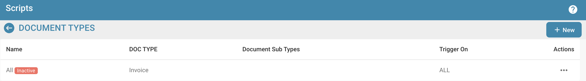
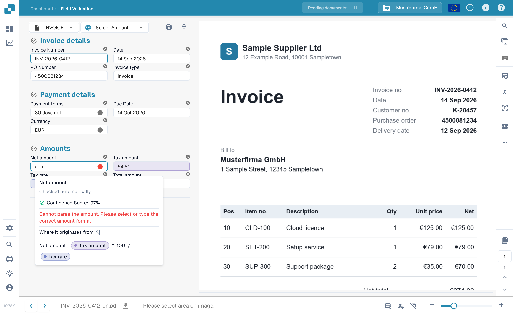
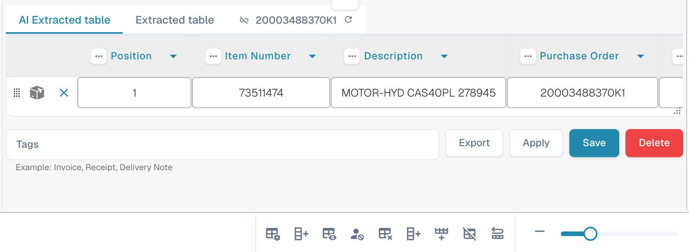
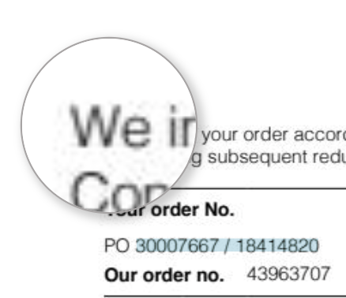
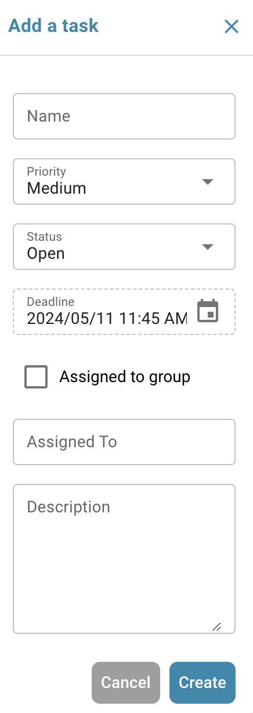
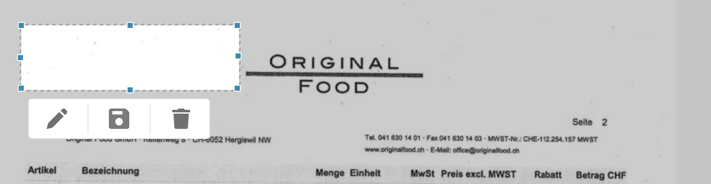
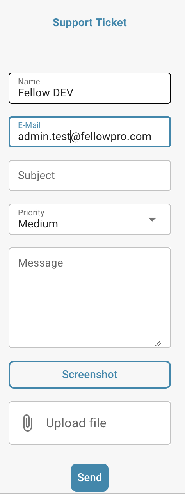
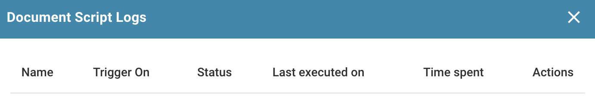

# 验证界面



## 概览

<figure><figcaption></figcaption></figure>

### 文档来源


DocBits 来源设置说明：日期和数字格式的国家/地区标准


## **保存按钮：**

<figure><figcaption></figcaption></figure>

* **保存按钮：**
  * **用途：**保存当前正在处理的文档或脚本状态。
  * **使用场景：**对文档进行修改或添加注释后，使用此按钮保存所有更改。

### **添加特殊规则：**

<figure><figcaption></figcaption></figure>

<figure><figcaption></figcaption></figure>

* **在 DocBits 中添加特殊规则 / 添加脚本：**
  * **用途：**允许用户实施特定规则或脚本，以自定义文档的处理方式。
  * **使用场景：**使用此功能可自动执行数据提取或格式验证等任务，提高工作流效率。


请参阅此处的[在 DocBits 中添加脚本](../../../administration-and-setup/settings/global-settings/document-types/script/scripting-in-docbits/)


### **模糊字段：**

<figure><figcaption></figcaption></figure>

* **模糊字段：**
  * **用途：**帮助识别并更正数据可能并非完全匹配、但足够接近的字段。
  * **使用场景：**适用于无法始终精确匹配的数据验证流程，例如姓名或地址有轻微拼写错误的情况。

### **必填字段：**

<figure><figcaption></figcaption></figure>

需要处理的字段会显示彩色边框或信息图标。在下方示例中，**发票编号**字段显示红色边框和警告图标。该值在右侧发票上清晰可见，但 DocBits 未能从文档中提取出来。请在文档上选中该编号或更正字段，然后保存文档。

将鼠标悬停在字段旁的信息图标上，或选中该图标，即可查看具体原因。根据字段的不同，消息可能表示缺少提取结果、缺少必填值、置信度较低或验证不匹配。如果警告与合计金额有关，请将金额字段与发票进行比较，并参阅[验证界面上的自动检查](automatic-checks-on-the-validation-screen.md)了解相关检查。

<figure><figcaption>
需要处理的字段，以及用于核对字段值的发票。
</figcaption></figure>

## 已提取的表格（行项目）

<figure><figcaption>
标题字段下方的已提取表格
</figcaption></figure>

在标题字段下方，DocBits 会显示文档的行项目表格，每个发票行对应一行，每列对应一种为该文档类型配置的[表格列](../../../administration-and-setup/settings/global-settings/document-types/table-columns/README.md)。如果某个文档类型有多个表格（例如物料和费用），每个表格都会在网格上方显示自己的选项卡。

### 表格的来源

网格上方会为组织已启用的每种提取方式显示一个选项卡：

| 选项卡 | 含义 |
|---|---|
| **已提取的表格** | 基于规则的提取（*表格提取*设置）。对于已训练表格的供应商，这些行来自已保存的规则，并且会以相同方式从该供应商的每份文档中提取；对于尚未训练的供应商，此选项卡可能为空。 |
| **AI 已提取的表格** | AI 表格提取（*AI 表格提取*设置）。当供应商没有已保存规则时，系统会填充此表格；即使存在规则，对标记为 *使用 AI* 的列也会填充此表格。选项卡上显示工具提示 *未找到 AI 表格*，表示 AI 未从此文档中返回任何内容。 |
| **PO 表格** | 仅在布局构建器中显示：用于匹配的采购订单行。 |

如果两个选项卡都没有显示，说明组织已关闭这两项表格设置（设置 → 文档处理 → 分类和提取）。读取表格的 AI 等级按组织设置，也可以按供应商覆盖；请参阅[供应商专属 AI 模型](supplier-specific-ai-model-for-field-and-table-extraction.md)。

### 在表格中操作

* **编辑单元格**：单击单元格并输入内容。输入时会验证金额、数字和日期列。
* **添加新表格行**：在末尾添加一个空行。未识别出某个行项目时可使用此操作。
* **删除行**：单击该行末尾的垃圾桶图标。
* **添加空白映射列**：显示 AI 留空的已配置列，供你手动填写。
* **恢复表格列**：恢复在此文档视图中移除的列。
* **删除表格**：清除此文档中此表格的所有行。此操作不会更改配置。
* **添加新表格列**（管理员）：打开与表格列设置中相同的对话框，无需离开文档。
* **标签**（仅限 AI 表格）：为 AI 提供简短的文本提示，例如 *“最后一列是净金额”*。请参阅[AI 表格标签](../ai-table/ai-table-tags.md)。
* **标签旁的应用 / 保存 / 删除**：*应用*会根据你所做的标签和列更改，为此文档重新运行 AI 表格提取，但不会保存任何内容（如果文档行已与 PO 匹配，DocBits 会警告匹配结果将被移除）；*保存规则*会为此供应商保存当前列映射和标签；*删除规则*会移除这些内容，并为此文档重新运行 AI 提取。
* **导出**：将表格下载为 CSV 文件。
* **转到表格提取视图**：打开此文档的表格训练。如果同一供应商的提取结果总是错误，可使用此功能：绘制一次表格，映射列，然后单击*保存规则*；之后，相应行就会显示在*已提取的表格*选项卡中。请参阅[训练行字段 / 表格训练](../../../administration-and-setup/setup/document-training/training-line-fields-table-training/README.md)。


如果表格由 AI 提取，而你打开了表格训练，DocBits 会询问 *表格已由 AI 提取。是否要手动训练？*保存规则后，此供应商将不再使用 AI 表格。


### 重新提取表格

* **同一文档，AI 表格**：添加或更改标签，然后单击**应用**；系统将仅为此文档重新生成 AI 表格。若要同时删除供应商已保存的标签和格式，请单击**删除**（*删除规则*）：DocBits 会确认 *规则已成功删除*，并重新运行 AI 提取。
* **同一文档，已训练规则**：打开*转到表格提取视图*，更正表格，然后单击*保存并重新提取*。
* **重新处理整个文档（标题和表格）**：转到控制面板 → 文档菜单 → *重新启动*。管理员更改表格列或提取设置后，需要执行此操作。

### 阻止审批的情况

保存或审批时会检查表格。红色单元格或表格下方的消息表示以下情况之一：

| 消息 | 原因 | 处理方法 |
|---|---|---|
| 必填列为空 | 标记为 *必填* 的列在此行中没有值。 | 填写单元格，或询问管理员此列是否必须设为必填。 |
| *行合计与数量 x 单价不匹配（预期 …，实际 …）* | `quantity × unit price + charges − discount` 与行合计的差值超过 0.02。通常是四个值中的一个被读入了错误的列。 | 更正文档中的错误值；如果 *费用* 等列始终填入了错误的值，请告知管理员（请参阅[故障排除](../../../administration-and-setup/settings/global-settings/document-types/table-columns/troubleshooting-1.md)）。 |
| *行项目合计为 …，但净金额为 …* | 行合计之和与标题中的净金额不一致。 | 检查是否缺少或重复了某一行，或标题金额是否读取错误。 |
| *行项目表缺少采购订单的必需列* | 采购订单匹配需要物料编号、单价、数量和总金额；其中一列已隐藏。 | 管理员：在“表格列”下取消隐藏该列。 |

管理员可以在文档类型的*更多设置*中启用*跳过表格验证*，以关闭该文档类型的所有表格检查；启用后将不再报告行不匹配和必填列为空的情况。

有关检查的更多信息：[验证界面上的自动检查](automatic-checks-on-the-validation-screen.md)和[表格提取故障排除](../../../overview-and-basics/faq/document-processing/table-extraction-troubleshoot.md)。

### **放大镜：**

<figure><figcaption></figcaption></figure>

* **放大镜（放大镜）：**
  * **用途：**放大文档中所选区域的视图。
  * **使用场景：**帮助查看文档中的细节或小号文字，确保数据录入或审核的准确性。

<figure><figcaption></figcaption></figure>

### **在新窗口中打开：**

<figure><figcaption></figcaption></figure>

* **在新窗口中打开：**
  * **用途：**打开新窗口，以便并排比较文档或同时处理多项任务。
  * **使用场景：**适用于比较两份文档，或在不离开当前文档的情况下参考其他信息。

### **键盘快捷键：**

<figure><figcaption></figcaption></figure>

1. **键盘快捷键：**
   * **用途：**允许用户通过键盘组合快速执行操作。
   * **使用场景：**减少对鼠标导航的依赖，加快文档导航和处理速度，提高工作效率。

### **任务：**

<figure><figcaption></figcaption></figure>

如需分享内部信息，你可以创建任务，并将其分配给公司内的特定员工或群组。

* **任务：**
  * **用途：**允许用户创建与文档相关的任务，并将其分配给团队成员。
  * **使用场景：**促进团队协作和任务管理，确保每个人都了解自己的职责。

<figure><figcaption></figcaption></figure>

### 审批历史记录

<figure><figcaption></figcaption></figure>

**注意：**必须先启用审批历史记录，才能在此处显示。

**审批历史记录：**

* **用途**：在字段验证中显示文档审批历史记录，红色表示已拒绝，应用颜色表示已批准。
* **使用场景**：适用于需要在字段验证过程中透明记录审批操作的组织。

<figure><figcaption></figcaption></figure>

### **批注模式：**

<figure><figcaption></figcaption></figure>

<figure><figcaption></figcaption></figure>


DocBits 批注模式教程：在验证界面添加备注，以及下载带批注或不带批注的文档


你可以在文档上留下批注，方便之后继续编辑该文档的其他用户查看相关信息。

* **批注模式：**
  * **用途：**允许用户直接在文档上留下备注或批注。
  * **使用场景：**适用于向之后处理该文档的其他团队成员提供反馈、说明或重要备注。

### **合并：**

<figure><figcaption></figcaption></figure>

你可以在此处合并文档。例如，如果发票缺少一页，可以通过此方式稍后将这些页面合并，无需删除或重新上传整个文档。

* **合并文档：**
  * **用途：**将多个文档合并为一个文件。
  * **使用场景：**适用于分别扫描文档的不同部分、随后需要将其合并的情况。

### **OCR 视图：**

<figure><figcaption></figcaption></figure>

在 OCR 视图中，系统会自动从文档中提取文本。此功能用于识别邮政编码、合同编号、发票编号等相关信息，并对文档进行排序。

* **OCR 视图：**
  * **用途：**使用光学字符识别技术自动识别文档中的文本。
  * **使用场景：**简化印刷或手写文本的数字化流程，使其可搜索和编辑。

<figure><figcaption>
OCR
</figcaption></figure>

### **创建工单：**

<figure><figcaption></figcaption></figure>

任务用于在公司内部传递信息，而此支持工单则用于通知我们，使你能够在发生错误和/或差异时立即创建工单。此功能让流程更加轻松，因为你可以立即附上相应文档来提交错误。你还可以设置优先级、截取文档屏幕截图或上传图片。

* **创建工单：**
  * **用途：**允许用户创建支持工单，报告问题或差异。
  * **使用场景：**对于快速解决问题和错误至关重要，有助于维护系统的完整性并确保其正常运行。

<figure><figcaption></figcaption></figure>

### **文档脚本日志：**

<figure><figcaption></figcaption></figure>

你可以在“文档类型”设置中创建脚本；相关信息随后会显示在此处。

* **文档脚本日志：**
  * **用途：**显示已为不同文档类型实施的脚本相关日志。
  * **使用场景：**适用于跟踪和调试文档上的脚本操作，帮助用户了解自动化流程并更正问题。

<figure><figcaption></figcaption></figure>

### **更多设置：**

<figure><figcaption></figcaption></figure>

### **文档流程：**

此处可以查看文档的流程。

* **用途：**显示文档在系统中的处理顺序和进度。
* **使用场景：**帮助跟踪文档在不同阶段的状态，确保完成所有必要的处理步骤。

### **转到布局模板：**

* 使用此选项可跳转到布局模板，以便编辑布局或使用默认模板。
* **转到布局模板：**
  * **用途：**将用户带到布局编辑器，可在其中修改现有模板或应用默认模板。
  * **使用场景：**可自定义文档布局以满足特定业务需求或偏好，让文档的外观和功能符合公司标准。

### 使用可用的电子文本

* **用途：**如果可用，则启用 DocBits 对特定供应商的所有文档使用电子文本，以提高提取准确性。
* **使用场景：**通过使用嵌入的文本而非 OCR 来增强文本提取，从而提高该供应商文档提取结果的准确性。

### [基于供应商的 AI 模型](supplier-specific-ai-model-for-field-and-table-extraction.md) 

* **用途：**允许在三种不同的 AI 模型之间进行选择，以优化特定供应商的提取结果。
* **使用场景：**通过为每个供应商的文档结构和内容选择最合适的 AI 模型，确保更高的提取准确性。
