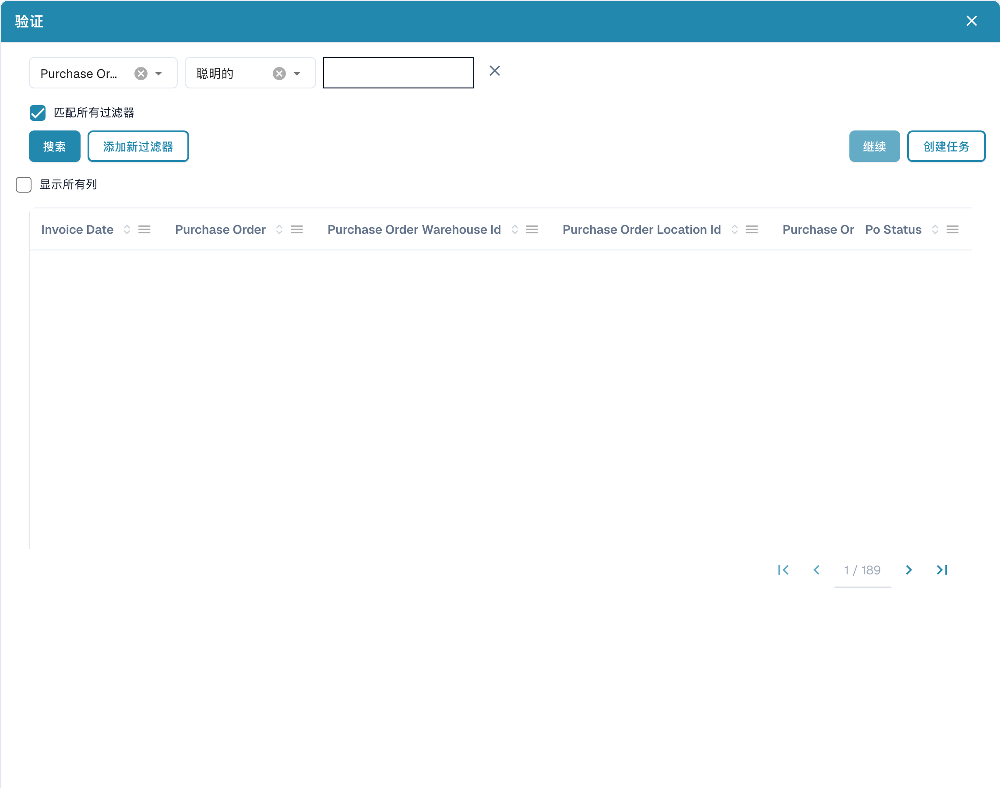

# 模糊数据

### **概述**

模糊数据字段允许用户根据主数据中的近似匹配结果填充相关字段。这些字段旁边会显示一个**蓝色图标**。

<figure><figcaption></figcaption></figure>

### **功能**

#### **模糊数据字段有什么作用？**

* 根据字段值或输入内容填充相关字段。
* 以下三个标准字段使用模糊数据：
  * **采购订单**
  * **供应商**
  * **供应商 ID**

#### **使用模糊数据字段**

1. **选择采购订单**
   *   单击采购订单字段旁边的**蓝色图标**，打开**选择窗口**。

       <figure><figcaption>
主数据查询窗口；记录已隐藏。 过滤方式“聪明的”指智能匹配；部分已配置的列名称仍为英文。
</figcaption></figure>
   * 此窗口中的表格包含主数据查询表中的所有采购订单。
   * 启用 **“Display all columns”（显示所有列）** 选项可查看其他详细信息。
   * 选择一个**采购订单**，然后单击 **Proceed（继续）**：
     * 如果系统在文档中找到采购订单，会自动筛选出该订单。
     * 如果未找到匹配项，可以**创建自定义筛选条件**，以查找正确的采购订单。
     * 可以添加多个筛选条件；启用 **“Match all filters”（匹配所有筛选条件）** 可确保必须满足所有条件。
     * 可用的筛选选项：
       * **Smart（智能）**
       * **Contains（包含）**
       * **Exact（精确）**
       * **Starts with（开头为）**
       * **Ends with（结尾为）**
   * **Proceed（继续）** 旁边的按钮允许用户**创建新任务/通知**。
2. **选择供应商或供应商 ID**
   * 操作过程与选择采购订单相同。
   * 不同之处在于，**供应商和供应商 ID 字段使用供应商主数据表**，而不是采购订单抬头主数据表。

#### **字段填充提示**

* 如果字段是通过模糊数据填充的，而非从文档中提取，系统会显示一个**小提示或信息图标**，表明该数据**并非从文档中提取**，而是根据主数据填充的。

### **管理员配置**


[使用主数据配置模糊数据](../../../administration-and-setup/setup/document-types/fuzzy-data-configuration-with-master-data.md)



[使用值列表配置模糊数据](../../../administration-and-setup/setup/document-types/fuzzy-data-configuration-with-list-of-values.md)



