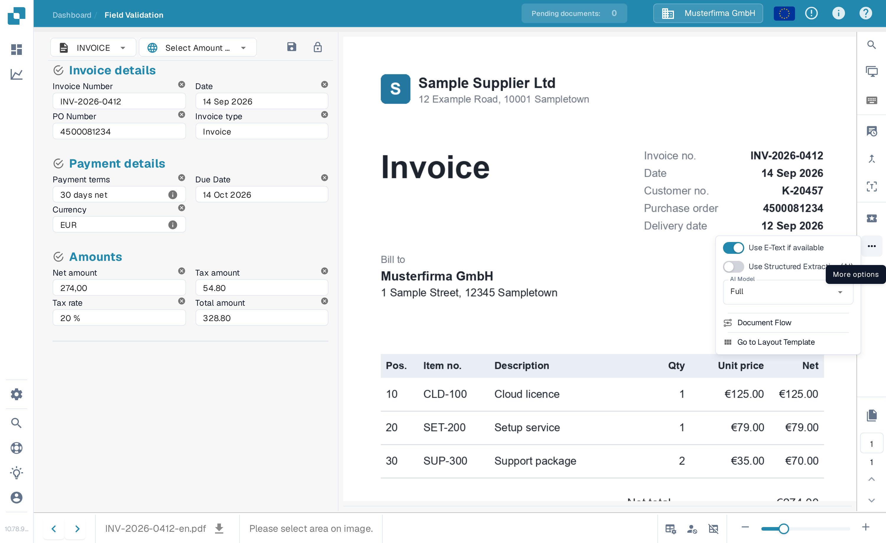
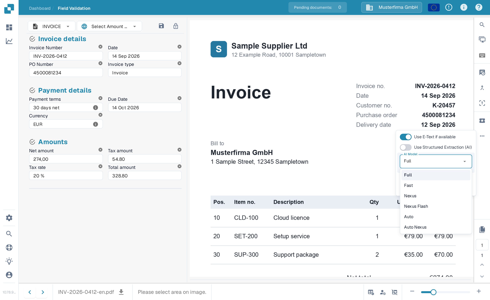

# 选择用于字段和表格提取的供应商专属 AI 模型

在 **Validation screen（验证界面）** 的工具区域中，您可以选择用于 **Field Extraction（字段提取）** 和 **Table Extraction（表格提取）** 的 AI 模型。\
所选 **AI model（AI 模型）** 仅应用于当前供应商的所有文档。

要更改模型，请点击屏幕右侧的 **More options（更多选项）**（三个点）按钮打开选项菜单，然后选择一个可用模型： 

* **Full** – 准确度最高；每份文档消耗 2 个令牌
* **Fast** – 默认级别；每份文档消耗 1 个令牌
* **Nexus** – 每份文档消耗 1 个令牌
* **Nexus Flash** – Nexus 系列中速度更快的级别；每份文档消耗 1 个令牌
* **Auto** – DocBits 会针对每份文档判断 Fast 是否足够，或是否需要 Full；每份文档消耗 1 个令牌
* **Auto Nexus** – 与 Auto 类似，但仅限于 Nexus 模型系列；每份文档消耗 1 个令牌

<figure><figcaption>
打开选项菜单，为此供应商选择 AI 模型。
</figcaption></figure>

<figure><figcaption>
AI Model 下拉菜单中的六个可用选项。
</figcaption></figure>

如果 **字段提取** 或 **表格提取** 的结果不理想，请尝试切换到其他模型以提高准确度。

如需为**未设置自定义模型的供应商全局配置 AI 模型**，或**管理每个供应商启用的模型**，请参阅相应文档[**此处**](../../../administration-and-setup/settings/document-processing/classification-and-extraction/ai-model.md)。
