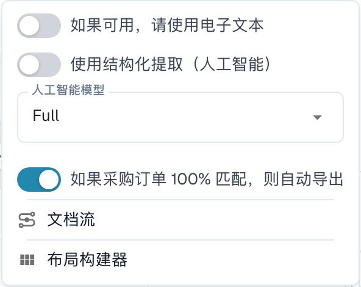
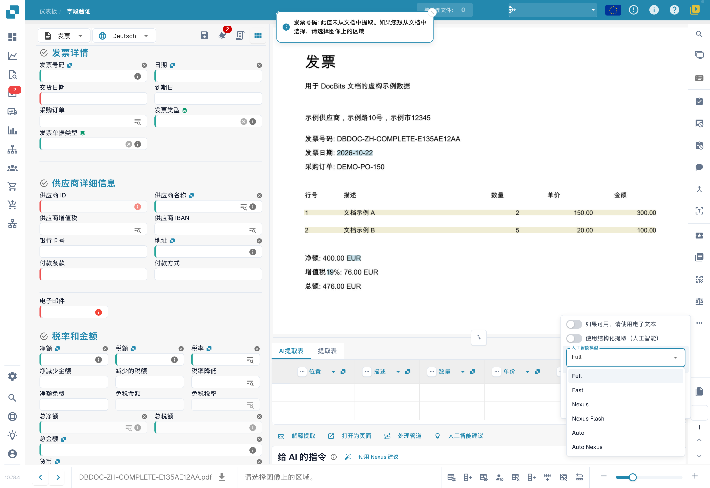

# 选择用于字段和表格提取的供应商专属 AI 模型

在 **Validation screen（验证界面）** 的工具区域中，您可以选择用于 **Field Extraction（字段提取）** 和 **Table Extraction（表格提取）** 的 AI 模型。\
该入口设置当前提取模板上下文的覆盖值，按组织及模板标识 `tfidf_id` 保存。供应商标识可作为关联信息，但这不保证同一供应商的所有模板、所有历史文档都被更改。没有覆盖值时，按组织全局设置回退。

要更改模型，请点击屏幕右侧的 **More options（更多选项）**（三个点）按钮打开选项菜单，然后选择一个可用模型： 

当前菜单提供 **Full、Fast、Nexus、Nexus Flash、Auto、Auto Nexus** 六个选项。正式名称按界面原样保留；实际费用、可用性与自动选择方式以当前菜单信息及订阅约定为准，不承诺某级别在所有文档上准确率最高或速度最快。

选择新模型后，可能需要在确认对话框中确认并重新开始提取。先核对文档和作用范围；展开菜单本身不会更改设置。本文未执行选择或确认，也未测试切换后的结果。

<figure><figcaption>
当前中文验证界面“更多选项”中的“供应商特定的 AI 模型”入口。示例为自有虚构中文发票，没有切换模型、重启提取或导出；测试文档在拍摄后已验证删除。
</figcaption></figure>

<figure><figcaption>
当前实际模型菜单提供 Full、Fast、Nexus、Nexus Flash、Auto、Auto Nexus 六个选项。只展开菜单，未选择或确认；截图显示的文档语言值属于识别/文档设置，不是界面的语言，当前界面已验证为中文。
</figcaption></figure>

如果字段或表格提取结果不理想，可在获准测试文档中比较其他模型，并逐项检查提取值、处理时间和费用。切换模型可能重新处理文档，且不保证改善结果。

如需为**未设置自定义模型的供应商全局配置 AI 模型**，或**管理每个供应商启用的模型**，请参阅相应文档[**此处**](../../../administration-and-setup/settings/document-processing/classification-and-extraction/ai-model.md)。
