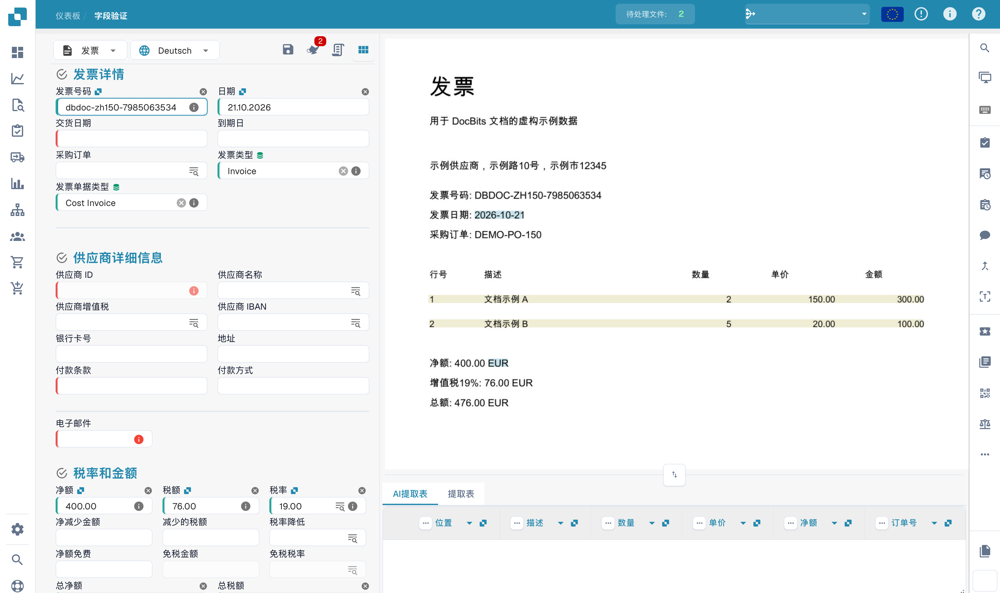
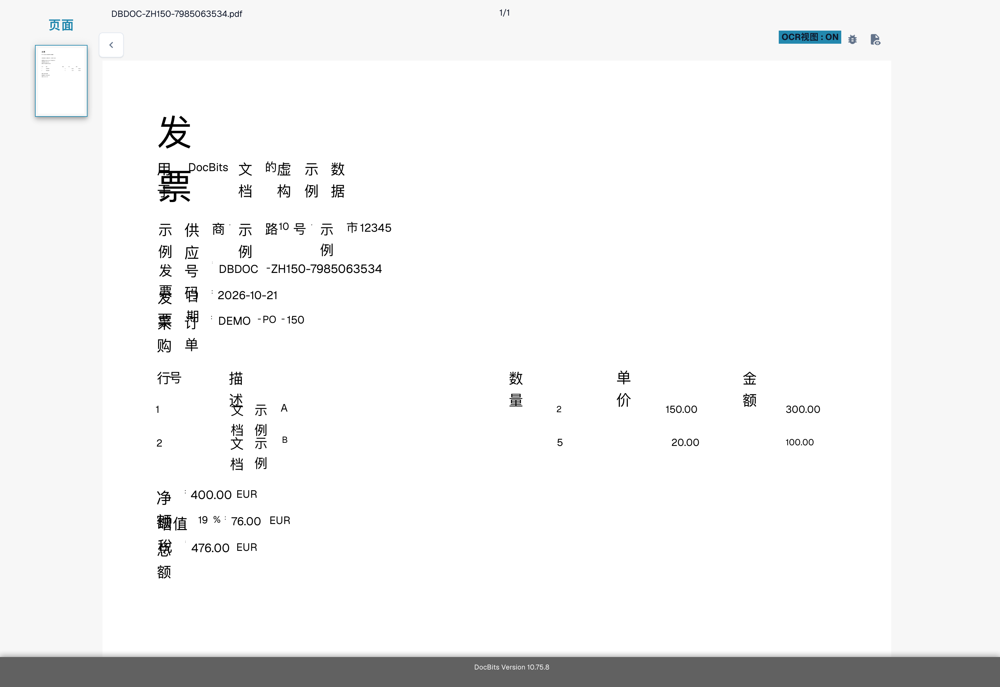
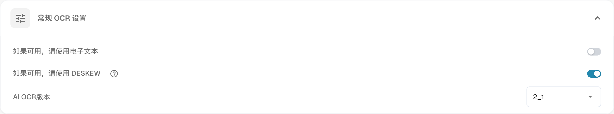

# OCR 提取中缺少文本

## **问题**

在某些情况下，**OCR 视图** 中可能会缺少文本，因此无法使用提取功能提取这些文本。

<figure><figcaption>
检查虚构发票的字段。
</figcaption></figure>

要确认这一点，请点击右侧工具栏中的 **OCR 视图** 按钮。如果其中没有显示该文本，就表示无法提取它。

<figure><figcaption>
虚构发票识别文本的 OCR 视图。 该视图展示识别文字的位置；当前界面中的部分中文会在窄框内逐字换行。原始 PDF 在验证页面中可以正常阅读。
</figcaption></figure>

## **原因**

最可能的原因是，您尝试提取的文本位于文档中的图像内（例如徽标或扫描的内容）。\
启用 E-Text 功能后，图像或徽标中的文本不会包含在提取的文本层中。因此，无法通过标准提取逻辑访问或提取这些文本。

## **解决方法**

要解决此问题，请禁用 E-Text 功能：可以针对[特定供应商](missing-text-in-ocr-extraction.md#disable-e-text-for-a-specific-supplier)禁用，也可以针对[整个组织](missing-text-in-ocr-extraction.md#disable-e-text-for-the-entire-organization)禁用。停用 E-Text 后，DocBits 将仅使用 OCR，从而能够从文档中的图像和徽标提取文本。

### **针对特定供应商禁用 E-Text** 

1. 在 **字段验证** 中打开一份来自该供应商的文档。
2.  点击右侧工具栏中的三点菜单。

    <figure><figcaption>
字段验证中的更多选项菜单。
</figcaption></figure>
3.  取消勾选 **如果可用，请使用电子文本**。

    <figure><figcaption>
文档菜单中的电子文本选项。
</figcaption></figure>
4.  点击 **确认**，重新启动该文档的处理。

    <figure><figcaption>
更改电子文本使用方式前的确认窗口。
</figcaption></figure>

### 针对整个组织禁用 E-Text 

1.  前往 **Settings → Document Processing → OCR Settings**。

    <figure><figcaption>
中文界面中的 OCR 设置。
</figcaption></figure>
2.  在 **常规 OCR 设置** 下，取消勾选 **如果可用，请使用电子文本** 选项。

    <figure><figcaption>
包含电子文本选项的常规 OCR 设置。
</figcaption></figure>

图片使用具有可用 OCR 文本的虚构发票。它们展示界面控件，并非复现文本缺失的故障。
