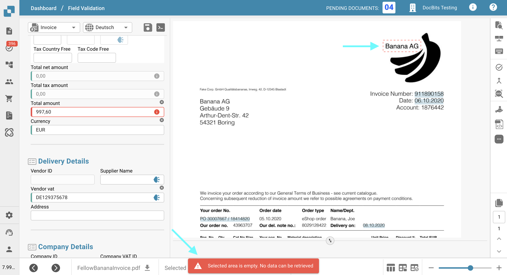
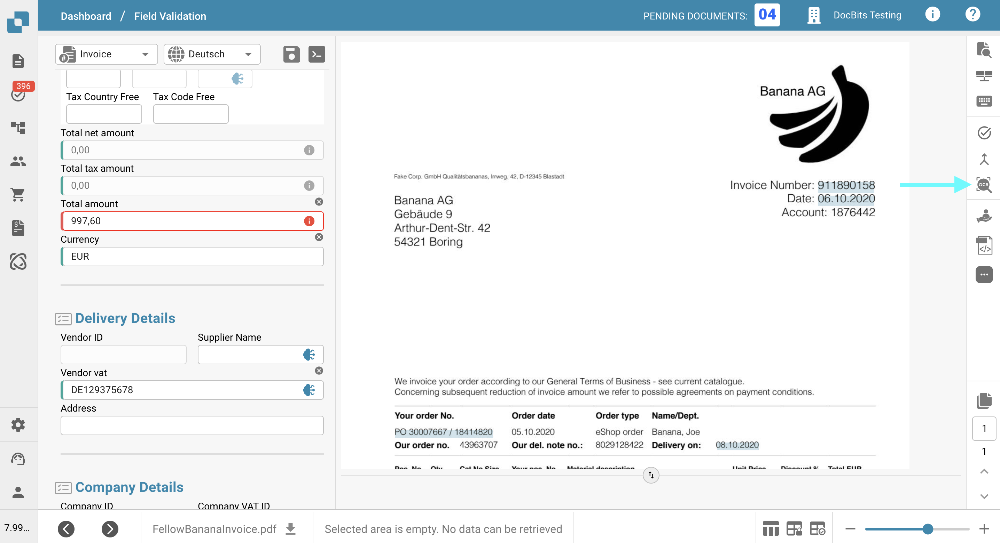
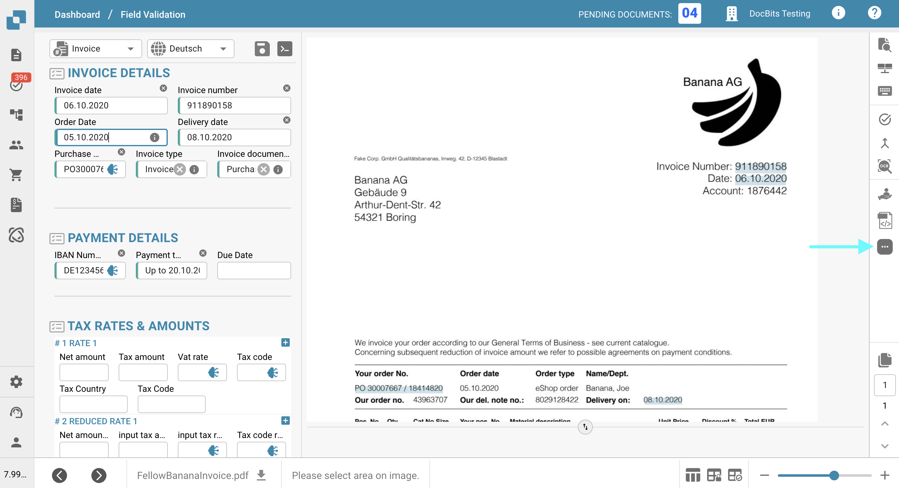
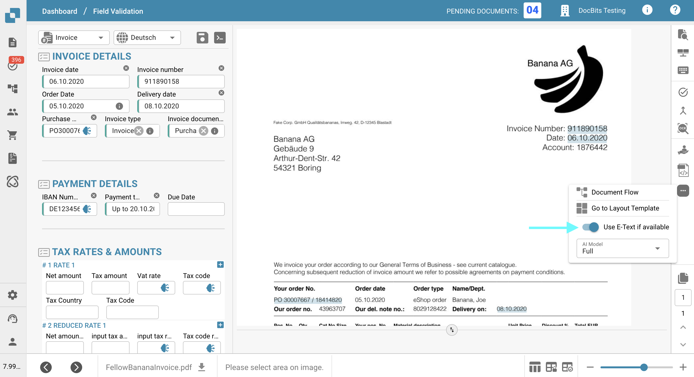
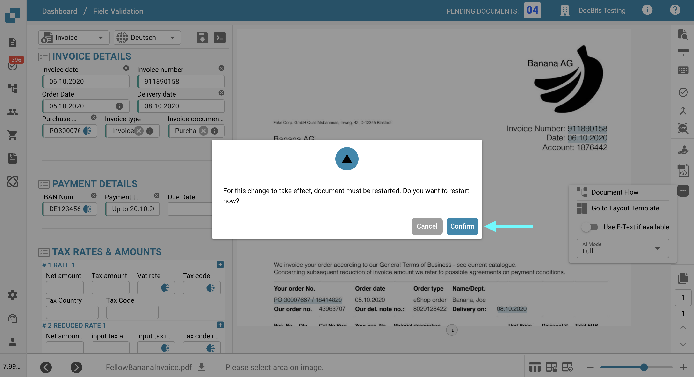
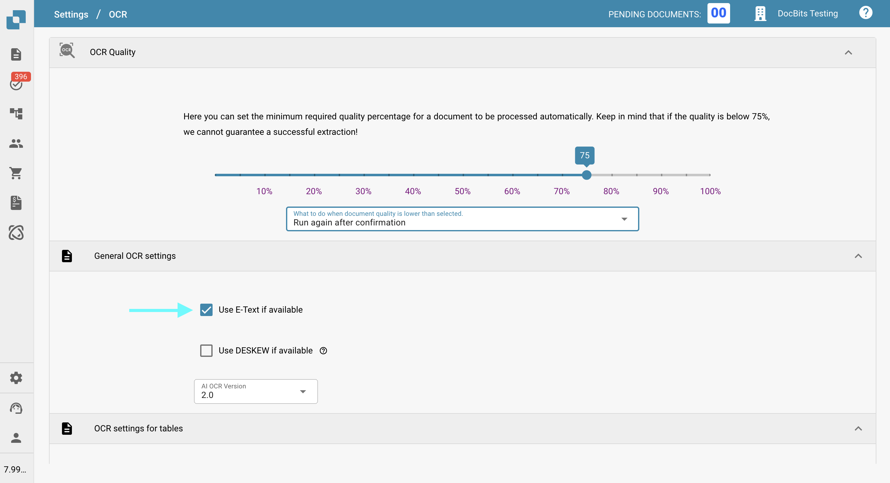

# OCR 提取中缺少文本

## **问题**

在某些情况下，**OCR View** 中可能会缺少文本，因此无法使用提取功能提取这些文本。

<figure><figcaption></figcaption></figure>

要确认这一点，请点击右侧工具栏中的 **OCR View** 按钮。如果其中没有显示该文本，就表示无法提取它。

<figure><figcaption></figcaption></figure>

## **原因**

最可能的原因是，您尝试提取的文本位于文档中的图像内（例如徽标或扫描的内容）。\
启用 E-Text 功能后，图像或徽标中的文本不会包含在提取的文本层中。因此，无法通过标准提取逻辑访问或提取这些文本。

## **解决方法**

要解决此问题，请禁用 E-Text 功能：可以针对[特定供应商](missing-text-in-ocr-extraction.md#disable-e-text-for-a-specific-supplier)禁用，也可以针对[整个组织](missing-text-in-ocr-extraction.md#disable-e-text-for-the-entire-organization)禁用。停用 E-Text 后，DocBits 将仅使用 OCR，从而能够从文档中的图像和徽标提取文本。

### **针对特定供应商禁用 E-Text** 

1. 在 **Field Validation** 中打开一份来自该供应商的文档。
2.  点击右侧工具栏中的三点菜单。

    <figure><figcaption></figcaption></figure>
3.  取消勾选 **Use E-Text if available**。

    <figure><figcaption></figcaption></figure>
4.  点击 **Confirm**，重新启动该文档的处理。

    <figure><figcaption></figcaption></figure>

### 针对整个组织禁用 E-Text 

1.  前往 **Settings → Document Processing → OCR Settings**。

    <figure><figcaption></figcaption></figure>
2.  在 **General OCR Settings** 下，取消勾选 **Use E-Text if available** 选项。

    <figure><figcaption></figcaption></figure>
