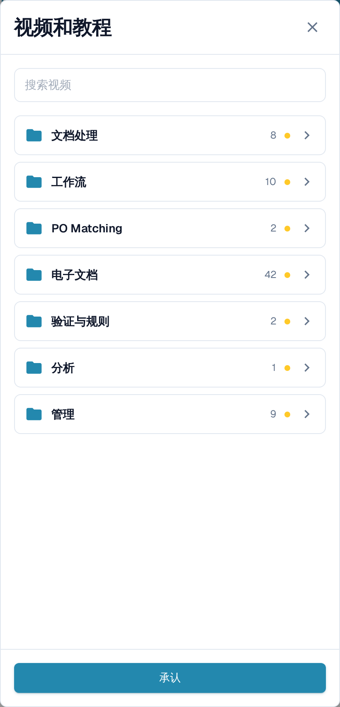
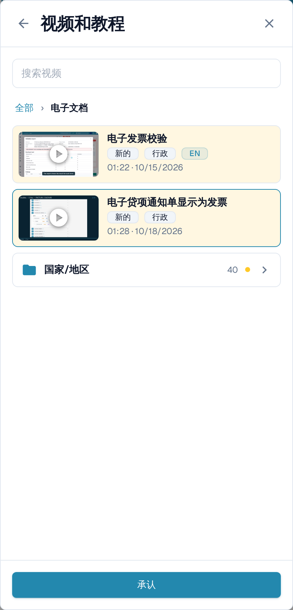
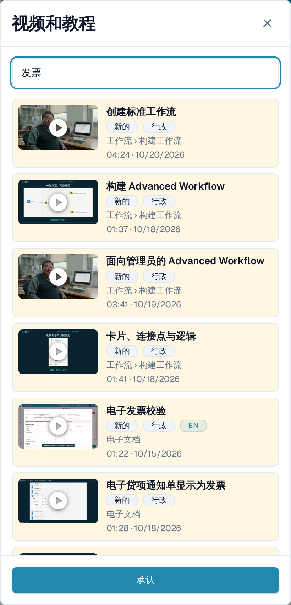

# 视频和教程

**视频和教程**可在您当前工作的页面上直接播放 DocBits 短视频，无需离开页面。视频按主题分组，便于您快速找到与手头任务相符的内容。

## 打开面板

视频图标位于顶部栏最右侧，在帮助图标之后。

<figure><figcaption>
视频图标是顶部栏中的最后一个图标。
</figcaption></figure>

* 只要还有视频未确认，图标就显示为**带小圆点的黄色**。
* 当您确认了全部视频后，图标会恢复为与顶部栏其他图标相同的颜色。

选择该图标，即可在右侧以面板形式打开**视频和教程**。

<figure><figcaption>
面板打开后显示主题列表。每个主题都是一个文件夹，并标明其中的视频数量。
</figcaption></figure>

## 浏览主题

面板打开后显示**主题文件夹**，例如**文档处理**、**工作流**、**电子文档**或**管理**。文件夹会显示其中包含的视频数量；只要其中仍有您尚未确认的视频，就会显示**新的**标记。

选择文件夹即可打开。其中包含该主题的视频；若主题内容较多，还会有进一步分组的文件夹，例如**电子文档**下的**国家/地区**。顶部的路径和返回箭头可返回上一层。从某个文件夹打开的视频，关闭后会回到该文件夹。

<figure><figcaption>
打开主题即可查看其中的视频和子文件夹。
</figcaption></figure>

## 搜索视频

在**搜索视频**中输入内容，即可一次检索所有主题。每条结果都会标明其所属文件夹，例如**工作流 › 构建工作流**，以便您了解视频的位置。搜索同样匹配主题和文件夹名称，并且不区分大小写和重音符号。

<figure><figcaption>
搜索覆盖所有主题，并显示每条结果所在的文件夹。
</figcaption></figure>

清空搜索框即可返回主题文件夹。

## 观看视频并确认

选择视频即可在面板中播放。标题和简短说明会告诉您该视频的内容。

<figure><figcaption>
在面板中播放视频，然后进行确认。
</figcaption></figure>

观看完视频后选择**承认**。这仅针对您的用户将其标记为已观看：该视频及其文件夹上的**新的**标记对您消失；当没有任何视频待确认时，顶部栏中的图标会变为灰色。其他用户仍会看到各自未确认的视频。

## 面向管理员和普通用户的视频

* 标有**行政**的视频面向管理员。管理员在面板中可以看到管理员视频和终端用户视频；终端用户只能看到终端用户视频。
* 如果某个视频没有您界面语言的版本，则会显示英文版本，并带有 **EN** 之类的语言代码。


屏幕截图取自 DocBits 测试组织，应用界面语言设置为中文。

