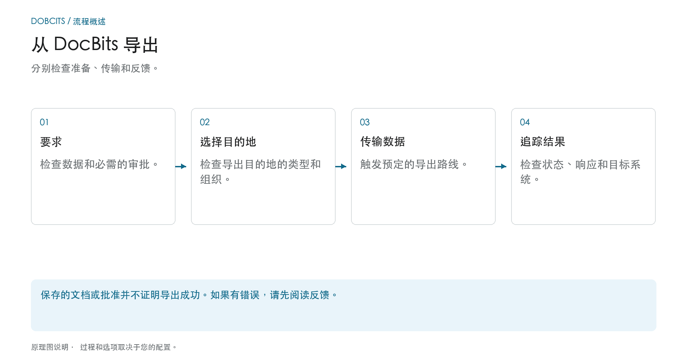

# 在 DocBits 中导出

## 从检查的文档到目标系统

<figure><figcaption>
分别检查准备、传输和反馈。 该图是示意性的；您组织的活动设置决定了实际行为。
</figcaption></figure>

导出时，DocBits 将文档和数据传输到已建立的连接。是否提供或自动触发导出取决于文档类型、状态、工作流程和导出配置。

1. **检查先决条件：** 查看流程所需的文档数据、未完成任务和批准。成功的 PO 匹配不会取代这些步骤。
2. **明确导出目的地：** 检查哪些配置适用于文档类型和组织或子组织。导出管理支持 Infor、Infor & IDM、Webhook 和 SFTP 等。实际交付范围取决于所设置的连接。
3. **触发传输：** 使用预期的文档操作或配置的工作流程。单独设置替代导出；其可用性状态不是导出后要设置的状态。
4. **检查反馈：** 检查文档状态和可用的收件人回复。对于端到端检查，您还可以检查目标系统中的关联进程。对于 Infor，进一步的处理步骤可以在 ION 和 ERP 中进行。

### 如果导出失败

再次导出之前打开错误详细信息。重复发送无法解决错误映射或收件人拒绝的问题。使用响应检查文档值、映射和目标配置，并检查目标系统中是否已创建交易。

### 进一步说明

- [导出模块](export-module.md)：管理入门。
- [导出配置](../../administration-and-setup/settings/document-processing/export/README.md)：连接和范围。
- [替代导出](alternate-export.md)：每个文档类型和状态的单独导出路径。
- [导出到 Infor](../exporting-to-infor/README.md)：下游Infor处理。

DocBits 中的文档导出指南。
