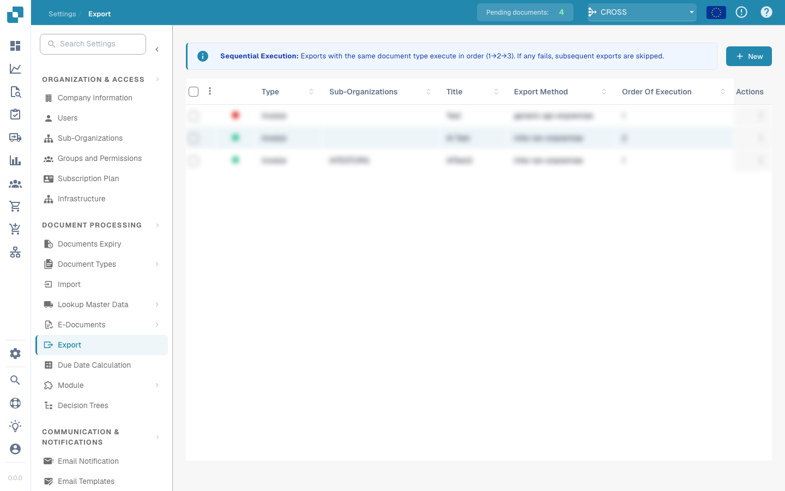

# 导出模块

## 概述

“导出”页面会显示所有已配置的导出设置，包括这些设置处于启用还是停用状态。在此页面中，用户可以：

* 查看和管理现有导出配置
* 创建新的导出连接（例如 **Infor**、**Infor & IDM**、**Webhook** 或 **SFTP**）
* 编辑或删除现有导出配置

## 查找位置

路径：**设置** → **文档处理** → **导出**

<figure><figcaption></figcaption></figure>

有关如何配置各类导出的详细说明，包括截图和字段描述，请参阅完整指南：

[查看导出配置指南](../../administration-and-setup/settings/document-processing/export/)
