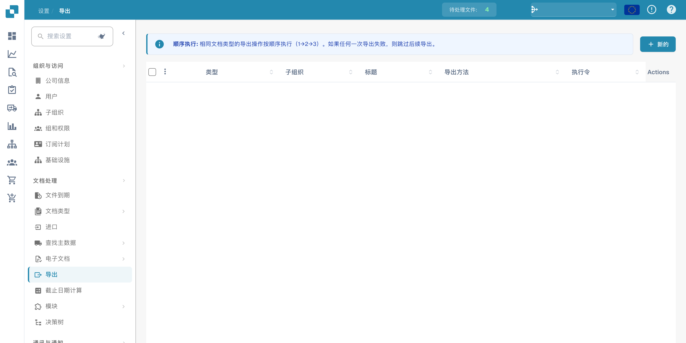
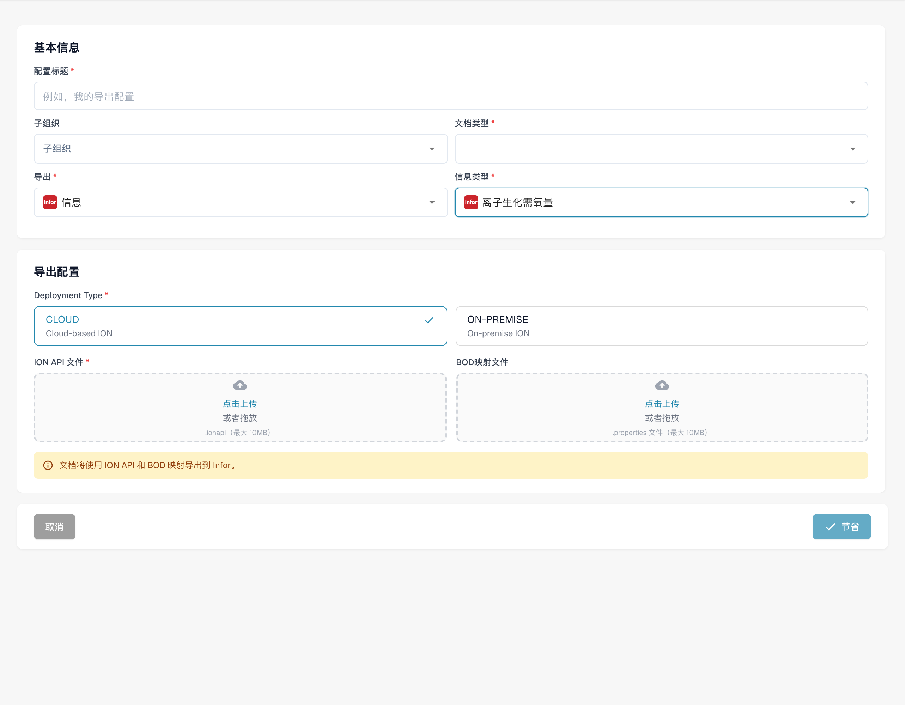

# 为 DocBits 导出创建 Infor ION API 端点

Infor 管理员会为**特定的 DocBits 环境和组织**配置 API Gateway 端点。本页的旧截图展示的是一个历史 Infor 租户、固定的 `api.docbits.com` 示例和旧版 DocBits Export 表单。请使用适用于实际环境的已批准目标 URL、API 密钥和 OpenAPI 文档。本次更新未连接任何 Infor 租户，也未保存端点。

## 开始之前

请向集成管理员获取目标 DocBits API URL、已批准的 API 密钥及其请求头名称、OpenAPI URL，以及计划使用的 Infor 和 DocBits 环境。请勿将密钥和 `.ionapi` 文件放入工单、截图或 Git 仓库。确认测试端点无法路由到生产环境。

## 配置 Infor API Gateway

1. 在 **Available APIs** 中，为目标环境创建一个 **Custom or Non-Infor** API 套件。请参阅 Infor 的 [API 套件说明](https://docs.infor.com/inforos/2025.x/en-us/useradminlib_cloud/apigatewayag_cloud/gyy1489512842881.html)。
2. 向套件添加一个端点，并填写已批准的 **Target Endpoint URL**。选择该端点所需的身份验证类型。对于 **API Key**，Infor 会要求填写 **Key Name** 和 **Key Value**；请使用 DocBits API 合约指定的名称，以及为此组织签发的密钥。请参阅 Infor 的[端点字段说明](https://docs.infor.com/inforos/2024.x/en-us/useradminlib_cloud/apigatewayag_cloud/bmg1489588707659.html)。请勿复制其他环境的密钥。
3. 按照 Infor 的[文档说明](https://docs.infor.com/ionapi/2021-x/en-us/ionapiag_cloud/tzr1489597424134.html)，在端点的 **Documentation** 设置下添加该环境的 OpenAPI/Swagger URL。请确认端点出现在 [API metadata](https://docs.infor.com/ionapi/latest/en-us/ionapiag_cloud/tdr1489674063627.html) 中。
4. 与 Infor 管理员一起，在将端点用于 ION 文档流之前，验证目标 URL、身份验证、代理路径，并执行安全的非生产调用。仅保存 API 套件并不能证明文档已送达。

## 在 DocBits 中配置导出

在目标 DocBits 组织中，打开 **Settings → Export**，然后选择 **New**。下方展示的英文 Sandbox Test A 组织没有已保存的配置。

<figure><figcaption>
中文导出配置列表；Actions 仍为英文，配置值已隐藏。
</figcaption></figure>

输入 **Configuration Title**，选择 **Document Type**，并仅在需要时选择 **Sub-Organization**。将 **Export** 设置为 **Infor**，并将 **Infor Type** 设置为 **Infor IDM + ION BOD**。当前表单随后会要求填写 **Deployment Type**（**CLOUD** 或 **ON-PREMISE**）、**ION API File**（`.ionapi`，必填）、**IDM Mapping File**（`.properties`）和 **BOD Mapping File**（`.properties`）。请向管理员获取这些特定于租户的文件。截图中有意将所有上传项留空。

<figure><figcaption>
Infor ION BOD 的中文导出草稿。“信息”和“离子生化需氧量”分别误译了品牌 Infor 和技术名称 ION BOD；部署方式仍为英文。本图未上传文件、保存或测试连接。
</figcaption></figure>

管理员验证 ION 路由后，保存配置并测试一份非生产文档。在 DocBits 和 Infor ION 中检查其状态。保存表单或 API metadata 条目并不能证明导出成功。
