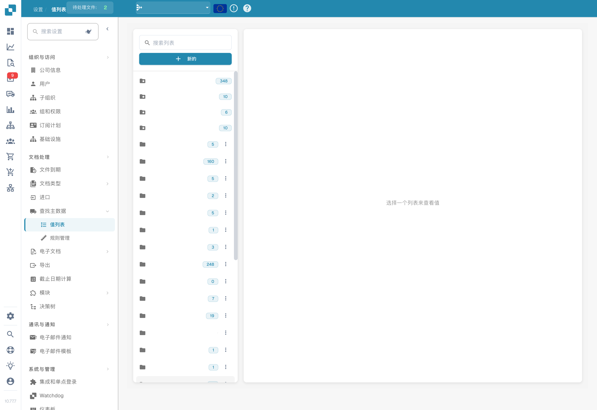
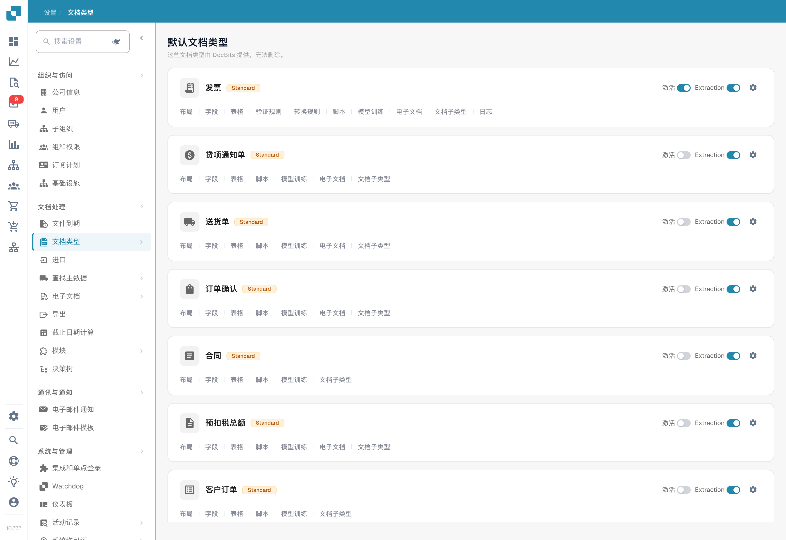
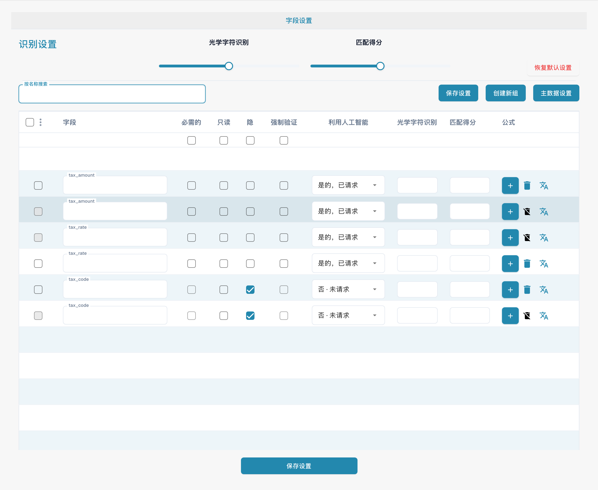
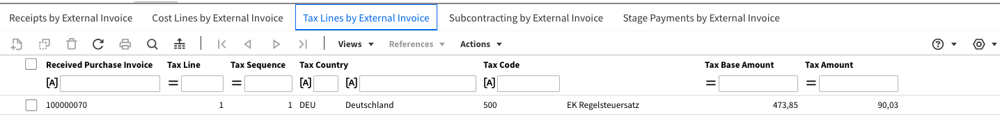

# 将税码导出到 LN

## **概述：**

\
本指南介绍税码、字段、布局和导出映射的配置示例。中文截图展示当前设置入口，没有在本次检查中创建这些税务配置或执行 LN 端到端导出。请在测试环境完成映射、金额及导出结果验证后再用于业务。

## **单个税码**

### **步骤 1：设置值列表**

1.  前往 **Settings** -> **Document Processing** -> **List of Values**。

    <figure><figcaption>
DocBits 值列表，已隐藏组织自定义列表的名称。
</figcaption></figure>
2.  点击 **New**。

    <!-- Obsolete illustration retired: Retire redundant obsolete English navigation/list/value illustration. Actual Chinese LOV, new-list, new-value and document-type views are already shown; complete list names, values and save steps remain. -->
3.  创建名为 `Tax_Country` 的列表，然后点击 **Save**。

    <figure><figcaption>
中文创建值列表空白表单；请按步骤使用 Tax_Country 等技术名称，并检查子组织范围。本图未创建税务列表。
</figcaption></figure>
4.  再创建以下三个列表：

    * `Tax_Code_Full`
    * `Tax_Code_Reduced`
    * `Tax_Code_Free`

    
<!-- Obsolete illustration retired: Retire redundant obsolete English navigation/list/value illustration. Actual Chinese LOV, new-list, new-value and document-type views are already shown; complete list names, values and save steps remain. --> <!-- Obsolete illustration retired: Retire redundant obsolete English navigation/list/value illustration. Actual Chinese LOV, new-list, new-value and document-type views are already shown; complete list names, values and save steps remain. --> <!-- Obsolete illustration retired: Retire redundant obsolete English navigation/list/value illustration. Actual Chinese LOV, new-list, new-value and document-type views are already shown; complete list names, values and save steps remain. -->

5.  点击其中一个新建的列表以打开它。然后点击 **Add Row** 按钮添加新行。

    <!-- Obsolete illustration retired: Retire redundant obsolete English navigation/list/value illustration. Actual Chinese LOV, new-list, new-value and document-type views are already shown; complete list names, values and save steps remain. -->
6.  输入 LN 中相应的所需值，然后点击 **Save** 保存更改。

    * 如果有多个值，可以点击 **Add More Values** 添加。

    
<!-- Obsolete illustration retired: Retire redundant obsolete English navigation/list/value illustration. Actual Chinese LOV, new-list, new-value and document-type views are already shown; complete list names, values and save steps remain. --> <figure><figcaption>
新建值的表单，包含子组织、同义词和翻译；未输入或保存数据。语言选项用于该值的翻译。
</figcaption></figure>

    * **注意：**您可以在 LN 中通过以下路径找到税码：**Common** → **Taxation** → **Master Data** → **Tax Codes** → **Tax Codes by Country**

    <figure><figcaption>
外部 Infor LN 税码配置示例，界面为英文，部分配置说明为德文；保留原始代码和示例值。此图不是中文 DocBits 界面，也不是现行税务规则或推荐配置。
</figcaption></figure>

### **步骤 2：在 DocBits 中添加字段**

1.  前往 **Settings** -> **Global Settings** -> **Document Types**。

    <figure><figcaption>
中文文档类型页面；Standard 和 Extraction 仍为英文。文档类型激活与提取模式属于独立配置。
</figcaption></figure>
2.  在要添加字段的文档类型对应的菜单中选择 **Fields**。

    <!-- Obsolete illustration retired: Retire redundant obsolete English navigation/list/value illustration. Actual Chinese LOV, new-list, new-value and document-type views are already shown; complete list names, values and save steps remain. -->
3.  在相应税额字段组（示例名称为 **VAT & Amounts**）中，按下表配置六个字段。技术名称和值列表标识必须保持一致：

    <figure><figcaption>
当前中文发票字段设置，按 tax 筛选后显示已有标准税额、税率和税码字段标识；此图是字段设置入口，不是下表六个自定义字段已创建的证明。
</figcaption></figure>

<table data-header-hidden><thead><tr><th width="306"></th><th width="139"></th><th width="119"></th><th></th></tr></thead><tbody><tr><td><strong>名称</strong></td><td><strong>标题</strong></td><td><strong>字段类型</strong></td><td><strong>值列表</strong></td></tr><tr><td><code>tax_country</code></td><td>税务国家/地区</td><td>下拉列表</td><td>Tax_Country</td></tr><tr><td><code>tax_country_2</code></td><td>税务国家/地区（减免）</td><td>下拉列表</td><td>Tax_Country</td></tr><tr><td><code>tax_country_3</code></td><td>免税国家/地区</td><td>下拉列表</td><td>Tax_Country</td></tr><tr><td><code>tax_code_without_country</code></td><td>税码</td><td>下拉列表</td><td>Tax_Code_Full</td></tr><tr><td><code>tax_code_without_country_2</code></td><td>减免税码</td><td>下拉列表</td><td>Tax_Code_Reduced</td></tr><tr><td><code>tax_code_without_country_3</code></td><td>免税税码</td><td>下拉列表</td><td>Tax_Code_Free</td></tr></tbody></table>

<!-- Obsolete illustration retired: Retire repeated obsolete English field-detail form. Both complete tables preserve all six exact field IDs, Chinese titles, dropdown types and LOV identifiers; native field-settings context is shown separately. --> <!-- Obsolete illustration retired: Retire repeated obsolete English field-detail form. Both complete tables preserve all six exact field IDs, Chinese titles, dropdown types and LOV identifiers; native field-settings context is shown separately. --> <!-- Obsolete illustration retired: Retire repeated obsolete English field-detail form. Both complete tables preserve all six exact field IDs, Chinese titles, dropdown types and LOV identifiers; native field-settings context is shown separately. -->

<!-- Obsolete illustration retired: Retire repeated obsolete English field-detail form. Both complete tables preserve all six exact field IDs, Chinese titles, dropdown types and LOV identifiers; native field-settings context is shown separately. --> <!-- Obsolete illustration retired: Retire repeated obsolete English field-detail form. Both complete tables preserve all six exact field IDs, Chinese titles, dropdown types and LOV identifiers; native field-settings context is shown separately. --> <!-- Obsolete illustration retired: Retire repeated obsolete English field-detail form. Both complete tables preserve all six exact field IDs, Chinese titles, dropdown types and LOV identifiers; native field-settings context is shown separately. -->

4.  保存每个字段后，点击 **Save Settings** 应用更改。

### **步骤 3：编辑布局**

1.  前往 **Settings** -> **Global Settings** -> **Document Types**。

    <figure><figcaption>
中文文档类型页面；Standard 和 Extraction 仍为英文。文档类型激活与提取模式属于独立配置。
</figcaption></figure>
2.  打开要编辑的文档类型对应的 **Edit Layout** 菜单。

    <figure><figcaption>
中文布局编辑器示例，用于说明分组、字段和布局编辑入口。已有测试布局名称保留原文；本图没有配置本指南的 Tax_Country 字段、重复税务分组或 LN 导出结果。
</figcaption></figure>
3.  选择要应用税码的 **Document Origin**。

4.  向下滚动到 **Tax Details** 部分。

5. 展开 **Form Elements** 下拉菜单。
6.  在 **Tax Details** 部分使用 **Horizontal Separator Tool**。将其拖放到税务部分的子部分之间，以便清楚地分隔各部分并减少混淆。

7. 展开 **Form Fields** 下拉菜单。
8.  搜索 **Tax Country**，然后将该字段拖放到相应区域。

9.  搜索 **Tax Code**，然后将该字段拖放到对应区域。

10. 保存模板。

### 步骤 4：验证配置是否生效

在 DocBits 中上传新文档并选择正确的文档设置后，您现在应该可以选择在步骤 1 的列表中添加的税码。

<!-- Obsolete illustration retired: Retire obsolete English configured-validation result illustration. Preserve the full verification procedure and technical field/mapping details; no current repeated tax group or successful LN export is claimed. -->

## 多个税码

### **步骤 1：设置值列表**

1.  前往 **Settings** -> **Document Processing** -> **List of Values**。

    <figure><figcaption>
DocBits 值列表，已隐藏组织自定义列表的名称。
</figcaption></figure>
2.  点击 **New**。

    <!-- Obsolete illustration retired: Retire redundant obsolete English navigation/list/value illustration. Actual Chinese LOV, new-list, new-value and document-type views are already shown; complete list names, values and save steps remain. -->
3.  创建名为 `Tax_Country` 的列表，然后点击 **Save**。

4.  再创建以下三个列表：

    * `Tax_Code_Full`
    * `Tax_Code_Reduced`
    * `Tax_Code_Free`

    
<!-- Obsolete illustration retired: Retire redundant obsolete English navigation/list/value illustration. Actual Chinese LOV, new-list, new-value and document-type views are already shown; complete list names, values and save steps remain. --> <!-- Obsolete illustration retired: Retire redundant obsolete English navigation/list/value illustration. Actual Chinese LOV, new-list, new-value and document-type views are already shown; complete list names, values and save steps remain. --> <!-- Obsolete illustration retired: Retire redundant obsolete English navigation/list/value illustration. Actual Chinese LOV, new-list, new-value and document-type views are already shown; complete list names, values and save steps remain. -->

5.  点击其中一个新建的列表以打开它。然后点击 **Add Row** 按钮添加新行。

    <!-- Obsolete illustration retired: Retire redundant obsolete English navigation/list/value illustration. Actual Chinese LOV, new-list, new-value and document-type views are already shown; complete list names, values and save steps remain. -->
6.  输入 LN 中相应的所需值，然后点击 **Save** 保存更改。

    * 如果有多个值，可以点击 **Add More Values** 添加。

    
<!-- Obsolete illustration retired: Retire redundant obsolete English navigation/list/value illustration. Actual Chinese LOV, new-list, new-value and document-type views are already shown; complete list names, values and save steps remain. --> <figure><figcaption>
新建值的表单，包含子组织、同义词和翻译；未输入或保存数据。语言选项用于该值的翻译。
</figcaption></figure>

    * **注意：**您可以在 LN 中通过以下路径找到税码：**Common** → **Taxation** → **Master Data** → **Tax Codes** → **Tax Codes by Country**

    <figure><figcaption>
外部 Infor LN 税码配置示例，界面为英文，部分配置说明为德文；保留原始代码和示例值。此图不是中文 DocBits 界面，也不是现行税务规则或推荐配置。
</figcaption></figure>

### **步骤 2：在 DocBits 中添加字段**

1.  前往 **Settings** -> **Global Settings** -> **Document Types**。

    <figure><figcaption>
中文文档类型页面；Standard 和 Extraction 仍为英文。文档类型激活与提取模式属于独立配置。
</figcaption></figure>
2.  在要添加字段的文档类型对应的菜单中选择 **Fields**。

    <!-- Obsolete illustration retired: Retire redundant obsolete English navigation/list/value illustration. Actual Chinese LOV, new-list, new-value and document-type views are already shown; complete list names, values and save steps remain. -->
3.  在相应税额字段组（示例名称为 **VAT & Amounts**）中，按下表配置六个字段。技术名称和值列表标识必须保持一致：

<table data-header-hidden><thead><tr><th width="306"></th><th width="139"></th><th width="119"></th><th></th></tr></thead><tbody><tr><td><strong>名称</strong></td><td><strong>标题</strong></td><td><strong>字段类型</strong></td><td><strong>值</strong></td></tr><tr><td><code>tax_country</code></td><td>税务国家/地区</td><td>下拉列表</td><td>Tax_Country</td></tr><tr><td><code>tax_country_2</code></td><td>税务国家/地区（减免）</td><td>下拉列表</td><td>Tax_Country</td></tr><tr><td><code>tax_country_3</code></td><td>免税国家/地区</td><td>下拉列表</td><td>Tax_Country</td></tr><tr><td><code>tax_code_without_country</code></td><td>税码</td><td>下拉列表</td><td>Tax_Code_Full</td></tr><tr><td><code>tax_code_without_country_2</code></td><td>减免税码</td><td>下拉列表</td><td>Tax_Code_Reduced</td></tr><tr><td><code>tax_code_without_country_3</code></td><td>免税税码</td><td>下拉列表</td><td>Tax_Code_Free</td></tr></tbody></table>

<!-- Obsolete illustration retired: Retire repeated obsolete English field-detail form. Both complete tables preserve all six exact field IDs, Chinese titles, dropdown types and LOV identifiers; native field-settings context is shown separately. --> <!-- Obsolete illustration retired: Retire repeated obsolete English field-detail form. Both complete tables preserve all six exact field IDs, Chinese titles, dropdown types and LOV identifiers; native field-settings context is shown separately. --> <!-- Obsolete illustration retired: Retire repeated obsolete English field-detail form. Both complete tables preserve all six exact field IDs, Chinese titles, dropdown types and LOV identifiers; native field-settings context is shown separately. -->

<!-- Obsolete illustration retired: Retire repeated obsolete English field-detail form. Both complete tables preserve all six exact field IDs, Chinese titles, dropdown types and LOV identifiers; native field-settings context is shown separately. --> <!-- Obsolete illustration retired: Retire repeated obsolete English field-detail form. Both complete tables preserve all six exact field IDs, Chinese titles, dropdown types and LOV identifiers; native field-settings context is shown separately. --> <!-- Obsolete illustration retired: Retire repeated obsolete English field-detail form. Both complete tables preserve all six exact field IDs, Chinese titles, dropdown types and LOV identifiers; native field-settings context is shown separately. -->

4.  保存每个字段后，点击 **Save Settings** 应用更改。

### **步骤 3：编辑布局**

1.  前往 **Settings** -> **Global Settings** -> **Document Types**。

    <figure><figcaption>
中文文档类型页面；Standard 和 Extraction 仍为英文。文档类型激活与提取模式属于独立配置。
</figcaption></figure>
2.  打开要编辑的文档类型对应的 **Edit Layout** 菜单。

3.  选择要应用税码的 **Document Origin**。

4.  向下滚动到 **Tax Details** 部分。

5. 展开 **Form Elements** 下拉菜单。
6.  在 **Tax Details** 部分使用 **Sub Group** 工具。将其拖放到现有字段旁边。

7.  要为子组命名，请点击该子组，并在 **Label** 字段中输入所需名称。

    
 

8.  将与此组对应的字段拖放到 **Sub Group** 字段中。

9. 展开 **Fields** 下拉菜单。
10. 搜索 **Tax**，然后将相应字段（例如 **Tax Country** 和 **Tax Code**）拖放到对应的子组中。

11. 将步骤 5 到 10 重复两次，直到达到以下状态：

12. 保存模板。

### 步骤 4：验证配置是否生效以及结果变化

在 DocBits 中上传新文档并选择正确的文档设置后，您可以选择在步骤 1 中添加的税码，并添加在步骤 3 中配置的多个税码。

* 文档将显示三个不同的部分：分别用于完整税额、减免税额和免税额。
* 点击某个部分中的加号按钮会创建副本，以便按选定的税率添加多笔申报。

<!-- Obsolete illustration retired: Retire obsolete English configured-validation result illustration. Preserve the full verification procedure and technical field/mapping details; no current repeated tax group or successful LN export is claimed. -->

* 点击移除按钮即可删除部分。

<!-- Obsolete illustration retired: Retire obsolete English configured-validation result illustration. Preserve the full verification procedure and technical field/mapping details; no current repeated tax group or successful LN export is claimed. -->

* 根据实际金额公式汇总所有税务分组，并验证总金额与明细是否一致；添加布局分组本身不证明金额已正确汇总。
* 检查总金额校验是否覆盖全部税务分组，并测试一组、多个组、空值及不同税码的情况。
* 如果脚本依赖重复分组中的字段，请确认字段位于正确的布局上下文，并测试脚本对各组的读取与写入；不要仅凭字段可见就认定脚本适用。

### LN 说明：

在此 LN 映射示例中，税行位置由配置的税码／税务国家字段和位置编号关联。实际发送内容取决于导出映射，不能把“只发送位置编号”当作所有导出的通用行为；请检查生成的负载及 LN 中的成本行和税行。

<figure><figcaption>
外部 Infor LN“Cost Lines by External Invoice”示例，展示成本行、科目、金额和维度。英文表头及示例编号保持原样；不表示已完成本次端到端导出测试。
</figcaption></figure>

<figure><figcaption>
外部 Infor LN“Tax Lines by External Invoice”示例，展示税行位置、税务国家和税码等列。英文界面及德文配置值保留原文；不表示当前税务配置或本次导出验证结果。
</figcaption></figure>

#### **导出映射**

要将税行关联到成本行：

1. 将 `TaxLine` 添加到 **InvoiceCostFields** 列表。
2. 按照以下示例添加条目：\
   `ICF_TaxLine = TF_position`

<figure><figcaption>
导出映射代码片段：InvoiceCostFields 包含 TaxLine，ICF_TaxLine 映射到 TF_position。技术字段名必须保持原文；请按实际导出配置验证映射。
</figcaption></figure>
