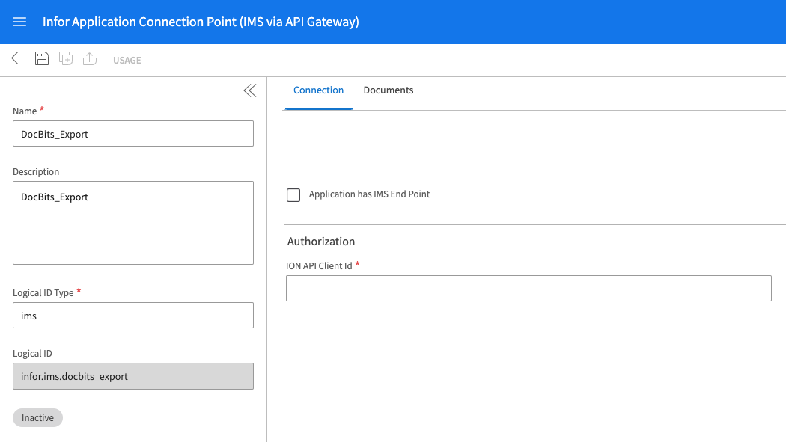
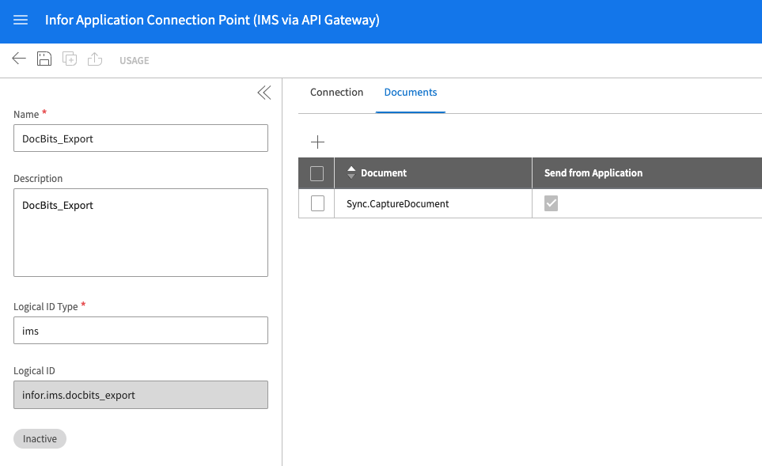
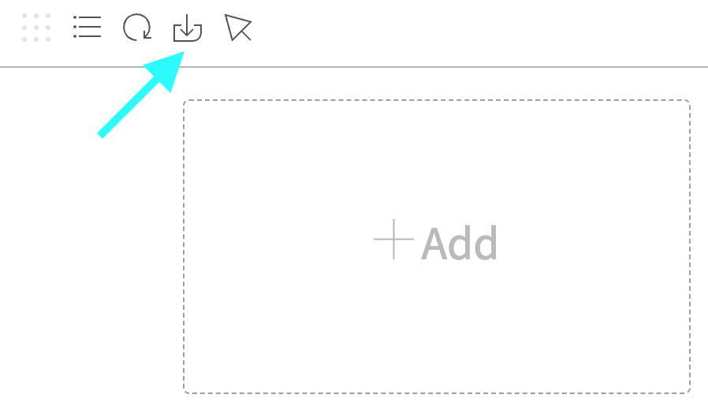
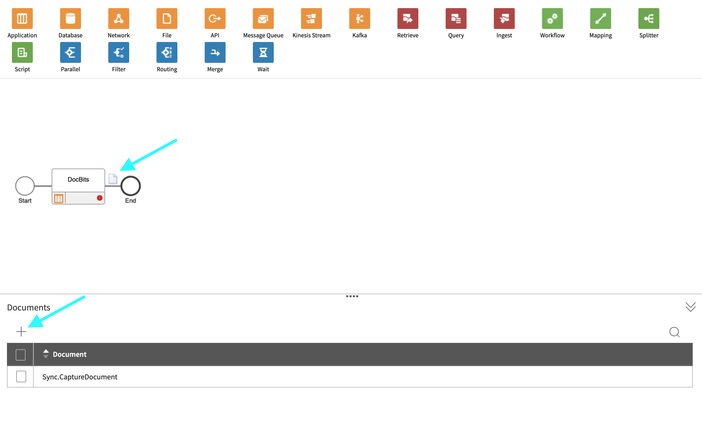
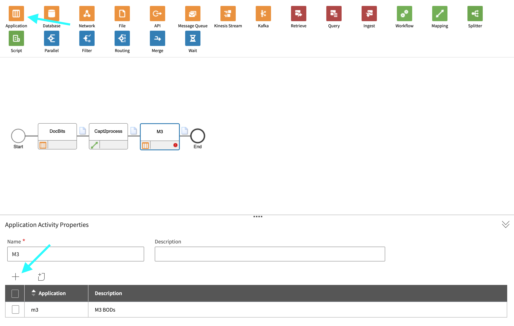
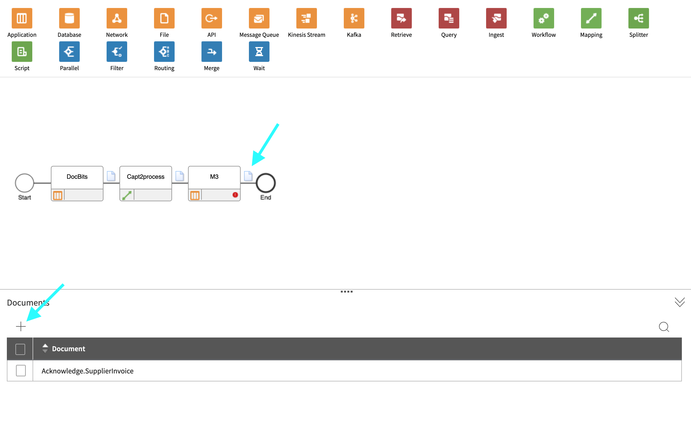
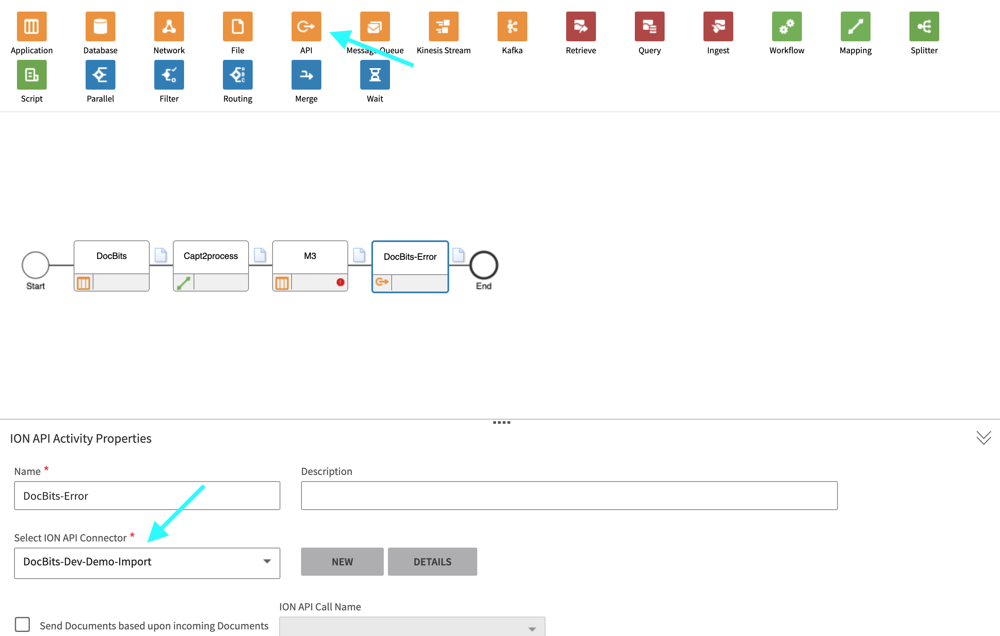
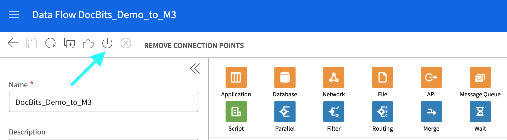

# M3

本页展示 **DocBits → ION → M3** 的集成示例。Infor 屏幕为历史英文技术界面，连接点、数据流、映射和应用名称都是示例名称，不能照搬为当前租户配置。先确认目标环境、文档契约、凭据及权限；本次没有连接 Infor 租户或执行端到端导出。

## 第 1 步：创建连接点

1. 导航至 **OS > ION > Connect > Connection Points**
2. 点击 **Add**，然后选择 **IMS via API Gateway** 作为连接类型。
3. 配置以下设置：
   * **Name**：设置为 `DocBits_Export`。
   * **Description**：设置为 `DocBits_Export`。
   * **取消勾选**：_Application has IMS End Point_。
   * **ION API Client ID**：
     * 打开 ION API 文件。
     * 在文件中搜索 `"ci"`。
     * 复制引号内的值（不包括引号）。

<figure><figcaption>
外部 Infor 英文连接点示例：IMS via API Gateway；ION API Client Id 字段为空。DocBits_Export 为示例名称，按目标租户应用核对连接参数。
</figcaption></figure>

4. 在 **Documents** 下添加 `Sync.CaptureDocument`。

<figure><figcaption>
外部 Infor 英文 Documents 列表示例，展示 Sync.CaptureDocument 及发送方向。逻辑 ID 和连接点名称是旧示例配置，不是通用固定值。
</figcaption></figure>

5. 点击 **Save**，完成配置。

## 第 2 步：上传映射



1. 下载 M3 映射文件。
2. 导航至 **Infor** > **OS** > **ION** > **Connect** > **Mappings**。
3. 点击 **Import**，并选择适用于 **M3** 的映射文件。

<figure><figcaption>
外部 Infor 英文映射导入工具入口；只说明 Import 控件位置，不代表映射已通过当前租户兼容性校验。
</figcaption></figure>

4. 文件导入后，批准这些映射以激活它们。

<figure><figcaption>
外部 Infor 英文 Approve 映射入口示例；输入 Sync.CaptureDocument、输出 Process.SupplierInvoice 应按实际映射元数据确认。
</figcaption></figure>

## 第 3 步：创建数据流

1. 导航至 **OS** -> **ION** -> **Connect** -> **Data Flows**。
2. 点击 **Add**，然后选择 **Document Flow**。
3. 填写详细信息：
   * **Name**：`DocBits_Export_to_M3`
4. 向数据流添加节点：

#### 应用程序节点

1. 向数据流添加一个 **Application Node**。
   * **Name**：`DocBits` 或 `DocBits-Export`。
2. 点击 **Add**，然后选择第 1 步中创建的 **Connection Point**。

<figure><figcaption>
外部 Infor 英文数据流中的 DocBits 应用节点示例。连接点标签是历史演示名称，必须选择当前获准的源连接。
</figcaption></figure>

3. 点击应用程序节点旁的 **Document Icon**。
   * 点击 **Add**，然后选择 `Sync.CaptureDocument`。

<figure><figcaption>
外部 Infor 英文应用节点的 Documents 示例，添加 Sync.CaptureDocument。此图不表示已经收到或传输了 BOD。
</figcaption></figure>

#### 映射节点

1. 在应用程序节点右侧添加一个 **Mapping Node**。
   * **Name**：`Capt2process`。
   * **Mapping**：`CaptureDocument_to_ProcessSupplierInvoice`。

<figure><figcaption>
外部 Infor 英文映射节点示例，映射名称是历史演示值。应核对映射实际输入／输出契约，不能仅根据名称判断与下载附件相同。
</figcaption></figure>

#### 应用程序节点

1. 在上一个映射节点右侧添加一个 **Application Node**。
   * **Name**：`M3`。
2. 点击 **Add**，然后选择客户的 **M3 Application**。

<figure><figcaption>
外部 Infor 英文 M3 应用节点示例；目标应用必须属于当前环境和公司，不能照搬演示连接。
</figcaption></figure>

3. 点击应用程序节点旁的 **Document Icon**。
   * 点击 **Add**，然后选择 `Acknowledge.SupplierInvoice`。

<figure><figcaption>
外部 Infor 英文确认文档示例：Acknowledge.SupplierInvoice。它属于返回确认阶段，应与向 M3 发送的业务文档分开验证。
</figcaption></figure>

#### API 节点

1. 在应用程序节点右侧添加一个 **API Node**。
   * **Name**：`DocBits-Error`。
   * **ION API Connector**：`DocBits_Import`。
   * 如果 `DocBits_Import` 不存在，请参阅从 M3 导入文档中的 **第 1 步**和**第 2 步**来创建连接点。

<figure><figcaption>
外部 Infor 英文错误回传 API 节点示例；DocBits-Dev-Demo-Import 是旧演示连接名称。必须核对当前回传 API 的方法、地址、权限和负载。
</figcaption></figure>

#### 保存并激活数据流

* 添加并配置所有节点后，点击 **Save**。
* 在核对节点、文档契约、映射与目标环境后再激活。激活只使数据流可运行，不证明 M3 已接收、入账或返回确认；用唯一测试标识在 ION OneView、API 响应和 M3 中逐段核对结果。

<figure><figcaption>
外部 Infor 英文数据流保存／激活工具示例。激活不证明 M3 已接收、入账或返回确认；本次未运行该数据流。
</figcaption></figure>

## 第 4 步：在 DocBits 中配置导出

导出类型由实际接收接口和映射要求决定，不能只根据“本地／云端”判断。下面是不同配置示例；不要为同一文档类型重复建立互相冲突的默认导出。

### 示例 A：Infor IDM + ION BOD

1. 打开 **DocBits**。
2. 导航至 **Settings > Document Processing > Export**。

    <figure><figcaption>
中文导出配置列表入口，配置值已隐藏，Actions 标签仍为英文。这里只说明如何进入导出配置，没有创建 Infor 配置、上传 .ionapi 凭据、运行映射或导出到 M3。
</figcaption></figure>
3. 创建新的导出：
   * **选择**：**Infor IDM + ION BOD**。
   * **Title**：选择一个有意义的标题。
   * **Document Type**：设置为 **Invoice**。
   * **Sub-Organization**：核对目标组织或子组织，只有明确需要组织级配置时才留空。
4. 上传所需文件：
   * **ION Mapping File**（旧界面字段名）：通常需要获准应用的 `.ionapi` 连接凭据文件，从目标租户 **API Gateway → Authorized Apps** 获取。它包含凭据，不是业务字段转换映射；不得粘贴到公开文档或截图中。按当前表单要求核对文件类型。
   * **IDM Mapping File**：由集成管理员提供与当前 IDM 文档类型和字段匹配的已审核映射；不能用 `.ionapi` 凭据文件替代。
   * **BOD Mapping File**：使用与输出 BOD 类型及目标版本匹配的已审核映射，并验证生成的 XML。

### 示例 B：Infor IDM + M3 (API)

1. 打开 **DocBits**。
2. 导航至 **Settings > Document Processing > Export**。

3. 创建新的导出：
   * **选择**：**Infor IDM + M3 (API)**。
   * **Title**：选择一个有意义的标题。
   * **Document Type**：设置为 **Invoice**。
   * **Sub-Organization**：核对目标组织或子组织，只有明确需要组织级配置时才留空。
4. 上传所需文件：
   * **ION Mapping File**（旧界面字段名）：通常需要获准应用的 `.ionapi` 连接凭据文件，从目标租户 **API Gateway → Authorized Apps** 获取。它包含凭据，不是业务字段转换映射；不得粘贴到公开文档或截图中。按当前表单要求核对文件类型。
   * **IDM Mapping File**：由集成管理员提供与当前 IDM 文档类型和字段匹配的已审核映射；不能用 `.ionapi` 凭据文件替代。
   * **M3 Mapping File**：使用与目标 M3 API 及字段契约匹配的已审核映射；文件来源应由集成管理员确认。

### 示例 C：Infor IDM + M3 (API) 与 TOML

1. 打开 **DocBits**。
2. 导航至 **Settings > Document Processing > Export**。

3. 创建新的导出：
   * **选择**：**Infor IDM + M3 (API)**。
   * **Title**：选择一个有意义的标题。
   * **Document Type**：设置为 **Invoice**。
   * **Sub-Organization**：核对目标组织或子组织，只有明确需要组织级配置时才留空。
4. 上传所需文件：
   * **ION Mapping File**（旧界面字段名）：通常需要获准应用的 `.ionapi` 连接凭据文件，从目标租户 **API Gateway → Authorized Apps** 获取。它包含凭据，不是业务字段转换映射；不得粘贴到公开文档或截图中。按当前表单要求核对文件类型。
   * **IDM Mapping File**：由集成管理员提供与当前 IDM 文档类型和字段匹配的已审核映射；不能用 `.ionapi` 凭据文件替代。
   * **M3 toml Mapping File**：使用适配当前 M3 API 的已审核 TOML 映射，先验证语法、字段及测试负载。

有关连接点及 API Gateway 控件，参阅 [Infor API Gateway 指南](https://docs.infor.com/inforos/2025.x/en-us/useradminlib_cloud/apigatewayag_cloud/ionapi_2025.x_apigatewayag_cloud_en-us.pdf)；发布后用 [ION OneView](https://docs.infor.com/inforos/latest/en-us/useradminlib_cloud/iondeskceug/lsm1436532196155.html)核对同一测试标识。
