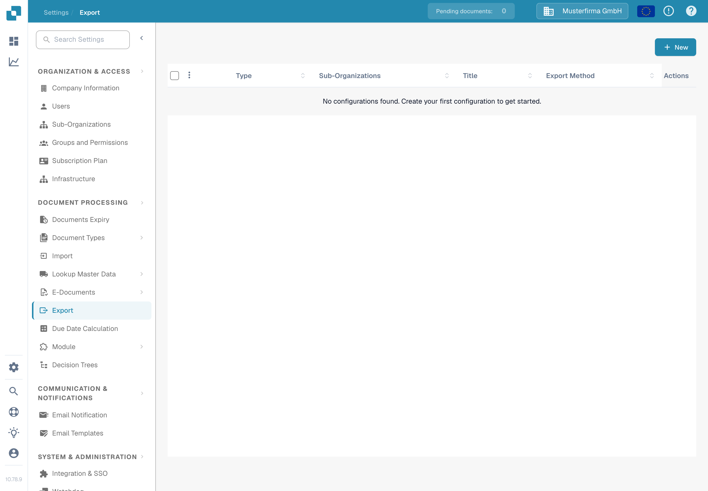
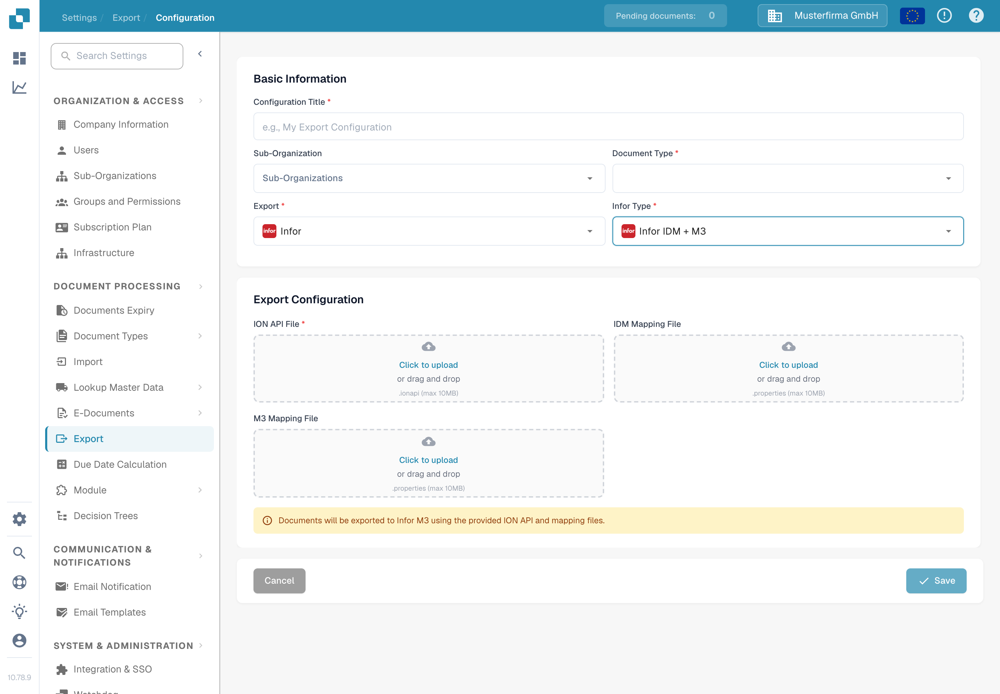

# M3 配置

本页说明如何检查 DocBits 导出配置与 Infor ION 文档流之间的连接，以用于 M3。上一页包含 38 张来自旧版 Infor 租户的截图，其中包括特定环境的 API 和映射设置。这些截图无法说明如何在您的租户中配置，因此当前指南链接到 Infor 的说明，并展示已验证的英文版 DocBits 表单。本次更新未测试 Infor 连接或发票导出。

## 准备 Infor 租户

请 Infor 管理员提供已批准的 **ION API 端点**、租户专属的 `.ionapi` 文件、**IDM 映射**和 **M3 映射** `.properties` 文件，以及此公司发票流使用的 BOD 映射名称。`.ionapi` 文件包含凭据；请勿将其放入截图、Jira 附件或 Git 中。其 `ci` 值是客户端 ID，详见 [Infor 的凭据字段参考](https://docs.infor.com/crm/9.4.x/en-us/webclient/upi1639111995644.html)。

在 ION Desk 中，管理员应：

1. 导入并批准当前租户所需的映射版本。验证映射的输入和输出 BOD 名称，不要沿用旧截图中的名称。
2. 检查 DocBits 和 M3 连接点、各自特定于环境的逻辑 ID、文档订阅和权限。
3. 使用已批准的映射和所有必需的筛选条件构建文档流。Infor 介绍了[连接点、映射和文档流](https://docs.infor.com/inforos/2024.x/en-us/useradminlib_cloud/iondeskceug_cloud_osm/lnj1556623308383.html)。
4. 只有在检查路由后，才保存、审核并[激活文档流](https://docs.infor.com/depm/2024.x/en-us/depmolh/configuring_ion/jex1510174562552.html)。激活与文档成功导出是两回事。

如需查看完整的历史 ION 示例，请参阅[导出到 Infor M3](./)。在参考该示例之前，请将其中的每个 Infor 界面与您的租户进行核对。

## 在 DocBits 中配置导出

在目标 DocBits 组织中，打开 **Settings → Export** 并选择 **New**。此处展示的英文版 Sandbox Test A 组织尚无已保存的导出配置。

输入 **Configuration Title**，选择 **Document Type**（此工作流选择 Invoice），并仅在需要时选择 **Sub-Organization**。对于 **Export**，选择 **Infor**；对于 **Infor Type**，选择 **Infor IDM + M3**。当前表单要求填写 **ION API File**（`.ionapi`，必填）、**IDM Mapping File**（`.properties`）和 **M3 Mapping File**（`.properties`）。仅使用此租户的文件，并在保存前进行审核。截图中特意将所有上传字段留空。

Infor 流激活后，请使用一张非生产环境发票进行测试。检查它在 DocBits、ION 和 M3 中的结果。仅保存配置或激活流，并不能证明发票已送达。
