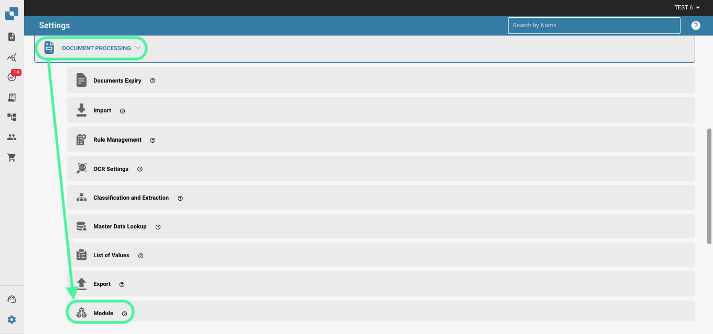
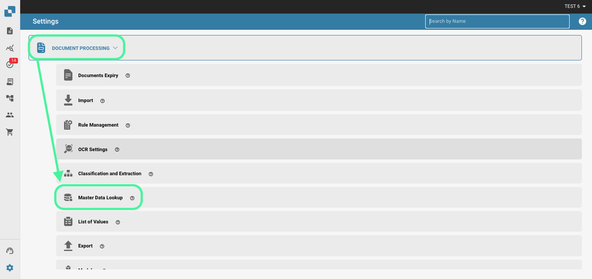
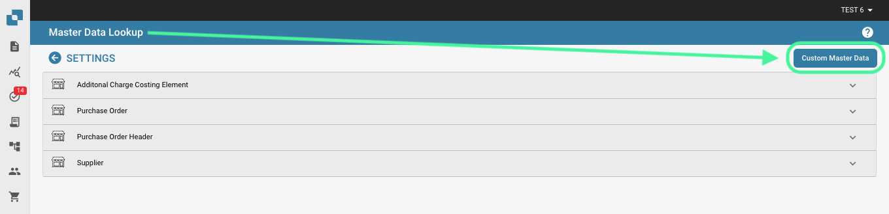
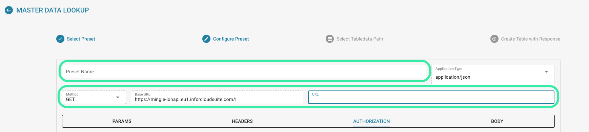

# 自定义主数据

#### 激活自定义主数据 

在仪表板中，依次前往“设置” → “文档处理” → “模块”。

.png>)

<figure><figcaption></figcaption></figure>

在“模块”中，按下方所示启用“自定义主数据”滑块。

<figure><figcaption></figcaption></figure>

#### 功能概览 

要将自己的主数据添加到 DocBits 中，请前往“设置”中的“主数据查找”。

<figure><figcaption></figcaption></figure>

点击“Custom Master Data”。

<figure><figcaption></figcaption></figure>

随后，您可以选择创建模板或端点。

<figure><figcaption></figcaption></figure>

#### 创建模板 

首先，选择使用组织的 ION API 文件，或使用 OAuth2 并输入所需数据。

<figure><figcaption></figcaption></figure>

接下来，我们将配置预设。在此处输入主数据表名称和 API 调用 URL。

<figure><figcaption></figcaption></figure>

随后，您需要使用点表示法输入 JSON 路径。有关点表示法的更多信息，请点击[此处](https://docs.hevodata.com/sources/engg-analytics/streaming/rest-api/writing-jsonpath-expressions/)。

最后，您需要将数据映射到要创建的列中，如下例所示。

<figure><figcaption></figcaption></figure>

完成后，点击“Done”以创建并填充新的主数据。

#### 创建端点 

首先，选择使用组织的 ION API 文件、使用 OAuth2，或将此项留空并输入所需数据。

<figure><figcaption></figcaption></figure>

接下来，我们将配置预设。在此处输入主数据表名称和 API 调用 URL。

<figure><figcaption></figcaption></figure>

随后，您需要使用点表示法输入 JSON 路径。有关点表示法的更多信息，请点击[此处](https://docs.hevodata.com/sources/engg-analytics/streaming/rest-api/writing-jsonpath-expressions/)。

最后，您需要将数据映射到要创建的列中，如下例所示。

<figure><figcaption></figcaption></figure>

完成后，点击“Done”以创建并填充新的主数据。
