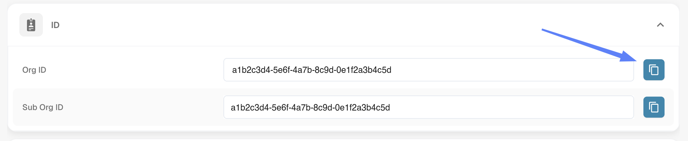
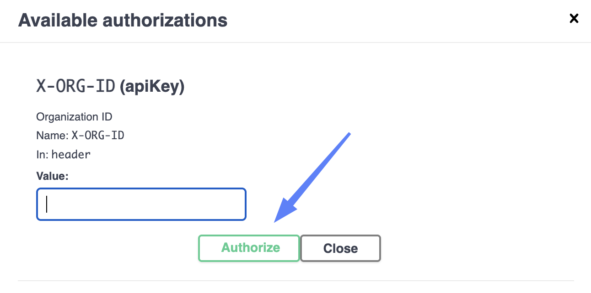
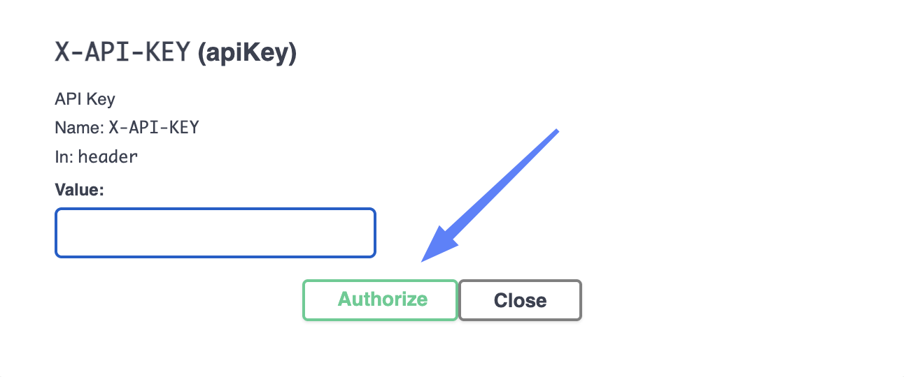
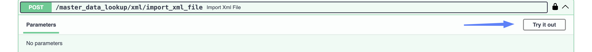
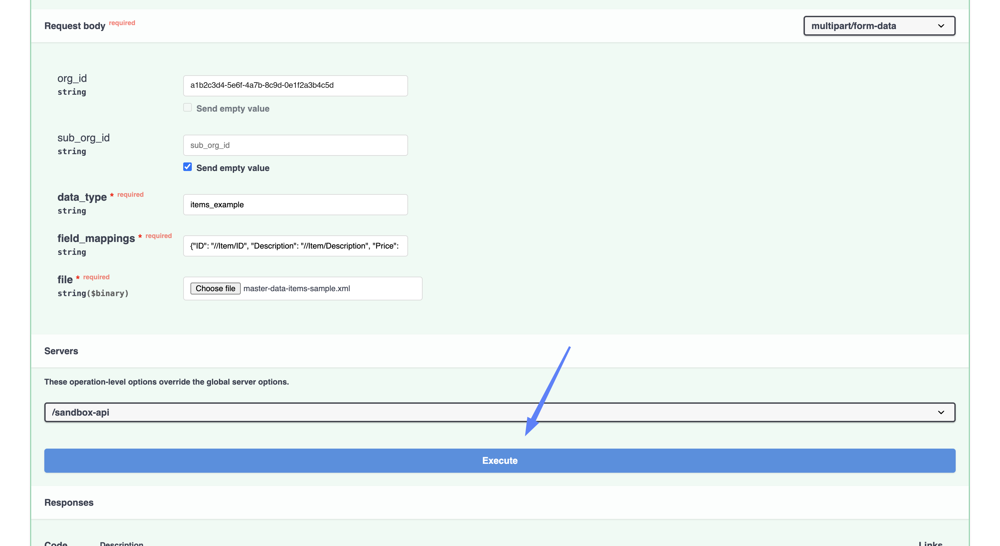
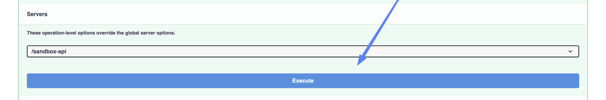
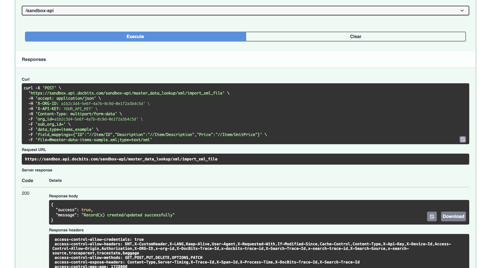

# 从 XML 导入主数据

除了 BOD 导入外，DocBits 还可以从**任意 XML 文件**中读取主数据，并写入你指定的查找数据集。你只需指定要写入的数据集，以及每一列应从哪个 XPath 读取，因此 XML 无需遵循 BOD 格式。

当主数据不是以 BOD 格式传入时，可以使用此功能，例如价格表、成本中心、物料属性，以及 ERP 能导出为 XML 的任何数据。

## 发送 XML 的两种方式

<figure><figcaption><p>上传文件，或粘贴 XML</p></figcaption></figure>

| 端点 | 适用情况 |
| --- | --- |
| `/master_data_lookup/xml/import_xml_file` | 数据是 **XML 文件**，需要上传。 |
| `/master_data_lookup/xml/import_xml_data` | 需要将 **XML 粘贴**到请求中。与 BOD 端点不同，此端点将 XML 作为纯文本接收，无需 JSON 封装。 |

下文将分别介绍这两种方式。步骤 1 和步骤 2 对两种方式都相同。

## 开始之前

你需要准备：

* **API 密钥。** 如果还没有，请参阅 [API 密钥管理](../../../administration-and-setup/settings/global-settings/integration/api-key-management.md)。
* **XML** — 文件，或可供粘贴的内容。
* **数据类型** — 要写入的查找数据集名称。
* **字段映射** — 指定哪个 XPath 填充哪一列。
* **组织 ID**，可在 **设置 → Integration & SSO** 的 **ID** 部分找到。

<figure><figcaption><p>设置 → Integration &#x26; SSO → ID</p></figcaption></figure>

## 分步说明

### 1. 打开 API 链接

打开与你所用环境和区域对应的 API 测试界面：

* [沙盒 API（欧洲）](https://eu.sandbox.api.docbits.com/docs#/master%20data%20lookup/import_xml_file_master_data_lookup_xml_import_xml_file_post)
* [沙盒 API（美国）](https://us.sandbox.api.docbits.com/docs#/master%20data%20lookup/import_xml_file_master_data_lookup_xml_import_xml_file_post)
* [生产 API（欧洲）](https://eu.api.docbits.com/docs#/master%20data%20lookup/import_xml_file_master_data_lookup_xml_import_xml_file_post)
* [生产 API（美国）](https://us.api.docbits.com/docs#/master%20data%20lookup/import_xml_file_master_data_lookup_xml_import_xml_file_post)

这些端点位于页面靠下的 **master data lookup** 部分，而不是 **import** 部分。


请使用组织托管所在的区域，也就是你登录 DocBits 时使用的同一区域。欧洲和美国环境彼此独立，因此如果将导入请求发送到错误的区域，数据不会显示在你的组织中。


### 2. 授权

<figure><figcaption><p>点击锁图标打开授权对话框</p></figcaption></figure>

授权方式与 BOD 导入完全相同：点击**锁图标**，将**组织 ID**粘贴到 **X-ORG-ID**，将 API 密钥粘贴到 **X-API-KEY**，然后分别点击每项的 **Authorize**。

<figure><figcaption><p>X-ORG-ID — 粘贴组织 ID，然后点击 Authorize</p></figcaption></figure>

<figure><figcaption><p>X-API-KEY — 粘贴密钥，然后点击 Authorize</p></figcaption></figure>

### 3. 填写字段

<figure><figcaption><p>点击 Try it out 后即可填写表单</p></figcaption></figure>

点击 **Try it out**，然后填写表单。

<figure><figcaption><p>已填写的请求正文表单</p></figcaption></figure>

| 字段 | |
| --- | --- |
| **data\_type** | 必填。要写入的查找数据集。系统会自动将其转换为小写，因此 `PriceList` 和 `pricelist` 表示同一个数据集。 |
| **field\_mappings** | 必填。一个 JSON 对象，用于将每一列与其读取路径 XPath 配对。详见下文。 |
| **file** | `import_xml_file` 必填。点击 **Choose file** 并选择 XML 文件。 |
| **xml** | 对 `import_xml_data` 必填，用于替代文件 — 将 XML 作为纯文本粘贴到此处。 |
| **org\_id** | 你的组织 ID — 与步骤 2 中填入 **X-ORG-ID** 的值相同。 |
| **sub\_org\_id** | 仅在需要导入到特定子组织时填写。 |

#### 字段映射

`field_mappings` 是一个 JSON 对象，每列对应一个条目。与列名固定为 `custom_field_1` … `custom_field_5` 的 BOD 导入不同，在这里你可以自行选择列名：

```json
{
  "ID": "//Item/ID",
  "Description": "//Item/Description",
  "Price": "//Item/UnitPrice"
}
```

左侧的名称会成为数据集中的列名，由你自行选择。右侧的值必须与所上传 XML 的结构相符 — 对于上面的示例，`//Item/ID` 会读取每个 `<Item>` 中的 `<ID>` 元素。两侧相互独立：上面的映射会将 `<UnitPrice>` 读入名为 `Price` 的列。


只有**格式错误**的 XPath 才会被拒绝，并返回包含字段名称的 `400` 错误。语法有效但在 XML 中没有匹配项的 XPath 会静默通过，只会让该列保持为空 — 因此，路径中的拼写错误看起来像是导入成功了，但实际上少了一列。如果未匹配到 `ID` 路径，导入会失败，并报告该记录缺少 `ID` 列。



**其中一列必须命名为 `ID`。** 它用于识别记录：再次导入相同数据时，会更新具有该 ID 的行，而不是添加重复行。名称不区分大小写，因此 `ID`、`Id` 和 `id` 都可以；但 `ItemID` 这样的名称不符合要求 — 请求会被 `ID_FIELD_IS_MISSING` 拒绝，并且不会写入任何数据。



**每个请求只导入一条记录。** 每个 XPath 只读取一次，因此如果 XML 包含多个元素，每个 XPath 只会使用第一个匹配项。若要加载列表，请为每条记录发送一个请求，或改用 CSV 导入。


#### 选择数据类型

`data_type` 是要写入的数据集的键。系统会将其转换为小写并去除首尾空格，因此 `Items` 和 `items` 表示同一个数据集。任何尚未被占用的名称都会创建一个你自己的数据集 — `items_example`、`cost_centres`、`price_list` — 再次导入该数据集时会更新其中的数据。


有些名称不能随意使用：它们是 DocBits 自有的主数据表，导入到这些名称会直接写入相应表中。

| 名称 | |
| --- | --- |
| `purchase_order_header`、`purchase_order_address` | 将返回 `RESERVED_DATASET_NAME`，拒绝导入。 |
| `supplier`、`supplier_accounts`、`purchase_order`、`receive_delivery`、`receive_delivery_lines`、`costing_element`、`customer_erp_items`、`supplier_item_price`、`supplier_item_number_mapping` | **接受导入，并会覆盖真实主数据。** 只有确实打算这样做时才使用这些名称。 |

其他情况下，请选择你自己的名称。



执行前请检查所选环境和组织是否正确。导入会直接写入该组织的主数据。


### 4. 执行

执行前，请检查表单底部的 **Servers** 下拉菜单。

<figure><figcaption><p>检查服务器，然后点击 Execute</p></figcaption></figure>

点击 **Execute**。导入成功时会返回：

```json
{
  "success": true,
  "message": "Record(s) created/updated successfully"
}
```

<figure><figcaption><p>主数据成功导入</p></figcaption></figure>

与 BOD 导入不同，这些端点会通过正确的错误状态报告问题，而不是返回包含 `"success": false` 的 `200` — **400** 表示请求被拒绝，且没有任何数据写入。

### 5. 检查数据是否已导入

* 在 DocBits 中，前往 **设置 → Document Processing → Lookup Master Data**。
* 在左侧选择 **Imported**，然后打开对应数据类型的选项卡。
* 列名就是你在 `field_mappings` 左侧填写的名称。

<!-- SCREENSHOT: Lookup Master Data with Imported selected and the new dataset open -->
