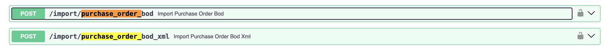
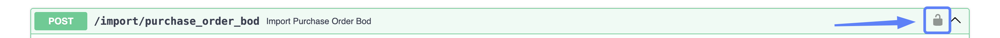
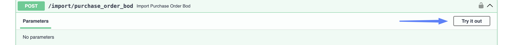
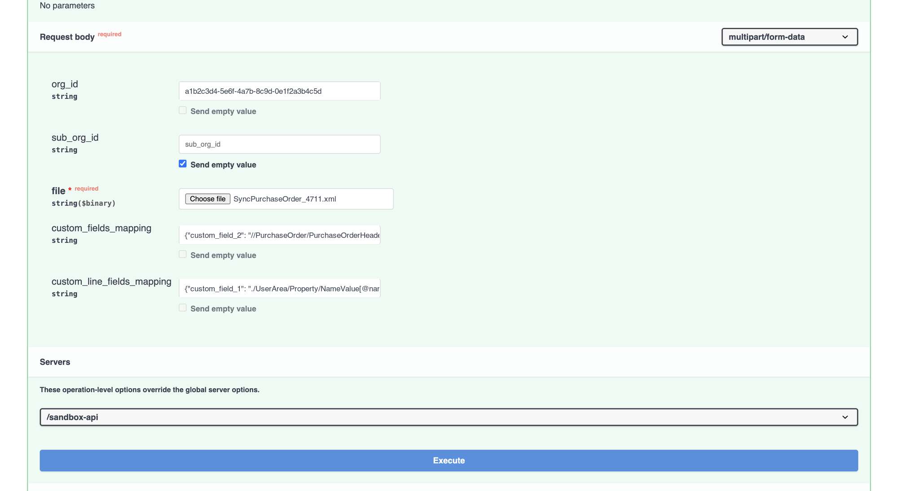
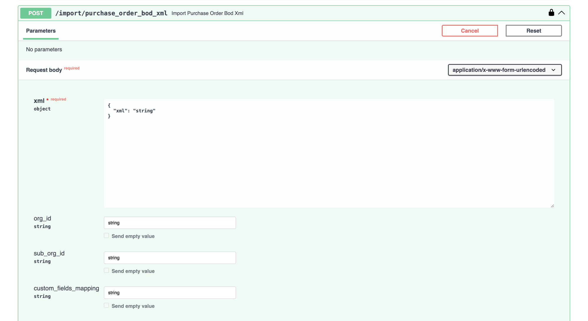
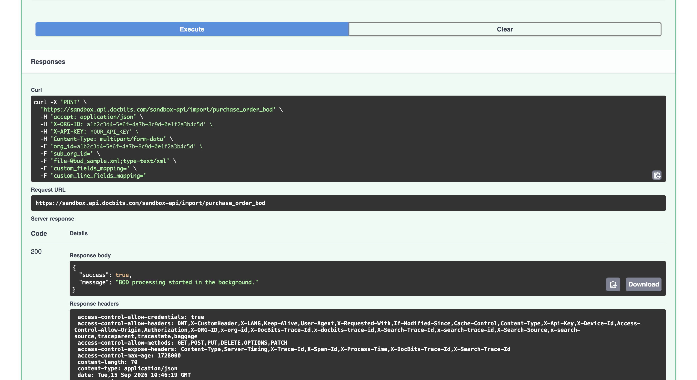

# 导入采购订单（Purchase Order BOD）

采购订单通常通过 ION 数据流自动发送到 DocBits。本页介绍如何手动发送 **Purchase Order BOD**：当您需要重新导入订单、补充未能送达的批次，或在启用自动数据流前测试新映射时，可以使用此方法。

## 发送同一 BOD 的两种方式

有两个端点，功能相同，唯一的区别是提交 BOD 的方式：

<figure><figcaption><p>上传文件，或在请求中发送 XML</p></figcaption></figure>

| 端点 | 适用情况 |
| --- | --- |
| `/import/purchase_order_bod` | 您有 BOD **XML 文件**，并希望上传该文件。 |
| `/import/purchase_order_bod_xml` | 您希望直接在请求中发送 **XML 内容**，而不是上传文件。BOD 必须封装在 JSON 中，因此这种方式适合较短的 XML，或由其他系统调用 API 的情况。手动导入完整 BOD 时，请上传文件。 |

下文将分别介绍这两种方式。无论使用哪种方式，步骤 1 和步骤 2 都相同。

## 开始之前

您需要准备：

* **API 密钥。** 如果还没有密钥，请参阅 [API 密钥管理](../../../administration-and-setup/settings/global-settings/integration/api-key-management.md)。
* **BOD** — 一个 `SyncPurchaseOrder` XML 文件或其内容。
* **组织 ID**，如果要导入到密钥所属组织以外的组织。

要查找组织 ID，请前往 **Settings → Integration & SSO**，然后打开 **ID** 部分。点击字段旁边的复制图标。

<figure><figcaption><p>Settings → Integration &#x26; SSO → ID</p></figcaption></figure>


**Sub Org ID** 显示标题栏中当前选定的子组织。选择 **CROSS**（跨所有子组织查看）时，该字段显示的值与 **Org ID** 相同，因此上方截图中的两个字段值一致。如果需要特定子组织的 ID，请先切换到该子组织。

如果您不打算导入到特定子组织，请将 `sub_org_id` 字段留空。


## 分步说明

### 1. 打开 API 链接

打开与您所用环境和区域对应的 API 测试界面：

* [Sandbox API（欧洲）](https://eu.sandbox.api.docbits.com/docs#/import/import_purchase_order_bod_import_purchase_order_bod_post)
* [Sandbox API（美国）](https://us.sandbox.api.docbits.com/docs#/import/import_purchase_order_bod_import_purchase_order_bod_post)
* [Production API（欧洲）](https://eu.api.docbits.com/docs#/import/import_purchase_order_bod_import_purchase_order_bod_post)
* [Production API（美国）](https://us.api.docbits.com/docs#/import/import_purchase_order_bod_import_purchase_order_bod_post)

点击所需端点，将其展开。


请使用组织所在的区域，也就是您登录 DocBits 时使用的同一区域。欧洲和美国环境相互独立，因此发送到错误区域的导入数据不会显示在您的组织中。

不带区域前缀的地址 `api.docbits.com` 和 `sandbox.api.docbits.com` 指向欧洲。您可能会在旧文档和现有配置中看到这些地址；它们与上面的 `eu.` 地址指向同一环境。


### 2. 授权

授权之前，**import** 下的所有内容都处于锁定状态。您需要填写两项：组织和 API 密钥。

* 点击端点右侧的**锁图标**。

<figure><figcaption><p>点击锁图标以打开授权对话框</p></figcaption></figure>

* **Available authorizations** 对话框会打开，其中有两个条目。
* 将您的**组织 ID**粘贴到 **X-ORG-ID**，然后点击 **Authorize**。

<figure><figcaption><p>X-ORG-ID — 粘贴组织 ID，然后点击 Authorize</p></figcaption></figure>

* 此条目现在会显示 **Authorized**，并隐藏该值。

<figure><figcaption><p>已设置 X-ORG-ID</p></figcaption></figure>

* 向下滚动到 **X-API-KEY**，粘贴您的 API 密钥，然后点击 **Authorize**。在 DocBits 中，您可以在 **Settings → Integration & SSO** 的 **API Key** 部分找到密钥，也可以[创建新密钥](../../../administration-and-setup/settings/global-settings/integration/api-key-management.md#creating-an-api-key)。

<figure><figcaption><p>X-API-KEY — 粘贴密钥，然后点击 Authorize</p></figcaption></figure>

<figure><figcaption><p>已设置 X-API-KEY</p></figcaption></figure>

* 点击 **Close**。


只粘贴密钥本身，不要在前面输入 `Bearer`。除非重新加载页面或点击 **Logout**，否则这两项授权都会保持有效。


### 3. 填写字段

<figure><figcaption><p>点击 Try it out 后即可填写表单</p></figcaption></figure>

点击 **Try it out**，然后根据所选端点填写表单。

#### 上传文件 — `/import/purchase_order_bod`

<figure><figcaption><p>已填写的请求正文表单</p></figcaption></figure>

| 字段 | |
| --- | --- |
| **file** | 必填。点击 **Choose file**，选择您的 `SyncPurchaseOrder` XML 文件。 |
| **org\_id** | 您的组织 ID，也就是步骤 2 中填入 **X-ORG-ID** 的同一个值。在此处也设置该值，可以明确指定请求要写入哪个组织。该组织必须在您的 API 密钥可访问范围内，否则请求会被拒绝。 |
| **sub\_org\_id** | 仅在您使用子组织时需要。否则留空。 |
| **custom\_fields\_mapping** | 可选。从 BOD 中读取额外的标头字段，并写入采购订单的自定义字段。请参阅下文的[自定义字段映射](#custom-field-mappings)。 |
| **custom\_line\_fields\_mapping** | 可选。用途相同，用于订单行上的额外字段。 |


**`string` 是一个值，不是占位符。** Swagger 会在可选字段中填入单词 `string`。如果不清除该值，它会原样发送——例如，将 `org_id` 设置为 `string` 会导致导入失败。

对于不打算使用的可选字段，请清空字段。清空后，下方的 **Send empty value** 复选框会启用，您可以勾选该复选框。上方截图中已对 `sub_org_id` 执行此操作。


#### 自定义字段映射 <a id="custom-field-mappings"></a>

两个映射字段都接受 JSON 对象。**左侧名称必须是 DocBits 自身的自定义字段之一**——采购订单可使用 `custom_field_1` 到 `custom_field_5`。任何其他名称都会被忽略，且不会显示警告，因此拼写错误看起来就像映射未生效一样。

右侧的值是要读取的 XPath。请不要添加命名空间前缀——DocBits 会自行添加：

```json
{"custom_field_2": "//PurchaseOrder/PurchaseOrderHeader/UserArea/Property/NameValue[@name='User defined 6']/text()"}
```

行映射使用相同的 `custom_field_1` … `custom_field_5` 名称，但 XPath 是**相对于每个订单行**读取的，因此以 `./` 开头：

```json
{"custom_field_1": "./UserArea/Property/NameValue[@name='User defined 1']/text()"}
```

#### 粘贴 XML — `/import/purchase_order_bod_xml`

<figure><figcaption><p>将 BOD 放入一个简单的 JSON 封装中</p></figcaption></figure>

此端点不接受直接粘贴的 BOD。**xml** 字段是一个对象，预先填入了：

```json
{
  "xml": "string"
}
```

将 `string` 替换为 BOD 内容，同时保留外围的引号和大括号：

```json
{
  "xml": "<SyncPurchaseOrder ...>...</SyncPurchaseOrder>"
}
```


BOD 位于 JSON 字符串中，因此 XML 中的每个双引号都必须转义为 `\"`，而 BOD 中有大量双引号（例如 `releaseID="9.2"`、`xmlns="..."`）。如果结果不是有效的 JSON，请求会失败并返回 **422**，且不会导入任何数据。

手动处理真实 BOD 的转义很繁琐，因此建议**上传文件**。当 XML 较短，或由其他系统构建请求并能够自行编码 JSON 时，使用此端点更合适。


`org_id`、`sub_org_id` 和 `custom_fields_mapping` 字段的用法与上文完全相同。此端点没有行映射字段。


执行前，请确认目标环境和组织。导入会直接写入该组织的主数据。


### 4. 执行

执行前，请检查表单底部的 **Servers** 下拉菜单。它决定请求实际发送到哪个环境，且可能与您打开的页面所属环境不同。

点击 **Execute**。

<figure><figcaption><p>检查服务器，然后点击 Execute</p></figcaption></figure>

**如果您上传了文件**，响应如下：

<figure><figcaption><p>文件上传成功后的响应</p></figcaption></figure>

```json
{
  "success": true,
  "message": "BOD processing started in the background."
}
```


**这表示文件已被接收，不代表导入已完成。** 上传的采购订单文件会在后台处理，避免大型订单阻塞系统的其他工作。稍等片刻，然后按照下文说明检查结果。


**如果您粘贴了 XML**，导入会立即运行，响应为 `"BOD processed successfully."`——看到此响应时，数据已经导入。

如果请求有误，您会收到 `"success": false`，以及说明问题的消息。最常见的原因是内容不是 `SyncPurchaseOrder` BOD，或 API 密钥无权访问该组织 ID。

### 5. 检查数据是否已到达

* 在 DocBits 中，前往 **Settings → Document Processing → Lookup Master Data**。
* 在左侧选择 **BOD Input Data**，然后打开 **Purchase Order** 选项卡。
* 搜索 BOD 中的 PO 编号。

<!-- SCREENSHOT F: Lookup Master Data with BOD Input Data selected and the Purchase Order tab open -->

如果列表中显示该订单，则说明导入成功，且该采购订单已可用于 PO 匹配。


DocBits 根据 BOD 内部的类型来决定如何处理，而不是根据您使用的导入端点。如果误将供应商 BOD 发送到此处，它会作为供应商数据导入，而不会被拒绝。因此，请确认您找到数据的选项卡符合预期。

