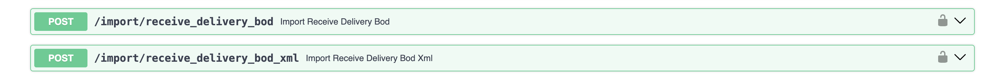
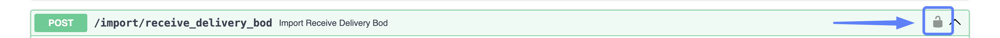
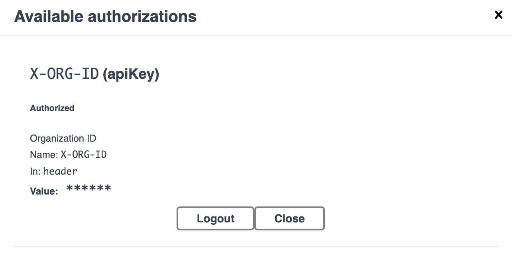
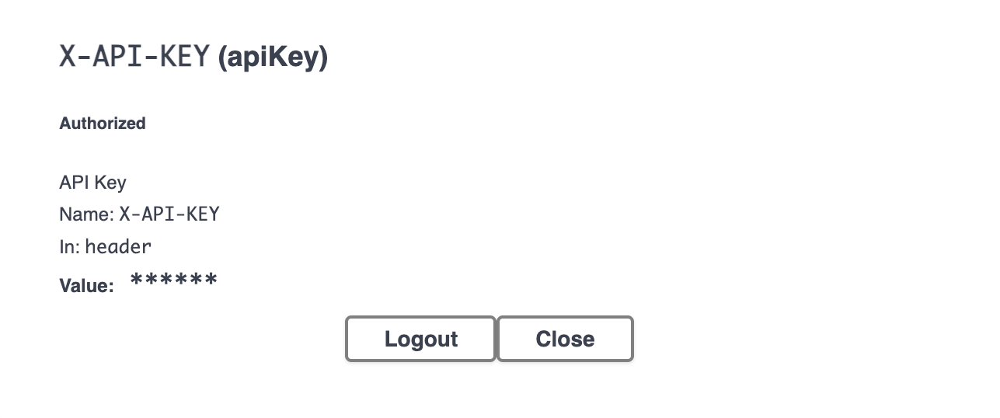
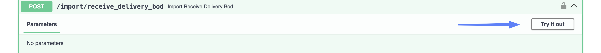
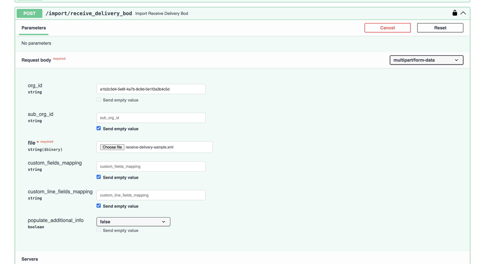
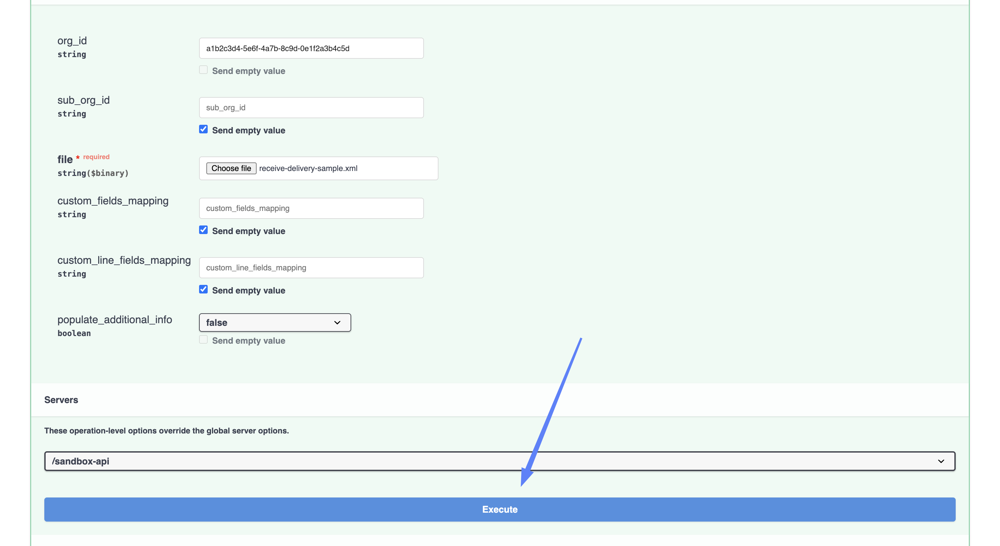
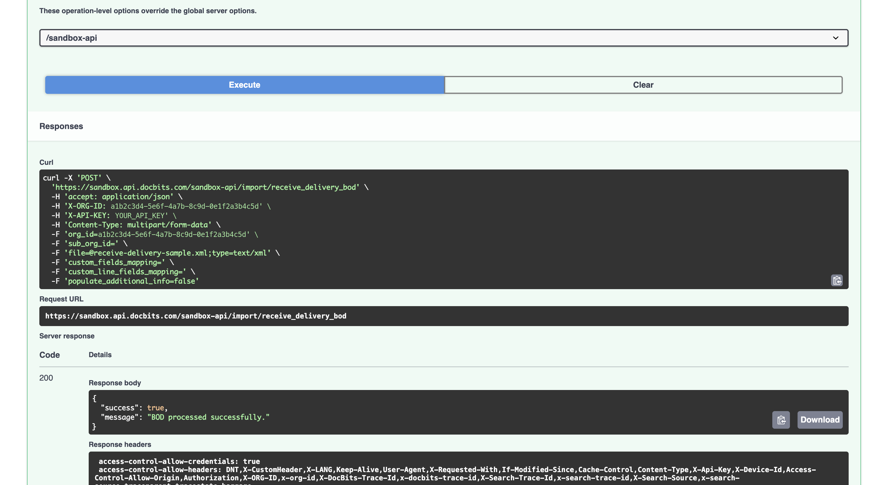

# 导入收货记录（Receive Delivery BOD）

收货记录通常会通过 ION 数据流自动传入 DocBits。本页介绍如何手动发送 **Receive Delivery BOD**，适用于重新导入收货记录、导入未能送达的一批记录，或在启用自动数据流前测试字段映射。

## 发送同一 BOD 的两种方式

<figure><figcaption><p>上传文件，或在请求中发送 XML</p></figcaption></figure>

| 端点 | 适用情况 |
| --- | --- |
| `/import/receive_delivery_bod` | 您有 **XML 文件**形式的 BOD，并希望上传该文件。 |
| `/import/receive_delivery_bod_xml` | 您希望在请求中发送 **XML 内容**，而不是上传文件。BOD 必须封装在 JSON 中，因此此方式适合较短的 XML，或由其他系统调用 API 的场景；如果要手动发送完整 BOD，请上传文件。 |

下文将分别介绍这两种方式。无论使用哪种方式，步骤 1 和 2 都相同。

## 开始之前

您需要准备：

* **API 密钥。** 如果您还没有 API 密钥，请参阅 [API 密钥管理](../../../administration-and-setup/settings/global-settings/integration/api-key-management.md)。
* **BOD**——`SyncReceiveDelivery` XML 文件或其内容。
* **组织 ID**，可在 **设置 → 集成与 SSO** 的 **ID** 部分找到。

<figure><figcaption><p>设置 → 集成 &#x26; SSO → ID</p></figcaption></figure>


**子组织 ID** 会显示标题栏中当前选定的子组织。如果选中 **CROSS**（跨所有子组织的视图），显示的值将与 **组织 ID** 相同。如果需要某个子组织的 ID，请先切换到该子组织。

如果您不打算导入到特定子组织，请将 `sub_org_id` 字段留空。


## 分步说明

### 1. 打开 API 链接

打开与您当前使用的环境和区域对应的 API 测试界面：

* [沙盒 API（欧洲）](https://eu.sandbox.api.docbits.com/docs#/import/import_receive_delivery_bod_import_receive_delivery_bod_post)
* [沙盒 API（美国）](https://us.sandbox.api.docbits.com/docs#/import/import_receive_delivery_bod_import_receive_delivery_bod_post)
* [生产 API（欧洲）](https://eu.api.docbits.com/docs#/import/import_receive_delivery_bod_import_receive_delivery_bod_post)
* [生产 API（美国）](https://us.api.docbits.com/docs#/import/import_receive_delivery_bod_import_receive_delivery_bod_post)

点击相应端点将其展开。


请使用组织所在的区域，也就是您登录 DocBits 时使用的区域。欧洲和美国环境彼此独立，因此发送到错误区域的导入数据不会显示在您的组织中。

不带区域前缀的地址——`api.docbits.com` 和 `sandbox.api.docbits.com`——指向欧洲环境。您可能会在旧版文档和现有配置中看到这些地址；它们与上面的 `eu.` 地址指向同一环境。


### 2. 授权

在完成授权之前，**import** 下的所有内容都会被锁定。您需要填写两项内容：组织和 API 密钥。

* 点击端点右侧的**锁形图标**。

<figure><figcaption><p>点击锁形图标以打开授权对话框</p></figcaption></figure>

* 此时会打开包含两个条目的 **Available authorizations** 对话框。
* 将您的**组织 ID**粘贴到 **X-ORG-ID** 中，然后点击 **Authorize**。

<figure><figcaption><p>X-ORG-ID — 粘贴组织 ID，然后点击 Authorize</p></figcaption></figure>

<figure><figcaption><p>已设置 X-ORG-ID</p></figcaption></figure>

* 向下滚动到 **X-API-KEY**，粘贴您的 API 密钥，然后点击 **Authorize**。您可以在 DocBits 的 **设置 → 集成与 SSO** 的 **API Key** 部分找到该密钥，也可以[创建新密钥](../../../administration-and-setup/settings/global-settings/integration/api-key-management.md#creating-an-api-key)。

<figure><figcaption><p>X-API-KEY — 粘贴密钥，然后点击 Authorize</p></figcaption></figure>

<figure><figcaption><p>已设置 X-API-KEY</p></figcaption></figure>

* 点击 **Close**。


请单独粘贴密钥，不要在前面输入 `Bearer`。重新加载页面或点击 **Logout** 之前，这两项授权都会保持设置状态。


### 3. 填写字段

<figure><figcaption><p>点击 Try it out 后即可填写表单</p></figcaption></figure>

点击 **Try it out**，然后根据所选端点填写表单。

#### 上传文件 — `/import/receive_delivery_bod`

<figure><figcaption><p>已填写的请求正文表单</p></figcaption></figure>

| 字段 | |
| --- | --- |
| **file** | 必填。点击 **Choose file** 并选择您的 `SyncReceiveDelivery` XML 文件。 |
| **org\_id** | 您的组织 ID，即步骤 2 中填入 **X-ORG-ID** 的同一个值。在此处也设置该值，可以明确指定请求要写入哪个组织。该组织必须在您的 API 密钥访问范围内，否则请求会被拒绝。 |
| **sub\_org\_id** | 仅当您要导入到特定子组织时才需要填写。 |
| **custom\_fields\_mapping** | 可选。用于额外的标头字段。请参阅下文的[自定义字段映射](#custom-field-mappings)。 |
| **custom\_line\_fields\_mapping** | 可选。用于收货行项目中的额外字段。 |
| **populate\_additional\_info** | 可选，默认为 `false`。将其设为 `true`，可让 DocBits 在导入后从 ERP 获取其他收货信息。除非您确定需要，否则请保留为 `false`，因为这会延长导入时间。 |


**`string` 是一个值，不是占位符。** Swagger 会用单词 `string` 填充可选字段；如果您不清除它，该值会原样发送。例如，若 `org_id` 的值为 `string`，导入就会失败。

对于不想使用的可选字段，请清空字段。清空后，下方的 **Send empty value** 复选框会变为可用，您可以勾选该复选框。


#### 自定义字段映射 <a id="custom-field-mappings"></a>

这两个映射字段都接受 JSON 对象。**左侧的名称必须是 DocBits 自有的自定义字段之一**——收货记录使用 `custom_field_1` 到 `custom_field_10`，数量是采购订单可用字段的两倍。任何其他名称都会被忽略，且不会显示警告，因此这里的拼写错误看起来就像映射未生效一样。

右侧的值是要读取的 XPath。请勿添加命名空间前缀——DocBits 会自行添加：

```json
{"custom_field_2": "//ReceiveDelivery/ReceiveDeliveryHeader/UserArea/Property/NameValue[@name='User defined 6']/text()"}
```

行项目映射使用相同的 `custom_field_1` … `custom_field_10` 名称，但其 XPath 是**相对于每个收货行项目**读取的，因此以 `./` 开头：

```json
{"custom_field_1": "./UserArea/Property/NameValue[@name='User defined 1']/text()"}
```

#### 粘贴 XML — `/import/receive_delivery_bod_xml`

<!-- SCREENSHOT: the Try it out form of /import/receive_delivery_bod_xml -->

此端点不接受直接粘贴的纯 BOD。**xml** 字段是一个对象，预先填入了 `{"xml": "string"}`。请将 `string` 替换为 BOD 的内容，并保留外围的引号和大括号：

```json
{
  "xml": "<SyncReceiveDelivery ...>...</SyncReceiveDelivery>"
}
```


BOD 位于 JSON 字符串中，因此 XML 中的每个双引号都必须转义为 `\"`；而 BOD 中有很多双引号。如果结果不是有效的 JSON，请求会以 **422** 错误失败，且不会导入任何内容。

对于真实的 BOD，手动处理这些转义很麻烦，因此建议**上传文件**。


此端点接受 `org_id`、`sub_org_id` 和 `populate_additional_info`，但**不接受任何字段映射**，无论是标头字段还是行项目字段。如果您的收货记录需要自定义字段，请改为上传文件。


执行之前，请确认您选择的环境和组织正确。导入会直接写入该组织的主数据。


### 4. 执行

执行之前，请检查表单底部的 **Servers** 下拉菜单。它决定请求实际发送到哪个环境，可能与您打开的页面不同。

<figure><figcaption><p>检查服务器，然后点击 Execute</p></figcaption></figure>

点击 **Execute**。导入成功后会返回：

```json
{
  "success": true,
  "message": "BOD processed successfully."
}
```

<figure><figcaption><p>成功导入收货记录</p></figcaption></figure>

Receive Delivery BOD 会在您等待时完成处理，因此看到此消息时，数据已经导入。

如果请求有误，响应会包含 `"success": false`，并附有说明问题的消息。

### 5. 检查数据是否已到达

* 在 DocBits 中，前往 **设置 → 文档处理 → 查询主数据**。
* 在左侧选择 **BOD Input Data**，然后打开对应的已导入数据选项卡。
* 搜索该收货记录或其所属的采购订单。

<!-- SCREENSHOT: Lookup Master Data with BOD Input Data selected and the goods receipt data shown -->


DocBits 会读取 BOD 内部的类型来决定如何处理它，而不是根据您使用的导入端点来判断。如果您误将其他类型的 BOD 发送到此处，它会按该类型导入，而不会被拒绝。因此，请确认找到数据的选项卡与您的预期一致。

