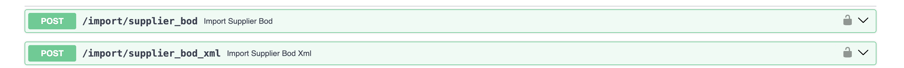
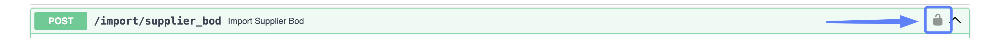
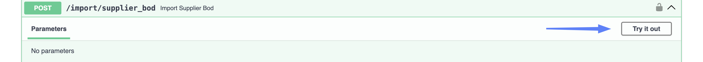
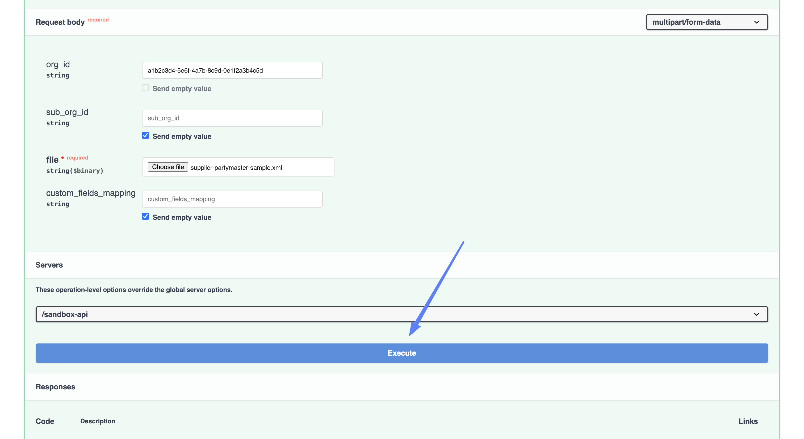
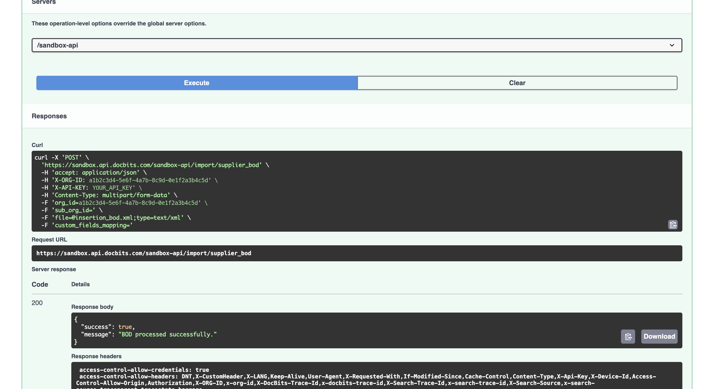

# 导入供应商（Supplier BOD）

供应商主数据通常会通过 ION 数据流自动传入 DocBits。本页介绍如何手动发送 **Supplier BOD**，适用于重新导入供应商、导入未成功送达的一批数据，或在启用自动数据流之前测试字段映射。

## 通过两种方式发送同一个 BOD

有两个端点，功能相同。唯一的区别是提交 BOD 的方式：

<figure><figcaption><p>上传文件，或在请求中发送 XML</p></figcaption></figure>

| 端点 | 适用情况 |
| --- | --- |
| `/import/supplier_bod` | 您有一个 **XML 文件**形式的 BOD，并希望上传该文件。 |
| `/import/supplier_bod_xml` | 您希望在请求中直接发送 **XML 内容**，而不是上传文件。BOD 必须封装在 JSON 中，因此适合较短的 XML，或由其他系统调用 API 的场景；如果要手动发送完整 BOD，请上传文件。 |

下文将分别介绍这两个端点。无论使用哪种方式，步骤 1 和 2 都相同。

## 开始之前

您需要准备：

* **API 密钥。** 如果还没有，请参阅 [API 密钥管理](../../../administration-and-setup/settings/global-settings/integration/api-key-management.md)。
* **BOD**——`SyncSupplierPartyMaster` 或 `SyncRemitToPartyMaster` XML 文件，或其内容。
* **组织 ID（Org ID）**，可在 **设置 → 集成与 SSO** 的 **ID** 区域中找到。

<figure><figcaption><p>设置 → 集成 &#x26; SSO → ID</p></figcaption></figure>


**Sub Org ID** 显示页眉中当前所选的子组织。如果选择了 **CROSS**（即跨所有子组织查看的视图），这里显示的值与 **Org ID** 相同。如果需要特定子组织的 ID，请先切换到该子组织。

如果您不打算导入到某个特定子组织，请将 `sub_org_id` 字段留空。


## 操作步骤

### 1. 打开 API 链接

打开与您所使用的环境和区域对应的 API 测试界面：

* [Sandbox API（欧洲）](https://eu.sandbox.api.docbits.com/docs#/import/import_supplier_bod_import_supplier_bod_post)
* [Sandbox API（美国）](https://us.sandbox.api.docbits.com/docs#/import/import_supplier_bod_import_supplier_bod_post)
* [Production API（欧洲）](https://eu.api.docbits.com/docs#/import/import_supplier_bod_import_supplier_bod_post)
* [Production API（美国）](https://us.api.docbits.com/docs#/import/import_supplier_bod_import_supplier_bod_post)

点击所需端点将其展开。


请选择组织所在的区域，也就是您登录 DocBits 时使用的区域。欧洲和美国环境相互独立，因此如果将导入请求发送到错误的区域，数据不会出现在您的组织中。

没有区域前缀的地址——`api.docbits.com` 和 `sandbox.api.docbits.com`——指向欧洲。您可能会在旧版文档和现有配置中看到这些地址；它们与上方的 `eu.` 地址指向同一环境。


### 2. 授权

在完成授权之前，**import** 下的所有内容都会被锁定。您需要填写两项内容：组织信息和 API 密钥。

* 点击端点右侧的**锁形图标**。

<figure><figcaption><p>点击锁形图标以打开授权对话框</p></figcaption></figure>

* 系统会打开 **Available authorizations** 对话框，其中包含两项。
* 将您的 **Org ID** 粘贴到 **X-ORG-ID**，然后点击 **Authorize**。

<figure><figcaption><p>X-ORG-ID — 粘贴 Org ID，然后点击 Authorize</p></figcaption></figure>

<figure><figcaption><p>已设置 X-ORG-ID</p></figcaption></figure>

* 向下滚动到 **X-API-KEY**，粘贴您的 API 密钥，然后点击 **Authorize**。您可以在 DocBits 的 **设置 → 集成与 SSO** 中找到该密钥，位置在 **API Key** 区域；也可以[创建新密钥](../../../administration-and-setup/settings/global-settings/integration/api-key-management.md#creating-an-api-key)。

<figure><figcaption><p>X-API-KEY — 粘贴密钥，然后点击 Authorize</p></figcaption></figure>

<figure><figcaption><p>已设置 X-API-KEY</p></figcaption></figure>

* 点击 **Close**。


只粘贴密钥本身，不要在前面输入 `Bearer`。重新加载页面或点击 **Logout** 之前，两项授权都会保持有效。


### 3. 填写字段

<figure><figcaption><p>点击 Try it out 可解锁表单</p></figcaption></figure>

点击 **Try it out**，然后填写所选端点的表单。

#### 上传文件 — `/import/supplier_bod`

<figure><figcaption><p>已填写的请求正文表单</p></figcaption></figure>

| 字段 | |
| --- | --- |
| **file** | 必填。点击 **Choose file**，然后选择供应商 BOD XML 文件。 |
| **org\_id** | 您的 Org ID，也就是步骤 2 中填入 **X-ORG-ID** 的同一个值。在此处也填写该值，可以明确指定请求要写入哪个组织。该组织必须在您的 API 密钥权限范围内；否则请求会被拒绝。 |
| **sub\_org\_id** | 只有在导入到某个特定子组织时才需要填写。 |
| **custom\_fields\_mapping** | 可选。将 BOD 中的额外字段读取到供应商的自定义字段中。请参阅下文的[自定义字段映射](#custom-field-mappings)。 |

此处没有行映射字段，因为供应商主数据不包含行项目。


**`string` 是一个值，不是占位符。** Swagger 会在可选字段中填入 `string` 一词；如果您不清除该值，它就会原样发送。例如，`org_id` 为 `string` 的导入请求会失败。

对于不需要使用的可选字段，请清空字段。清空后，下方会启用 **Send empty value** 复选框，您可以勾选该选项。


#### 自定义字段映射 <a id="custom-field-mappings"></a>

映射字段接受 JSON 对象。**左侧的名称必须是 DocBits 自带的自定义字段之一**——供应商可使用 `custom_field_1` 到 `custom_field_5`。其他名称会被忽略，且不会显示警告，因此拼写错误看起来就像映射未生效一样。

右侧的值是要读取的 XPath。请勿添加命名空间前缀——DocBits 会自行添加：

```json
{"custom_field_2": "//SupplierPartyMaster/UserArea/Property/NameValue[@name='User defined 6']/text()"}
```

#### 粘贴 XML — `/import/supplier_bod_xml`

此端点不能直接接受粘贴的 BOD。**xml** 字段是一个对象，预填内容为 `{"xml": "string"}`。请将 `string` 替换为 BOD 内容，并保留外层引号和花括号：

```json
{
  "xml": "<SyncSupplierPartyMaster ...>...</SyncSupplierPartyMaster>"
}
```


BOD 位于 JSON 字符串中，因此 XML 中的每个双引号都必须转义为 `\"`——而 BOD 中有很多双引号。如果结果不是有效的 JSON，请求会因 **422** 错误而失败，且不会导入任何内容。

手动处理真实 BOD 时很繁琐，因此建议**上传文件**。


`org_id`、`sub_org_id` 和 `custom_fields_mapping` 字段的用法与上文完全相同。


执行前，请确认指向的环境和组织是否正确。导入会直接写入该组织的主数据。


### 4. 执行

执行之前，请检查表单底部的 **Servers** 下拉菜单。它决定请求实际发送到哪个环境，可能与您打开的页面所对应的环境不同。

<figure><figcaption><p>检查服务器，然后点击 Execute</p></figcaption></figure>

点击 **Execute**。导入成功后会返回：

```json
{
  "success": true,
  "message": "BOD processed successfully."
}
```

<figure><figcaption><p>成功导入供应商</p></figcaption></figure>

Supplier BOD 会在您等待期间完成处理，因此看到此消息时，数据已经导入。

如果请求有误，响应会包含 `"success": false`，并附上一条说明问题的消息。最常见的原因包括：内容不是供应商 BOD，或者您的 API 密钥无权访问该 Org ID。

### 5. 检查数据是否已导入

* 在 DocBits 中，前往 **设置 → 文档处理 → 查找主数据**。
* 在左侧选择 **BOD Input Data**，然后打开 **Supplier** 选项卡。
* 搜索 BOD 中的供应商。

<!-- SCREENSHOT: Lookup Master Data with BOD Input Data selected and the Supplier tab open -->


DocBits 会根据 BOD 内部的类型来决定如何处理，而不是根据您使用的导入端点来判断。如果您误将采购订单 BOD 发送到此处，它会作为采购订单导入，而不会被拒绝。因此，请确认数据出现在预期的选项卡中。

