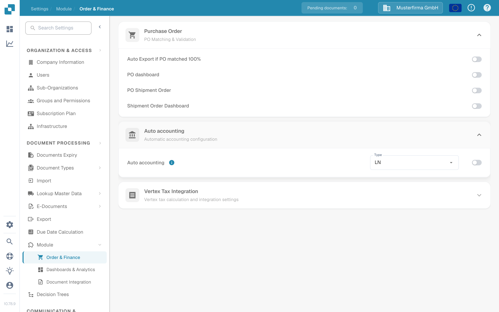
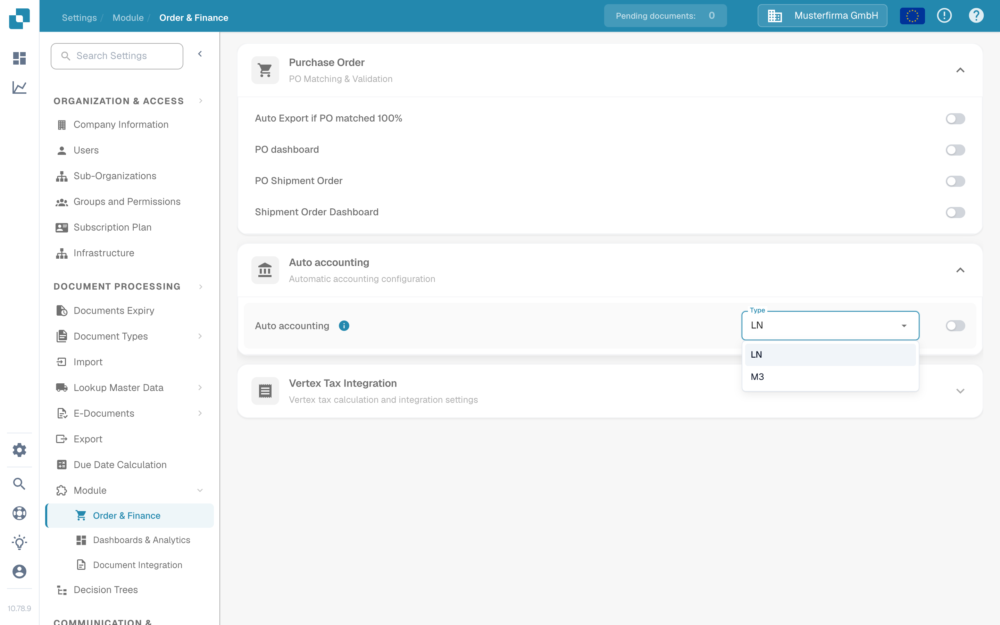

# 自动会计

当 Infor LN 管理员希望 DocBits 使用导入的财务主数据进行自动会计时，请使用本指南。旧版页面展示了来自某个 Infor 租户的 48 个界面。该租户的连接点名称、映射、凭据和端点地址不能作为可复用的配置。

## 在 DocBits 中查找设置

使用管理员账户打开 **Settings → Module → Order & Finance → Auto accounting**。**Type** 菜单提供 **LN** 和 **M3**。对于 LN 集成，请确认所选类型为 **LN**。只有在确认目标 LN 公司、BOD 流和已导入的主数据无误后，才启用开关。更改类型或开关可能会影响会计行为，因此请遵循组织的变更流程。

以下英文截图来自合成环境 **DocBits Documentation Test A** Sandbox。在该组织中，已选择 **LN**，且 Auto accounting 处于**关闭**状态。菜单已打开，但未选择其他值；没有保存任何设置。

<figure><figcaption>
找到 Auto accounting，并在启用之前确认所选类型。
</figcaption></figure>

<figure><figcaption>
此 Sandbox 提供 LN 和 M3 两种类型；未更改任何选项。
</figcaption></figure>

## 准备 LN 和 ION

1. 确认 LN 公司、会计实体、DocBits 组织和目标环境。与 DocBits 管理员商定当前哪个 API 操作和字段映射将接收科目和维度。请将 API 凭据保存在经批准的密钥存储中，切勿放入截图或 Jira 附件。
2. 在 LN 中配置 BOD 发布并验证发布数据设置。Infor 在其 [LN BOD 发布指南](https://docs.infor.com/ln/10.7.in/en-us/lnolh/help/tc/onlinemanual/000520.html)中介绍了 **BOD Parameters (tcbod0100m000)** 和 **Validate Publishing Data Setup (tcbod0300m000)**。
3. 检查 LN 版本和 DocBits 接收操作所需的名词。先前的示例使用 `Sync.ChartOfAccounts` 和 `Sync.CodeDefinition` 传输会计科目表和维度数据。Infor 的 [Publish Financial Master Data (tfbia0200m000)](https://docs.infor.com/ln/2025.x/en-us/lnolh/tfolh/help/tf/bia/tfbia0200m000.html)列出了会计科目表和 CodeDefinition 选项。只有在指定并批准维度映射后，才会显示某些 CodeDefinition 选项卡。在路由这些文档之前，请确认租户中的确切文档版本和字段。
4. 在 **ION Desk → Connect → Connection Points** 中，将 LN 源连接到经批准的 DocBits API 目标。在 **Data Flows** 中路由所选文档，检查筛选器和映射，然后保存并激活。Infor 区分了[保存流与激活流](https://docs.infor.com/inforos/latest/en-us/useradminlib_cloud/iondeskceug/lsm1436532178755.html)。
5. 在 LN 中使用非敏感测试标识符。在 **Publish Financial Master Data** 中，先使用 **Count** 或 **Simulate** 检查所选内容，然后仅在管理员批准的变更流程下使用 **Publish**。发布操作并非针对特定目标：Infor 表示，它会将数据发送给所有订阅方。请在 [ION OneView](https://docs.infor.com/inforos/latest/en-us/useradminlib_cloud/iondeskceug/lsm1436532196155.html)中跟踪该标识符及任何错误。

## 确认 DocBits 中的结果

请 DocBits 管理员在当前导入日志或 API 日志中验证接收到的记录、组织和会计字段。如果相关查找表已开放，请在 **Settings → Document Processing → Lookup Master Data** 下搜索同一标识符。ION 流成功激活本身并不能证明 DocBits 已接受记录。如果缺少某个值，请先比较源 BOD、ION 映射、API 响应和目标组织，再启用自动会计。

本次端到端测试无法使用 LN 租户或实时财务 BOD 传输。新的 Sandbox 图片仅验证当前 DocBits 控件。租户管理员必须验证最终映射和会计结果。
