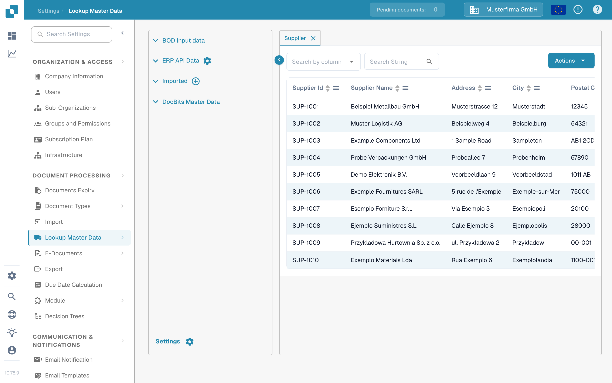
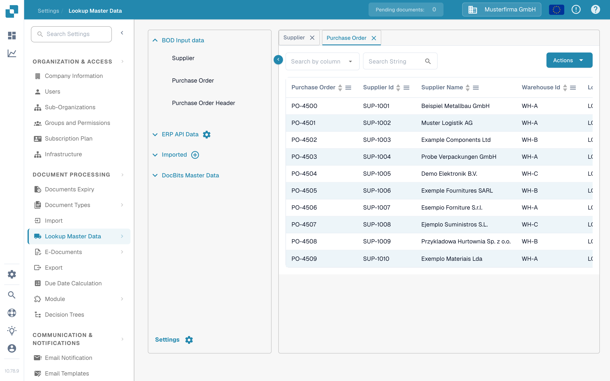

# 通过 ION API 从 Infor M3 导入主数据

当 Infor M3 管理员需要通过 Infor ION 和 API Gateway 向 DocBits 传送选定的 BOD 时，请使用本指南。本页的旧版本包含 42 张来自某个较早 Infor 租户的屏幕截图，以及固定的 Sandbox API 地址。这些屏幕和地址不能作为其他租户的安全配置模板。

需要检查的路径是：**M3 发布 BOD → ION 路由 BOD → API Gateway 调用 DocBits API → DocBits 显示导入的记录**。每个阶段都有自己的状态。在 DocBits 中看到记录才是最终确认；仅有处于活动状态的 ION 数据流并不能证明已完成导入。

## 配置数据流之前

1. 确认要连接的 M3 公司、ION 租户、DocBits 组织和环境。向 DocBits 管理员获取当前 API 基础 URL，以及该环境 OpenAPI 描述中要求的 API 操作。不同区域的主机可能不同；不要照搬旧屏幕截图中的主机或 API Gateway 代理路径。
2. 确认组织需要哪些文档类型。在 DocBits 中可以检查供应商和采购订单主数据。只有在用途和接收操作均已确认时，才添加交付和会计文档。
3. 准备一个有权调用所选 API 操作的 Infor 服务账户，以及一个仅具备所需最低权限的 DocBits API 凭据。只能在获准的配置界面中输入凭据。不要将完整的 `.ionapi` 文件或 API 密钥粘贴到文档页面、Jira 工单或屏幕截图中。
4. 为每个选定的 BOD 准备一个不敏感的测试标识符，以便在 M3、ION OneView 和 DocBits 中追踪同一条记录。

## 选择文档和接收操作

旧租户示例使用了以下 BOD。在创建连接点之前，请根据当前 API 元数据和集成设计确认每项映射：

| 旧示例中的 BOD | 预期的 DocBits 数据 | 接收格式检查位置 |
| --- | --- | --- |
| `Sync.SupplierPartyMaster`, `Sync.RemitToPartyMaster` | 供应商主数据 | [供应商 BOD 导入](../importing-via-the-api/supplier-bod.md) |
| `Sync.PurchaseOrder` | 采购订单 | [采购订单 BOD 导入](../importing-via-the-api/purchase-order-bod.md) |
| `Sync.ReceiveDelivery` | 交付数据 | [Receive Delivery BOD 导入](../importing-via-the-api/receive-delivery-bod.md) |
| `Sync.AdvanceShipNotice`, `Sync.ChartOfAccounts`, `Sync.CodeDefinition-AccountingDimension` | 已配置功能所需的其他主数据 | [主数据 XML 导入](../importing-via-the-api/master-data-xml.md)以及租户的 API 元数据 |

`Acknowledge.SupplierInvoice` 属于发票确认工作流，应与 M3 到 DocBits 的主数据导入分开配置。旧页面混淆了这两个方向，并包含特定于租户的请求正文；在未审核端点契约和访问控制之前，不要将该请求正文复制到新数据流中。

## 配置 Infor OS 和 ION

1. 在 Infor OS 中，为**已确认**的 DocBits API 操作准备 API Gateway 目标。与 DocBits 管理员一起检查目标 URL、请求方法、请求格式和身份验证。Gateway 控件的说明请参阅当前的 [Infor API Gateway 指南](https://docs.infor.com/inforos/2025.x/en-us/useradminlib_cloud/apigatewayag_cloud/ionapi_2025.x_apigatewayag_cloud_en-us.pdf)。
2. 在 **ION → Connect → Connection Points** 中，为 DocBits API 创建或选择连接点。只在 **Documents** 中添加选定的 BOD，选择匹配的 Gateway 操作，并配置该操作所需的请求负载。Infor 的 [API 元素说明](https://docs.infor.com/inforos/latest/en-us/useradminlib_cloud/iondeskceug/hqg1491985489422.html)介绍了服务账户和请求设置。
3. 在 **ION → Connect → Data Flows** 中，连接 M3 源和 API 目标。检查文档列表、筛选条件和映射，然后保存并激活数据流。Infor 对[保存和激活数据流](https://docs.infor.com/inforos/latest/en-us/useradminlib_cloud/iondeskceug/lsm1436532178755.html)作了区分。
4. 从 M3 发布一个已批准的测试 BOD。在 **ION OneView** 中查找该标识符，并确认处理该 BOD 的连接点、映射和 API 调用。请参阅 [Infor OneView](https://docs.infor.com/inforos/latest/en-us/useradminlib_cloud/iondeskceug/lsm1436532196155.html)。如果看不到路由或显示错误，请先修复 ION 数据流，再检查 DocBits。

## 在 DocBits 中验证结果

打开 **设置 → 文档处理 → 查找主数据**。展开 **BOD 输入数据**，选择相关类型，然后搜索测试标识符。下方显示的 **供应商**和**采购订单**选项卡，是合成的 **DocBits Documentation Test A** 组织当前使用的英文界面。界面中已有的演示行**不能证明数据来自 M3 导入**。

<figure><figcaption>
选择 Supplier，选取搜索列，并输入测试供应商标识符。
</figcaption></figure>

<figure><figcaption>
选择 Purchase Order 并搜索测试订单；图中所示的行是合成演示数据。
</figcaption></figure>

在任一选项卡中，**Search by column** 用于选择字段，**Search String** 用于输入标识符，放大镜按钮用于执行搜索。表头可对可见行排序；底部的箭头可用于翻页。**Actions** 会打开表格操作；此只读检查不需要使用它。选项卡上的 **×** 可关闭该选项卡。**Imported** 旁的加号按钮用于上传 CSV，并非用于接收 ION BOD。

如果在 OneView 中能看到 BOD，但 DocBits 中没有对应记录，请检查 API 操作及响应、组织和环境、文档类型、负载格式，以及搜索时使用的标识符。向 DocBits 管理员索取相应的导入日志。不要仅凭 HTTP 调用或无关演示行的屏幕截图就推断导入成功。

本页根据当前 DocBits Sandbox 控件和 Infor 文档更新。由于无法使用 Infor 租户，也无法进行真实的 M3 到 DocBits BOD 传输，因此未完成端到端测试；租户管理员必须验证最终映射和结果。
