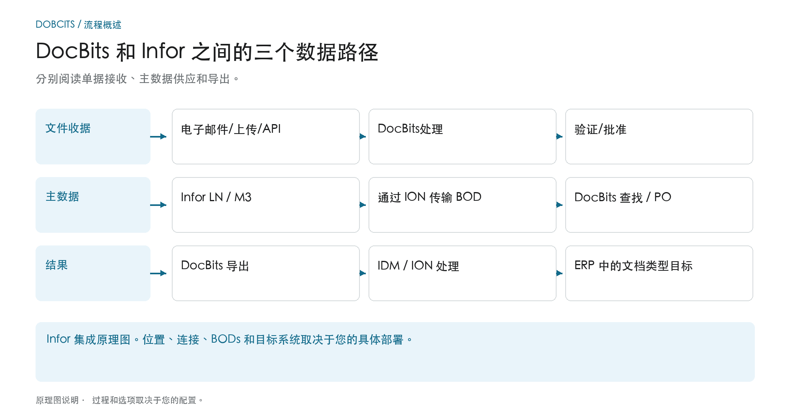
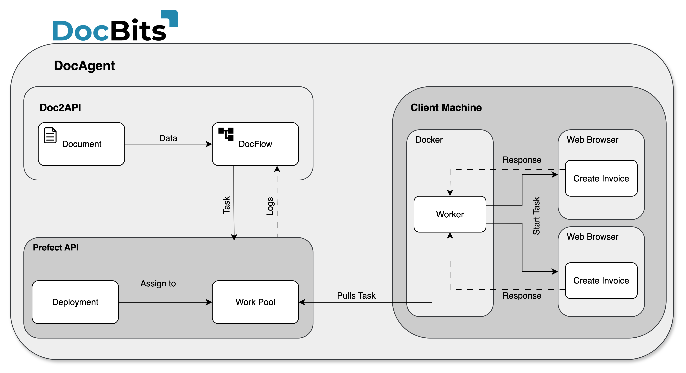

# 架构

## 该架构由三个独立的数据路径组成

<figure><figcaption>
分别阅读单据接收、主数据供应和导出。 该图是示意性的；您组织的活动设置决定了实际行为。
</figcaption></figure>

该架构包含多个具有不同目的的数据流。文件导入进行处理；主数据来自ERP集成；识别和审核的结果通过配置的导出路径返回。这些路径是单独的连接，在诊断期间应单独跟踪。

| 数据路径 | 方向和目的 | 检查站 |
| --- | --- | --- |
| **文件收据** | 电子邮件、上传或接口 → DocBits。文件被发送到预期的处理过程。 | 正确的文件是否到达了正确的组织？ |
| **主数据供应** | LN/M3 → BODs 和 ION 数据流 → DocBits。供应商和订单可供识别和核对。 | 所需的数据集是否已被 DocBits 传输并接受？ |
| **结果导出** | DocBits → 配置的 Infor 连接 → IDM 或 ION 和 ERP。文档和业务数据可以采用不同的下游路径。 | 目的地的转移和相应处理是否得到证实？ |

在此描述的 Infor 导出中，PDF 及其属性被发送到 IDM，`Sync.CaptureDocument` 被发送到 ION Desk。 ION根据文档类型将其转换为所需的目标BODs。 LN 或 M3 的接受必须在各自的目标系统中进行验证；单独的 DocBits 步骤并不能证明每个下游处理步骤。

**使用概述来调查错误：** 如果文档丢失，请从导入开始。如果缺少供应商或采购订单行，请遵循主数据路径。如果返回传输失败，请检查导出配置、收件人响应和 ION/ERP 处理。下面的架构图将部署和组件详细信息添加到此流程概述中。

此外：[导入文档](../../end-user-and-partner-section/end-user-section/how-to-import-documents/README.md)、[导入客户主数据](../../infor-integration-and-configuration/importing-customer-master-data/README.md) 和 [从 DocBits 导出](../../infor-integration-and-configuration/exporting-in-docbits/README.md)。

## **DocBits 云端客户**

<figure><figcaption></figcaption></figure>

## DocBits 本地部署

<figure><figcaption></figcaption></figure>

Doc**Bits** 通过 ION API、ION Desk 和 Infor 标准 BOD 与 Infor LN/M3 无缝集成。通过 API 集成，我们可以将数据导出到 Infor，并在 Doc**Bits** 中执行主数据验证。

## **DocBits Operator 架构**

组件之间的所有连接均使用行业标准加密协议进行保护。SSH、HTTPS 和其他安全通道可确保整个系统中的数据完整性和机密性。

**本地部署：**&#x20;

<figure><figcaption></figcaption></figure>


[Prefect 本地设置要求](prefect-local-setup-requirements.md)


**云端**：

<figure><figcaption></figcaption></figure>

## 将数据导出到 Infor

我们使用 ION API 将带有属性的 PDF 发送到 IDM，并将 BOD Sync.CaptureDocument 发送到 ION Desk。在 ION Desk 中，我们根据正在处理的文档类型，将 [Sync.CaptureDocument](../../infor-integration-and-configuration/exporting-in-docbits/) 转换为所需的目标 BOD。随后，这些转换后的 Infor BOD 会自动导入 LN 或 M3。


导出到 [Infor](../../infor-integration-and-configuration/exporting-to-infor/)


## 在 DocBits 中验证主数据

为识别供应商或比较/匹配采购订单行，我们会在 LN/M3 中激活一个触发器，将 Sync.RemitToPartyMaster、Sync.SupplierPartyMaster 和 Sync.PurchaseOrder BOD 发送到 Doc**Bits**。我们在 ION Desk 中配置此流程，将数据流定义到 Doc**Bits** 的特定连接点。

<figure><figcaption></figcaption></figure>


[主数据验证](../../infor-integration-and-configuration/importing-customer-master-data/)


## 电子邮件导入 OAuth Office365

<figure><figcaption></figcaption></figure>
