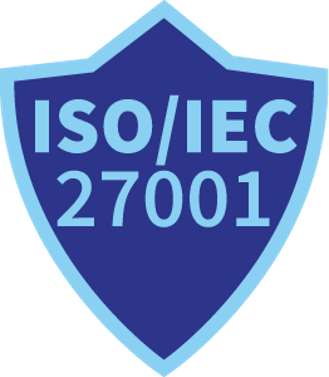
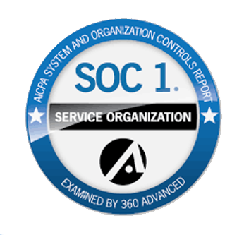
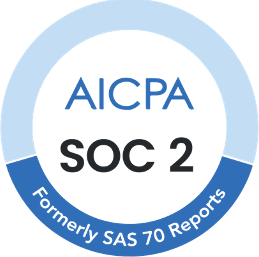
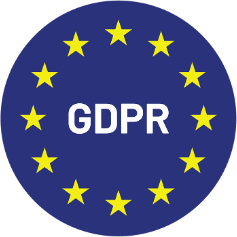

# 认证

DocBits 由 **Fellowpro AG** 运营，遵循全面的信息安全、隐私保护和内部控制计划。以下认证均每年接受独立审计；客户可直接从本页下载正式的鉴证报告。


您的采购、安全或合规团队需要证书吗？本页上的每份报告都是经签署的审计交付文件，无需签署保密协议。如对范围、控制措施或即将进行的审计有疑问，请联系 **compliance@fellowpro.com**。


## 1. ISO/IEC 27001

<figure><figcaption></figcaption></figure>

这项国际标准规定了建立、实施、维护并持续改进信息安全管理体系（ISMS）的要求。它通过风险管理流程和信息安全控制措施，帮助组织以系统且经济高效的方式保护数据。

**对客户的影响：**确保 DocBits 遵循最高级别的信息安全标准，让客户确信敏感数据得到了妥善保护。

**最近一次审计：**监督审计 SA1，2025 年——Fellowpro AG ISMS。



## 2. SOC 1（服务组织控制 1）

<figure><figcaption></figcaption></figure>

SOC 1 报告面向需要证明财务报告相关内部控制有效性的组织。对于会影响客户财务报告的服务提供商而言，这类报告尤为重要。

**与 DocBits 的相关性：**体现我们致力于维持严格的财务数据内部控制，让客户确信我们的流程可靠。

**最近一次审计：**SOC 1 Type II——报告期为 2025 年。



## 3. SOC 2（服务组织控制 2）

<figure><figcaption></figcaption></figure>

SOC 2 关注与服务组织的数据安全性、可用性、处理完整性、保密性和隐私保护相关的控制措施。对于处理敏感信息的技术和云计算公司而言，这项认证至关重要。

**对客户的价值：**通过独立验证，证明 DocBits 已实施有效控制措施来保护客户数据，确保我们的软件和服务值得信赖。

**最近一次审计：**SOC 2 Type II——报告期为 2026 年。



## 4. GDPR（通用数据保护条例）合规性

<figure><figcaption></figcaption></figure>

GDPR 是欧盟法律中的一项法规，涉及欧盟和欧洲经济区的数据保护与隐私。该法规还涉及将个人数据传输到欧盟和欧洲经济区以外地区的情况。

**对客户的保障：**遵守 GDPR 可确保 DocBits 按照欧盟法规处理个人数据，保护用户隐私并遵循严格的数据处理准则。

**最近一次审计：**独立 GDPR 审计报告，2025 年。



---

如需其他文档——例如 DPA 模板、子处理者名单、渗透测试摘要或安全问卷——请联系 **compliance@fellowpro.com** 或您的 DocBits 客户成功联系人。
