# 平台架构

DocBits 平台分为多个层：边缘 / Web、身份验证、导入、核心 API、数据存储和后台服务。有关产品中的实时视图，请参阅[基础设施](../../administration-and-setup/settings/infrastructure.md)。

<figure><figcaption>
DocBits 平台组件关系示意；组件与区域部署以实际环境为准。
</figcaption></figure>
