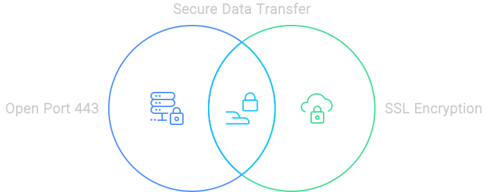
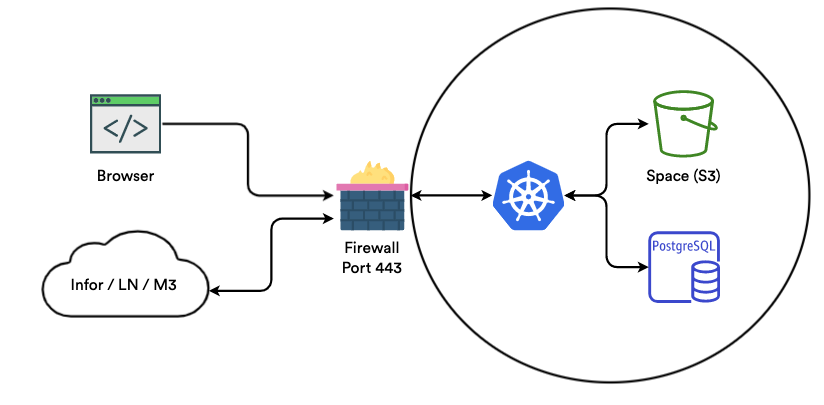
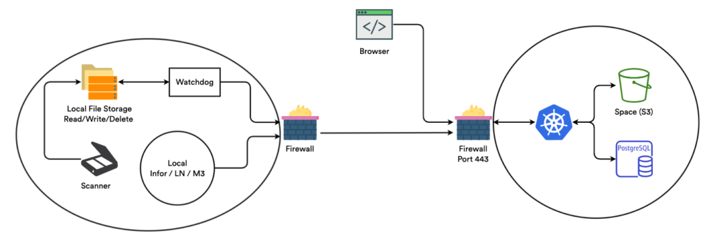

# Infor 基础设施

### 开放 443 端口与安全通信

我们深知安全传输数据的重要性。因此，我们使用开放的 443 端口（HTTPS 的标准端口），确保传输的所有数据都经过加密并受到保护。通过 SSL 保护的连接，确保您的数据在整个流程的每一步都安全无虞。

<figure><figcaption>
安全的数据传输
</figcaption></figure>

### 与数据库通信

在数据库通信方面，我们绝不冒险。我们的 Kubernetes 环境与数据库位于同一个虚拟私有云 (VPC) 中。这意味着我们只通过本地 IP 访问数据库，确保传输的数据始终留在本地网络内。这就像为您的数据开辟了一条专用高速公路。

### 空间

使用 Docbits 处理文档轻松便捷。所有上传的文档都会安全地存储在专用的“Space”中。我们使用 SSL 加密数据流量，并要求通过多个密钥访问文件，确保您的文档安全如保险库。

### 流量安全

我们只允许通过 HTTPS 安全连接与服务器通信。这能确保所有传输的数据都经过加密，妥善保护您的敏感信息。这就像全天候为您的数据配备了一名保安。

### Infor Cloud

<figure><figcaption></figcaption></figure>

### Infor 本地部署

灵活性至关重要，因此我们同时提供云端和本地部署解决方案。使用本地部署选项时，无需开放任何端口，从而确保您的网络安全不受影响。无论您使用云端，还是选择在本地部署，我们都能为您提供支持。

<figure><figcaption></figcaption></figure>
