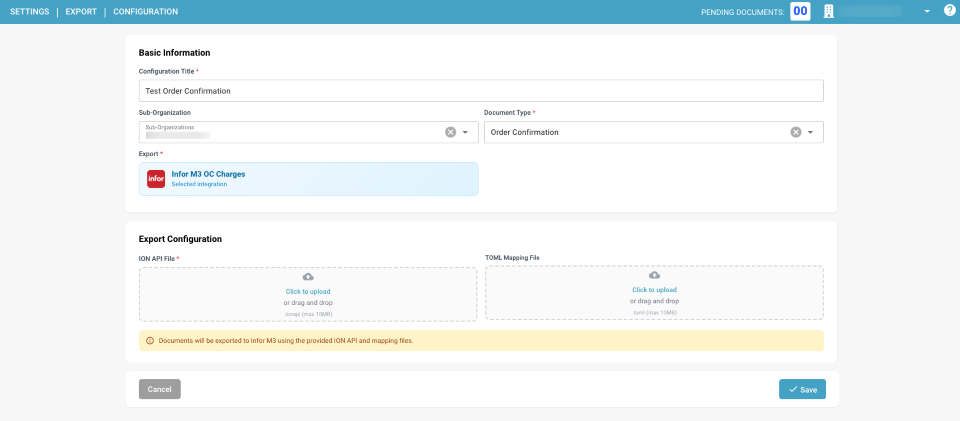
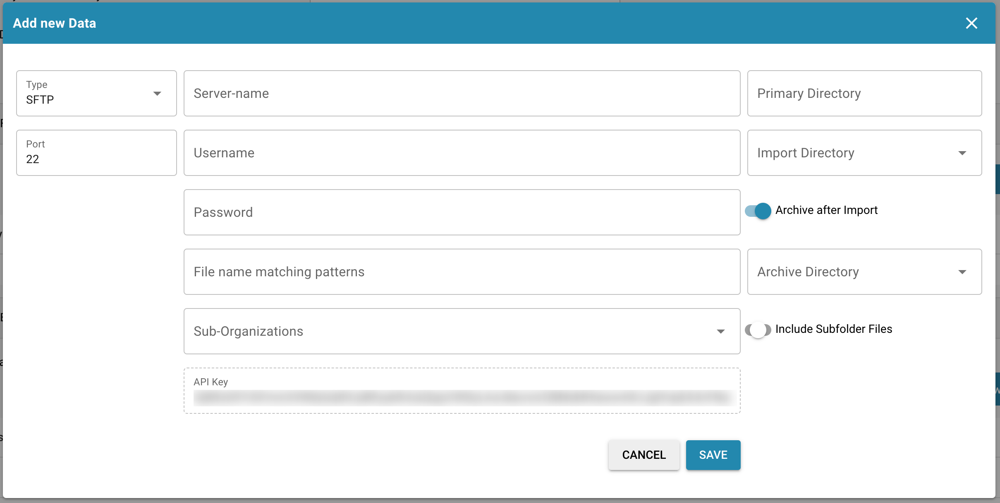

# 发行说明

**NOVA R1.1 可用情况：**自 **2026 年 10 月 16 日**起可在沙盒中使用。生产环境计划于 **2026 年 11 月 4 日**发布。



**DocBits 是产品。NOVA 是发布周期的名称。**[观看新 DocBits 版本介绍视频](https://docbits-videos.fra1.cdn.digitaloceanspaces.com/settings-assistant/nova-release/v1/zh.mp4) · [字幕](https://docbits-videos.fra1.cdn.digitaloceanspaces.com/settings-assistant/nova-release/v1/zh.vtt)。

选择发布渠道，了解团队将获得哪些变化。**NOVA 周期推出全新的 DocBits 主版本，并提供更多客户功能。VESTA 热修复则改进当前生产版本。**有关可用情况和渠道切换方式，请参阅[发布生命周期](../docbits-release-lifecycle-strategy.md)。

**此前在 VESTA 中作为测试版提供的功能已纳入 NOVA 沙盒。**此前在 VESTA 中作为测试版提供的所有功能，现已成为 NOVA 常规功能集的一部分，可在计划的生产版本发布前于沙盒中进行测试。这些功能也将在[计划于 **2026 年 11 月 11 日**发布的下一次 VESTA 热修复](vesta-hotfix-11-november-2026.md)中成为 VESTA 常规功能。

| 发布渠道 | 发行说明 | 重点 |
| --- | --- | --- |
| **NOVA – 主版本** | [客户新增功能](nova-major-release.md) · **2026 年 11 月 4 日（计划）** | 此前所有 VESTA 测试版功能，以及相较于 VESTA R1.0.15 的新功能和扩展。 |
| **VESTA — 下一次热修复（计划中）** | [2026 年 11 月 11 日](vesta-hotfix-11-november-2026.md) | 将此前所有 VESTA 测试版功能纳入 VESTA 常规功能集。 |
| **VESTA — 热修复版本** | [2026 年 10 月 14 日 — R1.0.15](incremental-updates-14-october-2026.md) | 改进并修复当前 VESTA 生产版本。 |

## NOVA – 主版本 2026 年 11 月 4 日

### NOVA 为您的团队带来的功能

* **将此前 VESTA 测试版功能作为 NOVA 常规功能使用。**此前在 VESTA 测试版中提供的所有功能都已纳入 NOVA，包括规则和布局管理控件。组织设置、文档类型开关和权限仍然适用。
* **使用验证助手解决文档阻塞问题。**询问文档被阻止的原因，跳转到相关字段，并查看建议的更正，全程无需离开文档。
* **将重复更正转化为经过审核的自动化改进。**审核人员可以提交改进请求；管理员可以评估已学习的规则建议、检查受影响的文档，并在启用后衡量效果。
* **了解并处理电子发票错误。**查看按验证级别分组的报告，检查文档类型政策及其历史记录，并以记录原因的方式拒收符合条件的发票。
* **设置并管理 FTP/SFTP 导入。**使用连接向导，按文件查看导入步骤，配置重试和失败通知，并可选择在成功导入后删除源文件。
* **减少匹配交付行项目时的重复操作。**先选择文档或采购订单行项目，再从任一侧进行关联。配置后的导出可以保留子行项目详情，并按行项目值对记录分组。
* **将已导出的工作与已完成的工作分开。**使用“已导出”状态进行后续处理，还可以选择锁定“已完成”文档，防止常规重新打开。
* **直接访问规则和布局控件。**无需通过测试版链接即可打开管理面板、搜索和预览布局，并从文档中打开布局编辑器。
* **管理提取和日常管理任务。**使用指定的页数重新启动文档，选择是否提取隐藏字段，使用更多设置助手操作，并将通知规则限制在子组织范围内。

### 规则设置指南

* [**转换规则**](../../administration-and-setup/settings/global-settings/document-types/transformation-rules.md)：清理并改写提取的值，创建一系列步骤并预览结果。**观看：**[观看视频](https://docbits-videos.fra1.cdn.digitaloceanspaces.com/settings-assistant/transformation-rules/v1/en.mp4)。
* [**自定义验证规则**](../../administration-and-setup/settings/global-settings/document-types/custom-validation-rules.md)：为字段和表格行定义检查项，选择条件和严重级别，并测试规则。**观看：**[观看视频](https://docbits-videos.fra1.cdn.digitaloceanspaces.com/settings-assistant/custom-validation-rules/v1/en.mp4)。
* [**采购订单匹配规则**](../../administration-and-setup/settings/global-settings/document-types/more-settings/purchase-order/purchase-order-matching-rules.md)：配置匹配类型、公差和执行顺序，并管理规则版本。**相关视频 — 选择合适的自动化方式：**[观看视频](https://docbits-videos.fra1.cdn.digitaloceanspaces.com/settings-assistant/choose-automation/v1/en.mp4)。

[浏览所有功能视频](nova-major-release.md#watch-the-feature-videos)，包括布局、Touchless Intelligence、电子发票验证和六集 AI 表格系列。

[阅读完整的 NOVA 功能对比](nova-major-release.md)，其中包括启用要求、其他改进以及全部 **16 个服务版本**。

**VESTA 基线包括现有功能和测试版功能：**原有的设置助手、基本导入健康警告、AI 层级、Header Field Check、Touchless Intelligence 仪表板、规则引擎、主数据查询后的转换，以及基本规则执行日志。NOVA 发行说明会区分从测试版转为常规可用的功能与这些功能的进一步扩展。

## VESTA — 热修复版本 <a id="vesta-hotfix-releases"></a>

**下一次计划发布的热修复：[2026 年 11 月 11 日](vesta-hotfix-11-november-2026.md)。**此前在 VESTA 中作为测试版提供、现已纳入 NOVA 的所有功能，都将在此次热修复中成为 VESTA 常规功能。

**最新发布的热修复：[2026 年 10 月 14 日 — R1.0.15](incremental-updates-14-october-2026.md)。**此次 VESTA 热修复引入了设置助手、更新后的 AI 层级、Header Field Check、登录改进和采购订单费用匹配改进。

此前的 VESTA 热修复说明：

* [2026 年 9 月 15 日 — R1.0.13](incremental-updates-15-september-2026.md)
* [2026 年 9 月 8 日](incremental-updates-8-september-2026.md)
* [2026 年 8 月 12–25 日](incremental-updates-12-25-august-2026.md)
* [2026 年 7 月 29 日 – 8 月 12 日](incremental-updates-29-july-12-august-2026.md)
* [2026 年 7 月 14–29 日](incremental-updates-14-29-july-2026.md)
* [2026 年 7 月 4–14 日](incremental-updates-4-14-july-2026.md)
* [2026 年 7 月 3–4 日](incremental-updates-3-4-july-2026.md)
* [2026 年 6 月 30 日 – 7 月 3 日](incremental-updates-30-june-3-july-2026.md)
* [2026 年 6 月 26–30 日](incremental-updates-26-30-june-2026.md)
* [2026 年 6 月 21–25 日](incremental-updates-21-25-june-2026.md)

以下保留原始版本公告以供参考。

## **版本 R1.0 2026 年 6 月 13/14 日**

> **沙盒可用日期：**2026 年 4 月 28 日

### 新功能：

* **活动日志 / 访问审计：**\
  在整个应用中提供详细的活动日志和访问审计跟踪，用于合规和监控。为所有微服务提供不同类型的日志记录，并可按时间范围筛选。
* **全局快速搜索：**\
  在应用的任意位置按 Cmd+K / Ctrl+K，即可搜索 200 多个路由和 40 多个页面内功能。显示前 8 个结果，支持模糊匹配、方向键导航，以及指向完整应用索引页的链接。
* **站点地图（应用索引页）：**\
  可搜索的索引页，列出 DocBits 中所有可导航页面和页面内功能（对话框、侧边栏、面板）。内容分为 18 个类别，支持类型筛选、类别标签、与 URL 同步的搜索；受权限限制的条目会向非管理员用户显示为锁定状态。
* **分析仪表板：**\
  全面的文档处理分析功能，包括执行概览、API 指标、质量指标、处理性能、文档流分析、活动日志、事件日志和审计跟踪。
* **仪表板导出功能：**\
  新增仪表板导出功能，可将列表导出为 CSV 或 XLSX 格式。
* **全文搜索 / DocSearch：**\
  基于 AI 的向量搜索，可搜索所有已编制索引的文档，支持实时供应商筛选、“查找相似项”功能以及可配置的索引设置。
* **供应商交付统计：**\
  新增视图，用于了解供应商相关的文档处理指标。
* **调试信息收集器：**\
  按 Ctrl+Shift+P 可采集完整的调试快照，包括 API 调用、WebSocket 状态、错误、控制台日志、性能指标和环境信息。快照可复制到剪贴板，也可以直接作为支持工单发送，并附带 HTML 格式报告和 JSON 文件。
* **AI 智能体（DocNet）：**\
  可自主运行的后台智能体，自动处理收到的电子邮件，包括分类、提取和路由文档，无需人工干预。智能体独立执行分配的任务；需要人工判断时，会通过审批请求升级给用户。还包括专用的智能体仪表板，用于监控活动和性能。
* **新电子文档：**\
  新增 80 多种全球电子发票类型和 40 多种格式，包括 XRechnung 3.0.2、ZUGFeRD 2.2/2.3.2、Factur-X 变体以及亚太地区 PINT 贷项通知单。分类和提取覆盖率达到 100%。
* **AI 脚本聊天：**\
  AI 助手聊天功能，可协助进行基础脚本开发，并实时流式输出响应。
* **脚本版本控制：**\
  提供完整的脚本版本历史，支持跟踪更改、比较和还原。为脚本提供版本管理，方式类似于电子文档版本的维护方式。
* **仪表板操作中的导出历史记录：**\
  可直接从仪表板操作菜单中查看文档的导出历史记录。
* **通用 API 导出器（APS450、GLS840）：**\
  通过映射文件配置灵活配置通用 API 导出目标，与外部系统集成。现已支持 APS450 和 GLS840。
* **多个导出配置：**\
  支持为每种文档类型配置多个有效的导出配置，并可设置执行顺序；新增重新导出按钮，可从失败步骤重试。
* **新版 Watchdog：**\
  全面重做 WatchDog 设置页面。新增多项易用性功能，包括当前 WatchDog 状态、安装指南和命令、XSLT 模板配置，以及自动更新设置。还实现了 WatchDog 同时处理多个配置的功能。
* **Vertex 集成：**\
  通过 Vertex 集成消费税，用于在文档处理过程中自动计算税款并确保合规。
* **UI 重新设计与设置重做：**\
  全面焕新应用界面。重新设计登录和身份验证页面。重新设计设置区域，新增可折叠侧边栏、经过整理的子类别、基于锚点的导航、上下文帮助面板和状态跟踪徽章。调整文档脚本 UI。重新设计文档流 UI。改进值列表 UI。
* **创意板：**\
  功能请求板，用户可以提交、讨论和投票提出新功能、改进、所需的错误修复等，并支持富文本编辑器和图片。
* **API 密钥管理：**\
  新增专用设置页面，用于创建、查看和管理多个 API 密钥。
* **主数据查询搜索功能：**\
  改进主数据搜索能力，可根据所选字段提供适用的搜索选项。
* **用户活动图表：**\
  以图表直观显示用户活动模式和参与度指标。登录活动仪表板包含趋势对比图、按日/周汇总，以及基于 GeoLite2 的地理位置数据。
* **用户登录历史：**\
  用户详情视图中新增登录历史。
* **可自定义侧边栏：**\
  支持拖放重新排序、显示/隐藏切换，以及将侧边栏菜单项固定在顶部。用户偏好会按用户保存，并提供“重置为默认值”选项。遵循功能标志设置。
* **视频轮播：**\
  准备仪表板页面新增自动播放视频轮播，展示简短的动画产品提示视频（全局搜索、键盘快捷键、文档上传、表格自定义）。采用两列布局，左侧显示视频，右侧显示仪表板准备内容。用户浏览视频时会暂停自动跳转。
* **高级工作流设计器：**\
  可视化节点式自动化构建器，提供拖放画布以创建多步骤处理流水线。支持等待步骤、并行路径、可重复使用的模板、Or 条件卡、手动测试/运行按钮、“从此处测试”部分执行，以及每个节点的执行日志；通过可视化流程突出显示已执行的节点。
* **工作流 KPI 仪表板：**\
  用于监控工作流执行情况的关键指标仪表板。
* **工作流合作伙伴卡片 SDK：**\
  为第三方开发者提供 SDK，用于构建自定义工作流卡片，并包含 AI 驱动的审核、沙盒验证和入门文档。
* **工作流测试管理器：**\
  自动化工作流测试管理器，管理员可以单独或批量创建并运行测试。

### 改进：

* **数据库（所有模块）— ID 列迁移：**\
  DocBits 中所有数据库“ID”列均已在内部从字符串迁移为专用 ID 类型（UUID7）。底层 Postgres 数据库已迁移至 V18，以支持此项改进。
* **文档处理 — 进一步改进：**\
  已更改与要考虑的最大页数有关的导出逻辑——现在会导出整个文档。验证文档时，用户可以覆盖默认的最大页数限制，仅对当前文档生效。待处理文档计数器的计算也已改进。
* **服务版本、状态和部署日期：**\
  “服务版本”弹窗中会提供服务可用状态。
* **扩展语言支持：**\
  支持的语言扩展至 22 种，并更新了语言选择器。
* **字段级访问控制设计：**\
  重新设计并改进访问控制，提供更清晰的启用状态、字段级访问、一致的规则处理方式以及简化的基于组的权限。修复访问控制与查看权限之间的冲突规则，在 UI 中显示导入所有者，并在字段验证、AI 提取的表格和所有视图中一致地应用访问控制。
* **所有屏幕均可使用活动流：**\
  现在，所有文档处理屏幕（待验证、采购订单匹配、会计、报价详情、拒收）均可使用活动流，不再仅限于“待审批”页面。活动流在所有屏幕中统一放置于右侧面板。
* **文档流页面：**\
  新增专用页面，用于直观显示并跟踪文档处理流程，显示状态转换和文档在流水线中的进度。
* **双显示器模式（全局用户设置）：**\
  双显示器模式已移至全局用户设置，可跨会话保留。
* **布局构建器改进：**\
  支持隐藏和只读字段并提供视觉指示器、可调整大小的面板分隔线以及字段长度设置。可将默认布局应用于多个来源，无需逐个访问。

## **版本热修复 3，2026 年 4 月 16 日**

### DocBits 改进：

* **波兰发票二维码提取：**\
  DocBits 现支持专门针对波兰发票进行二维码提取，从而改进源自波兰的文档的自动数据采集。

### 错误修复：

* 修复采购订单匹配已完成但采购订单未与文档关联时自动导出失败的问题。
* 修复包含包装单位（Verpackungseinheiten / VPE）的发票单位价格被错误舍入的问题。
* 修复 DocBits 未显示来自 ION/MEC 的导出错误消息（例如 Acknowledge.PurchaseOrder 失败），而是在导出失败时仍显示“已导出”状态的问题。
* 修复使用 AI 表格提取时，审批屏幕上的单位价格不正确的问题。
* 修复验证屏幕上的 Total Matching 脚本报错的问题。
* 修复文档处理失败并显示错误（“UserAuthentication object has no setter for 'org\_id'”）的问题。
* 修复特定供应商的表格训练不起作用、列落入隐藏列而非映射字段的问题。
* 修复因超过多部分请求大小限制而导致大型发票（10 页以上）采购订单匹配失败的问题。
* 修复文档重新启动后，脚本填充的列值未保存的问题。
* 修复“忽略表格验证”开关在 UI 中显示为启用（绿色），但后台实际上处于停用状态的问题。
* 修复导入后文档质量显著下降的问题。
* 修复完整部署推送后，应用中显示的微服务版本和部署日期在不同环境之间不一致的问题。
* 修复根据任务数据构建用户身份验证对象时出错，导致条码提取失败的问题。
* 修复在供应商门户中保存时供应商联系方式被清空的问题。
* 修复文档导出时出现 NoneType 错误的问题。
* 修复第一个附件为 PNG 或 JPEG 图片时未包含电子邮件正文的问题。
* 修复多份文档缺少电子邮件正文的问题。
* 修复 DocBits Operator“ai-exporting”未将导出结果发送至目标系统（LN/D3）的问题。

## **版本热修复 2，2026 年 3 月 31 日**

### DocBits 改进：

* **混合 PDF 处理 — 用户可控制 XML 提取：**\
  当 PDF 中包含嵌入式 XML 数据时，用户现在可以选择 DocBits 是使用嵌入式 XML 进行提取，还是将文档作为标准 PDF 处理。这使组织能够全面控制混合文档的处理方式，并确保使用最适合其工作流的提取方法。
* **审批屏幕上的 AP Assignment Code：**\
  AP Manager 审批页面现在包含 AP Assignment Code 字段，并与 Infor M3 CRS620 集成。审批人员可在审批过程中直接检查和确认分配代码，无需切换到外部系统。
* **采购订单总额与文档总额匹配：**\
  DocBits 现支持将采购订单总额与文档总额进行匹配，在采购订单匹配过程中增加一层验证，以便更早发现差异。
* **供应商物料编号和 VPE 更新：**\
  DocBits 现支持在文档处理期间更新供应商物料编号和 VPE（Verpackungseinheit / 包装单位）字段，并在导出时将值同步回 M3。
* **改进文档布局分类：**\
  文档布局 ID（tfidf\_id）现仅根据页眉文本生成，不再包含页脚文本。这样可以避免页脚内容影响文档类型检测，从而提高分类准确度。
* **导出并转到下一项：**\
  新增“导出并转到下一项”按钮，用户可导出当前文档并立即处理队列中的下一份文档，从而简化审核和导出工作流。
* **成本发票审批流程：**\
  通过改进路由和验证逻辑，增强了成本发票的审批流程。

### 错误修复：

* 修复 Infor SFTP 导出因库命令错误而失败的问题。
* 修复审批屏幕无法显示布尔值复选框的问题。
* 修复采购单位没有差异时仍发送 UNMU 消息的问题。
* 修复销售税在采购订单匹配屏幕上被错误分类为费用，导致未结金额为负的问题。
* 修复确认订单中未设置采购单位、但采购订单中存在采购单位时导出失败的问题。
* 修复多份文档缺少电子邮件正文的问题。
* 修复审批屏幕上看不到供应商物料编号、且更新未发送到 M3 的问题。
* 修复供应商导出到 Infor 时返回错误的问题。
* 修复采购订单匹配处理过程中出错的问题。
* 修复文档脚本中的 `findAll` 函数未正常工作的问题。
* 修复 Watchdog 的“更新者”列错误显示 Fellow Admin 用户而非实际用户的问题。
* 修复无法在 Watchdog UI 中配置 BOD-Mapping 的问题。
* 修复费用被错误显示为未结金额而非费用的问题。
* 修复即使已有匹配配置，多行发票的自动匹配仍不起作用的问题。
* 修复采购订单物料编号中的连字符（“-”）参与匹配、而发票中的连字符被忽略，导致误报不匹配的问题。
* 修复禁用“导出 PDF”开关后仍将 PDF 和 XML 文件都上传到导出文件夹的问题。
* 修复工作流卡片中缺少状态会导致文档无法继续流转的问题。
* 修复导入后文档质量显著下降的问题。
* 修复采购订单匹配屏幕报错（“Cannot read properties of null”）的问题。
* 修复无法编辑默认值列表的问题。
* 修复工作流无法正确读取字段状态，导致路由错误的问题。
* 修复入站电子邮件导入失败的问题。
* 修复导出时缺失的行项目未正确到达 M3 的问题。
* 修复已编码并已审批的发票偶尔未通过 APS110 API 更新为 M3 中“已审批”状态的问题。
* 修复多银行配置无法正常工作的问题。
* 修复共享仪表板显示和保存行为中的多个问题。
* 修复供应商物料编号字段限制为 30 个字符、导致无法存储更长值的问题。
* 修复单位价格和每单位价格导致导出报错的问题。
* 修复采购订单匹配规则已排除的状态（例如“已关闭”）下的采购订单行项目仍可在采购订单匹配屏幕上拖动和匹配的问题。

### 配置更改：

* 更新电子邮件模板，移除“转到任务”按钮。
* 调整成本要素的脚本和必填字段设置。

## **版本热修复 1，2026 年 3 月 16 日**

### DocBits 改进：

* **SFTP 导出中的文档历史记录：**\
  DocBits 现支持在导出到 SFTP 时将完整文档历史记录作为导出 XML 负载的一部分。此功能可通过导出设置进行配置，并向下游系统提供文档在 DocBits 中发生的每次状态更改和操作的完整审计跟踪，包括谁进行了更改、何时发生，以及更改前后的状态。这对合规、可追溯性和运营分析尤其有价值。
* **适用于 Infor On Premise 的确认订单费用更新：**\
  Infor On Premise 客户现在可在 DocBits 中直接处理包含费用的确认订单。费用会通过导出完整更新，使确认订单的端到端处理更加顺畅，并免去下游手动调整的需要。
*   **将默认布局应用于所有来源：**\
    布局配置屏幕新增 **将默认布局应用于来源** 按钮。管理员现在可以通过一次操作，将默认布局应用于组织中的所有来源，无需再逐个来源手动复制和粘贴布局 JSON。这在新客户上线时特别有用，因为需要为多个来源统一配置布局。

    <figure><figcaption></figcaption></figure>
*   **FTP 导入的文档类型选择：**\
    FTP 导入配置现支持按文件夹指定文档类型。配置 FTP 导入时，用户可以指定从该文件夹导入的所有文档所应用的文档类型，例如发票或确认订单。文档在导入时会自动分类，无需在导入后手动分配文档类型。此功能适用于在不同子组织和文件夹中管理多种文档类型的组织。

    <figure><figcaption></figcaption></figure>
* **导出到 GLS840（适用于 Infor On Premise）**:\
  DocBits 现支持 Infor On Premise 客户将文档导出到 GLS840 程序，扩展了本地部署环境支持的导出目标范围。
*   **Watchdog 和导出配置的 UI 改进：**\
    Watchdog 配置和导出配置屏幕已更新 UI，布局更加简洁，管理员管理这些设置时也更加直观。

    <figure><figcaption></figcaption></figure>

    <figure><figcaption></figcaption></figure>

### 错误修复：

* 修复拥有有效查看权限的用户无法查看文档的问题——权限逻辑已重构，使用访问级别检查替代此前基于用户组的筛选方式。
* 改进应用多个区域的异常处理，以提高稳定性。
* 修复字段提取过程中未正确处理布尔类型列的问题。
* 修复文件上传端点中的异步身份验证问题。
* 修复验证屏幕上采购订单表格的 UI 显示问题。
* 更新脚本模板，加入更改跟踪注释，以便更好地进行审计。
* 修复验证屏幕上的下拉字段行为异常的问题。
* 修复从仪表板更新文档分配时未预填子组织字段的问题。

## **版本 Winter Summit，2025 年 12 月 10 日**

### DocBits 改进：

*   **增强采购订单匹配规则自定义：**\
    DocBits 现为采购订单匹配规则提供更细致、灵活的控制。管理员可以针对每种文档类型，精确配置匹配过程中要评估的列，确保仅考虑最相关的字段。此外，还可以在列级别定义公差，从而更灵活地处理轻微差异。每条规则还可以配置为仅应用于手动匹配、自动匹配，或两者兼用，让团队能够根据实际运营需求定制匹配工作流。这些改进显著提升了采购订单匹配流程的灵活性和精确度。

    <figure><figcaption></figcaption></figure>
*   **支持多个供应商财务账户：**\
    DocBits 现支持通过 Infor 提供的 RemitToPartyMaster BOD 管理供应商的多个财务账户。组织可以为单个供应商维护多条收款账户记录，从而提高付款处理的灵活性和准确性。新增配置设置，可启用或禁用此功能，管理员可根据运营需求选择是否启用。

    <figure><figcaption></figcaption></figure>
*   **允许用户访问 OCR 提取结果：**\
    “字段验证”屏幕上的 **OCR 视图** 按钮现已向所有拥有验证权限的用户开放，不再仅限于管理员。现在，任何获授权的用户都可以直接查看 OCR 提取结果，从而更轻松地验证数据准确性并监控整体 OCR 性能。这项改进提高了透明度，也提升了验证工作流的效率。

    <figure><figcaption></figcaption></figure>
* **审批屏幕中的动态列渲染：**\
  改进审批视图，使其仅动态显示组织数据库偏好设置中配置为用于对比的列。此前，某些组织专用列在未配置为用于对比时也会显示为空白，造成困惑。现在，审批视图只显示实际参与对比的字段。这样可为不同组织提供更清晰、更符合其需求的审批屏幕，不再显示空白或无关列。
* **在主数据查询中添加订单类型字段**:\
  采购订单页眉列表现在在主数据查询中包含“订单类型”列，可提供更多分类方式。
* **自定义筛选仪表板改进：**\
  改进仪表板共享功能，为被共享的用户提供更大的灵活性。获得仪表板共享权限的用户现在可以调整和编辑仪表板筛选条件，以便根据自身需求定制显示的信息。这项改进支持更加个性化、交互性更强的查看体验，确保用户能够轻松筛选出与其任务最相关的数据见解。
* **可自定义审批屏幕列前缀：**\
  新增可配置选项，可在审批屏幕的文档列前显示前缀。管理员可以直接在布局构建器中管理此功能，全面控制是否显示前缀以及适用的文档类型。启用该选项后，用户在审批过程中查看文档时可以获得更清晰的上下文信息，提升可读性。

### 常规改进

* 改进表格提取中训练不足的表格的错误日志记录。
* 新增仪表板共享限制：最多可与 10 位用户或 5 个组共享；达到上限时会显示清晰的错误消息。
* 改进自定义仪表板的错误处理：用户尝试创建重名仪表板时会得到相应提示。

### 错误修复：

* 修复在“供应商详情”部分发送电子邮件时看似成功、但邮件实际上未送达收件人的问题。
* 修复添加到审批/拒收屏幕的下拉字段无法显示的问题。
* 修复所有导出的文档都被错误标记为由错误用户最后更新的问题。
* 修复文档显示“工作流进行中”状态，但没有执行任何工作流且日志为空的问题。
* 修复导出时将未对文档执行任何工作的无关用户分配给文档的问题。
* 修复拥有正确权限的用户无法拒收分配给自己的文档并收到错误的问题。
* 修复某些组织中无法显示文档流图标的问题。
* 修复通过拖放方式将文档上传到仪表板时出现弹窗的问题。
* 修复 E-TEXT 标志在 UI 中显示为启用、但 API 响应显示所有值均为 false 的问题。
* 修复上传包含空白页的文档时发生错误的问题。
* 修复电子邮件通知中的任务超链接未将用户重定向至正确审批屏幕的问题。
* 修复选择跨子组织后主数据查询中看不到任何供应商的问题。用户现在可以正确查看跨组织的供应商数据。

## 版本 Autumn Summit，2025 年 10 月 22 日

### DocBits 改进：

*   **电子邮件模板设计改进：**

    电子邮件模板编辑器经过重新设计，结构更加清晰，使用体验更加顺畅。选择文档字段变得更加直观，而且可以直接在模板中加入附件。这些改进让专业化、定制化电子邮件的创建更加快速、简单。

    <figure><figcaption></figcaption></figure>
*   **仪表板改进：**

    仪表板经过扩展，导航和自定义能力有所提升。通过新增的选项卡，用户可以更快地在不同文档类型之间切换，减少查找合适视图所花费的时间。

    <figure><figcaption></figcaption></figure>
*   **自定义筛选仪表板：**\
    此外，现在可以根据个人偏好自定义仪表板并应用筛选条件。这些自定义仪表板也可以与同事共享，让团队更轻松地创建一致的团队报告视图。

    <figure><figcaption></figcaption></figure>
*   **电子邮件通知日志：**

    现已为所有电子邮件通知提供日志功能。用户可以查看已发送通知的历史记录，从而更轻松地确认邮件是否送达，并在未收到邮件时排查问题。
*   **电子发票支持：e-SLOG 1.6 和 2.0：**

    新增对更多电子发票格式的支持。系统现在可以处理并生成 e-SLOG 1.6 和 2.0 版本，从而扩展与合作伙伴及监管要求的兼容性。
*   **重复检测改进：**

    重复检测新增两项强大的配置选项。**重复检测间隔**可让您定义时间范围，以便更精确地检查重复项；**禁止导出重复项**设置则会自动阻止导出检测到的重复文档。两项改进相结合，可提供更多控制并确保更高的数据准确性。

    <figure><figcaption></figcaption></figure>
*   **决策树改进：**

    决策树现更加灵活，能够返回文档字段值。这有助于构建更高级的自动化逻辑，使工作流能够根据实际文档数据做出决策。
*   **新增工作流卡片：**

    新增两种工作流卡片，扩展自动化能力。第一种可检查文档是否属于特定子组织，便于处理多实体设置。第二种新增交付日期公差检查，可按工作日将交付日期与当前日期进行比较，帮助更有效地管理和执行交付要求。
*   **CSV 导出改进：**

    CSV 导出功能得到显著改进。系统不再只导出当前页面显示的文档，而是导出数据集中的所有文档。每次导出都会创建一条日志记录，并自动通过电子邮件发送生成的 CSV，从而提供更加完整、可靠的导出流程。
*   **采购订单删除时限：**

    新增配置选项，管理员可以设置采购订单的删除时限。这项改进为数据保留政策增添了灵活性和控制能力，确保仅在适当的情况下删除采购订单。

### 错误修复

* 修复导出文档时包含旧数据的问题。
* 修正“导出错误”筛选器此前也显示其他状态的问题。
* 修复表格验证不匹配问题：尽管值正确，“单位价格”会触发错误，而“每单位价格”不会。
* 修复无法向仪表板添加新列的问题。
* 修复仪表板任务列中看不到任务的问题。
* 修复随机排序行为，使列表现在按一致顺序显示。
* 修复无法停止更改列宽的问题。
* 修复采购订单匹配屏幕阻止手动行匹配的问题。
* 修复保存后电子邮件附件选项被重置的问题。
* 修复首次打开自动会计时最初显示数据库 ID 的问题。
* 修正模糊字段行为，防止值被错误覆盖。
* 修复删除内容后自动会计中的字段消失的问题。
* 修复用户无法在设置弹窗中重命名“名字”和“姓氏”的问题。
* 修复文档可能卡在“工作流进行中”状态的问题。
* 修复菜单图标颜色问题，使所选组织颜色能够正确应用。
* 修复二维码有时无法识别的问题。
* 修复账户无法通过退格键删除以输入其他账户的问题。
* 修复生产环境推送后登录时出现的语言混用问题。

## 版本 **Summer Bloom**，2025 年 7 月

### DocBits 改进：

* **电子邮件导入日志筛选选项：**\
  用户现在可以筛选导入日志并对表格排序，以便更清晰、高效地查看信息。这项改进简化了识别和管理电子邮件条目的过程，提升了问题排查和整体日志管理效率。
*   **值列表多语言支持：**\
    我们扩展了值列表功能的多语言能力。管理员现在可以使用多种语言定义标签，系统会根据用户的系统语言设置自动显示相应标签。这项改进提升了可访问性和本地化水平，方便全球用户使用母语与平台交互。

    <figure><figcaption></figcaption></figure>
* **设置中的用户详情改进：**\
  设置界面现在会显示全面的用户信息。管理员可以轻松查看用户所属组、子组织详情及其他重要数据，从而更好地管理用户角色，并更清晰地了解团队结构。此外，管理员现在可以为组织创建系统管理员。
* **审批屏幕中的自动会计信息：**\
  审批屏幕现在会在发票信息旁显示自动会计详情。这项改进提供了更深入的交易数据见解，有助于简化审核流程，并帮助用户更全面地判断发票。
* **仪表板视图中的文档任务计数器：**\
  仪表板中的文档现在可以显示其关联的未完成任务，并显示待处理任务总数。用户可以快速了解尚待处理的操作，从而改进任务管理和工作流效率。
* **按供应商选择 AI 模型：**\
  用户现在可以按供应商选择用于数据提取的 AI 模型。这项改进支持精细优化，确保针对不同供应商提高提取准确度并改进整体数据处理效果。[了解详情](../../end-user-and-partner-section/end-user-section/validation-screen/README.md#supplier-based-ai-model)
* **决策树卡片的工作流日志改进：**\
  日志现在会显示决策树的输出，便于跟踪和了解工作流中决策的依据。
*   **引入全新的自动化测试设置，以增强系统功能和稳定性：**

    我们很高兴地宣布，现已实施新的自动化测试系统，旨在提升平台整体功能和可靠性。此设置会持续、全面地检查系统，以便在问题影响您的使用体验之前发现问题。通过自动运行这些测试，我们能够更快地响应潜在问题，并维持系统的高质量标准。
* **实施微服务架构：**\
  我们对平台进行了重构，将核心组件拆分为专用微服务。这一架构调整增强了可扩展性、提升了系统性能，并支持更快、更模块化的开发和部署周期。
*   **引导式教程：**\
    现已提供引导式教程，帮助用户更轻松地浏览并了解应用的不同部分。这对新用户入门或探索不熟悉的功能尤其有用。

    <figure><figcaption></figcaption></figure>
* **决策树改进：**\
  改进了决策树界面，包括更直观的行添加功能——现在位于树的顶部——让维护和编辑更加简单。
* **DocOperator**\
  DocOperator 等新的 AI 驱动工具可帮助自动处理重复任务，提升效率并减少文档工作流中的手动操作。
*   **电子文档预览选项：**\
    新增电子文档（eDocs）预览功能，用户可以在设置中直接测试和查看更改，然后再部署。\\

    <figure><figcaption></figcaption></figure>
* **新增语言支持——中文：**\
  DocBits 现已支持中文，进一步提升全球市场用户的可访问性和本地化体验。
* **改进任务仪表板：**\
  任务仪表板现可一次显示更多任务，为用户提供更清晰的概览并改进任务跟踪。
*   **采购订单匹配改进：**

    新增不同匹配状态的视觉指示器

    新增按文档类型忽略已匹配采购订单行项目的设置

    改进采购订单更新的自动检查，以确保一致性
* **布局构建器改进：**\
  现在可以搜索字段名称和字段标题，从而更快、更轻松地配置和查找布局组件。
* **审批屏幕中的“导出并转到下一项”按钮：**\
  审批屏幕新增按钮，用户可以导出文档并自动转到“待验证”队列中的下一份文档。
* **新增工作流卡片：**\
  新增工作流卡片，包括用于对新采购订单和报价相关事件运行工作流的卡片。这些卡片提供了更多自动化选项。
*   **Watchdog 改进：**\
    Watchdog 配置已移至主应用 UI，管理起来更加方便。还新增了其他功能，以便更好地进行监控和控制。\\

    <figure><figcaption></figcaption></figure>
* **行项目拒收改进：**\
  拒收行项目时，用户现在必须提供原因，以便更好地在审核工作流中进行追溯和问责。
* **设置中的供应商 AI 模型列表：**\
  新增设置视图，显示分配给特定供应商的 AI 模型，并提供重置选项。这提高了供应商专用 AI 配置的透明度和可管理性。
*   **文档日志改进：**\
    文档日志现在包含更多详细信息，以便更好地进行审计和问题排查。

    <figure><figcaption></figcaption></figure>
* **支持 PNG 和 JPG：**\
  现在可以上传 PNG 和 JPG 文件，系统会自动将其转换为 PDF 格式以供处理。
* **IDM 导出文档格式配置：**\
  现在可以配置 IDM 中 PDF 的导出格式，让用户更好地控制文档生成方式。
* **新增电子文档类型——EDIFACT INVOIC02：**\
  现已支持 EDIFACT INVOIC02 电子文档类型，扩展了与标准化发票格式的兼容性。
*   **电子邮件通知和模板选项**

    DocBits 现提供对电子邮件通知的更多控制，包括：

    * **定时重新发送：**如果在指定时间段内未采取操作，系统会自动重新发送通知邮件，确保任务不会被遗漏。
    * **重新分配时重新发送：**任务重新分配时也可以触发通知，让用户及时了解责任人变更。
    * **自定义电子邮件模板：**管理员现在可以创建和管理电子邮件模板，以自定义主题行、消息内容和格式。这样可以发送个性化、与上下文相关的通知，并符合组织的沟通风格。

    这些新增功能可提高沟通效率，并减少文档处理工作流中的延迟。
*   **仪表板中的采购订单状态**

    仪表板现在提供选项，可在文档概览中直接显示**关联采购订单（PO）的状态**。用户可一目了然地查看采购订单进展，例如已收货或已开票，从而更快做出决策，并更好地协调文档和采购流程。

### 错误修复

* 修复验证/审批屏幕上看不到任务的问题。
* 修复“下一项/上一项”按钮的位置，使其保持固定。
* 修复脚本和决策树视图中的滚动问题，确保滚动时操作按钮保持固定。
* 从电子发票中移除原产国字段。
* 修复任务计数器显示任务数量不准确的问题。
* 补充缺失的翻译。
* 修复自定义字段，使其显示描述性名称而非 ID。
* 修复下载文档时文件名不正确的问题。
* 修复采购订单匹配中发票行项目表的排序不一致问题。
* 修复任务创建功能的问题。
* 修复采购订单匹配中匹配行项目时发票表排序会重置的问题。
* 修复自动会计问题，确保金额拆分时能够正确拆分预订参考。
* 更新 ClickHouse 主机信息。
* 修复重复文档未被识别为重复项的问题。
* 修复预订参考过长导致的导出问题。
* 修复自动会计预测结果不正确的问题。
* 修复只读复选框并非只读的问题。
* 修复用户可以重复添加到同一子组织的问题。
* 修复更改文档子组织会导致已分配用户或组被重置的问题。
* 修复自动会计屏幕中的一些问题。
* 修复用户无法添加 FTP 配置的问题。
* 修复 SSO 登录问题。
* 修复若干入站电子邮件相关问题。
* 修复下载文档时名称错误的问题。
* 修复决策树返回错误结果的问题。

## 版本热修复 Winter Frost，2025 年 4 月 10 日

### DocBits 改进：

* **增强 `set_column_date_value` 脚本函数：**\
  `set_column_date_value` 函数现支持 `skip_weekend` 选项，可在应用日期值时自动跳过周末。
* **改进文件上传支持：**\
  现在可以直接上传 PNG 和 JPEG 文件，系统会自动将其转换为 PDF 格式，从而简化文档处理。
* **Watchdog 功能升级：**
  * 现在支持导出到 **Enaio**，以改进系统集成。
  * 增强了解析能力，可从 `Sync.ContentDocument` XML 结构中提取信息，从而更高效地处理数据。

### 错误修复

* 修复脚本函数中的一个问题。
* 修复采购订单更新后状态错误的问题。

## 版本热修复 Winter Frost，2025 年 3 月 17 日

### 错误修复

* 改进快捷方式。

## 版本热修复 Winter Frost，2025 年 3 月 11 日

### DocBits 改进：

* **改进数据提取：**新增选项，可从上一行或下一行提取**采购订单**或**物料编号**。
* **扩展跨子组织访问：**非管理员用户现在也可以访问**跨子组织**功能。[了解详情](../../administration-and-setup/settings/global-settings/groups-users-and-permissions/sub-organizations/README.md#cross-sub-organisations-access)

### **错误修复：**

* 修复用户无法添加到组的问题。
* 修复电子邮件导入失败问题。
* 修复多页文档的字段训练问题。
* 修复脚本无法正常工作的问题。
* 修复文档数据未正确显示的问题。
* 修复采购订单自动更新设置的问题。
* 修复订阅令牌显示错误的问题。
* 修复任务屏幕显示过时文档版本的问题。
* 修复导致文档状态无法更改的问题。

## 版本热修复 Winter Frost，2025 年 2 月 3 日

### **DocBits 改进：**

* **支持 ZUGFeRD 的 ISO-8859-1 编码：**改进对使用 ISO-8859-1 字符编码的发票的兼容性。
* **优化日志系统：**增强跟踪和诊断能力，以便更快识别和解决问题。

## 版本 Winter Frost，2025 年 1 月 22 日

#### 新功能

### 支持 ZUGFeRD 2.1 及更高版本

DocBits 现在全面支持 ZUGFeRD 2.1 及更高版本，可顺畅处理符合 ZUGFeRD 标准的电子发票。此集成确保：

* **兼容性**：DocBits 能够处理结构化（XML）和非结构化（PDF）格式的 ZUGFeRD 发票，并符合 EN 16931 等欧盟电子发票标准。
* **效率**：用户可以轻松导入、验证和提取 ZUGFeRD 电子发票中的数据，减少手动数据录入并缩短处理时间。
* **灵活性**：无论使用 ZUGFeRD 标准中的 Basic、Comfort 还是 Extended 配置文件，DocBits 都提供相应工具来处理不同复杂程度的发票。
* **面向未来**：借助对较新版本的支持，DocBits 可确保企业符合欧盟成员国及其他地区不断演变的电子发票法规。

通过纳入 ZUGFeRD 2.1 及更高版本标准，DocBits 简化了跨境交易并适应现代业务需求，成为重视数字化转型和法规合规的组织不可或缺的工具。[了解 ZUGFeRD 版本及其在 DocBits 中的映射](../../administration-and-setup/settings/global-settings/document-types/edi/zugferd/README.md)

### 外部 API 集成，改进文档处理

DocBits 新增了在文档处理期间调用外部 API 的高级能力，可提升提取数据的完整性和准确性。此功能可实时从可信来源获取准确、最新的信息并填充缺失字段，大幅减少手动输入，并确保更快、更一致地处理文档。

### 跨子组织访问

对于启用了多个子组织的组织，DocBits 现提供跨子组织功能。此项改进使管理员能够在统一管理范围内简化对所有子组织的文档管理。管理员现在无需切换子组织，即可访问和查看所有子组织中的文档。集中式视图让管理员可以查看所有子组织的全部文档，方便查找特定文件，同时仍能掌握整体情况。[了解详情](../../administration-and-setup/settings/global-settings/groups-users-and-permissions/sub-organizations/README.md#cross-sub-organisations-access)

<figure><figcaption></figcaption></figure>

### 根据组权限控制文档可见性

DocBits 增强了文档可见性控制，让管理员能够通过基于组的权限对非管理员用户进行更精确的访问管理。管理员可以定义哪些特定用户或组可以查看哪些文档，从而简化工作流并提高数据安全性。管理员可以将文档分配给特定组，仅允许这些组中的用户查看。这样，用户只会看到与其角色或团队相关的文档，减少干扰并使工作重点更加明确。[了解详情](../../administration-and-setup/settings/global-settings/groups-users-and-permissions/groups-and-permissions/README.md)

<figure><figcaption></figcaption></figure>

### 顺序工作流和审批历史记录

DocBits 新增强大的顺序工作流和审批历史记录功能，旨在提高文档处理效率和问责能力。启用该功能后，文档将按照预定义的决策树依次流转，确保审核和审批有序进行，并完整记录已执行的操作。顺序工作流管理：

* 可按预定义顺序将文档分配给多位用户，确保每个审核或验证阶段都按正确顺序进行。
* 当轮到工作流中的用户处理文档时，系统会通知该用户，减少困惑和延迟。
* 可自定义工作流以匹配特定业务流程。

**审批历史记录：**

* 可在验证和审批视图中查看文档所有操作的完整日志，其中包括：
  * 用户操作（例如“已审批”“已拒收”）
  * 每项操作的时间戳
  * 用户审核期间添加的评论或备注
* 历史记录确保流程透明，并为合规和问题排查提供审计跟踪。[了解详情](../../administration-and-setup/settings/global-settings/document-types/more-settings/approval/approval-history.md)

<figure><figcaption></figcaption></figure>

### SFTP/FTP 文档归档改进

DocBits 的 SFTP/FTP 文档归档改进基于现有导入功能，新增了处理文件后的无缝归档方式。FTP 导入配置中新增设置，可启用或禁用文件归档。文件成功导入并在 DocBits 中处理后，如果启用了此选项，系统会自动将文件归档到 SFTP/FTP 服务器上的指定文件夹。这可以保留已处理的文件以供记录，同时避免活动导入目录变得杂乱。[了解详情](../../end-user-and-partner-section/end-user-section/how-to-import-documents/ftp.md)

<figure><figcaption></figcaption></figure>

### 每种税种的多个税务分区以及导出到 LN

此功能增强了税务处理能力，可详细分类税务信息并将其导出到 Infor LN（全额税、减税、免税）。这有助于更好地适配复杂税务结构，并确保与会计系统无缝集成。

**每种税种的多个税务分区**：

* DocBits 现在支持在每种税种下添加多个税务分区，例如：
  * 全额税：标准增值税或销售税率。
  * 减税：适用于特定商品或服务（例如必需品）的较低税率。
  * 免税：适用于符合条件的交易的免税项。
* 这些分区有助于精确归类税额，确保符合税务法规和会计标准。

**动态自动会计集成**：

* 根据文档处理期间提取的数据，相关税务分区会自动显示在自动会计屏幕上。
* 用户可以快速验证和调整税务分录，无需手动计算或重新输入，从而简化工作流。

**导出到 Infor LN**：

* 税务数据（包括所有相关分区和分类）会无缝导出到 Infor LN，确保文档处理中的数据与企业资源规划（ERP）系统保持一致。
* 导出的数据会关联到 Infor LN 中相应的成本行，以保持清晰的可追溯性并确保财务报告准确。

<figure><figcaption></figcaption></figure>

<figure><figcaption></figcaption></figure>

### 仪表板改进

DocBits 对仪表板进行了重要更新，重点提升易用性、效率和数据可见性。这些改进包括新增“分配给组”筛选器，以及优化文档日志 UI，让用户更轻松地查看和管理文档。

### 采购订单匹配改进

DocBits 改进了采购订单匹配屏幕的易用性，旨在简化采购订单（PO）行项目与发票的匹配流程。这些改进为多行选择提供了更直观的控件，并为处理过时的采购订单数据提供清晰的视觉指示。

**按住 Ctrl 并单击以选择单独的行项目**：

* 在采购订单匹配屏幕上，用户现在可以按住 Ctrl 键并单击特定行，以选择多个不连续的行。

**按住 Shift 并单击以选择范围**：

* 用户可以按住 Shift 键，单击第一行，然后单击最后一行，以选择一个范围。系统会自动选择首尾两行之间的所有行。

**自动检测过时数据**：

* 如果与发票关联的采购订单数据已过时（根据系统设置判断），系统会显示图标通知用户。这一视觉指示可提醒用户数据可能未反映采购订单的最新更新。

### 错误修复

* 修复自动会计过程中未能正确显示所有可能值的问题。
* 改进工作流日志的用户界面，使导航和使用更加直观。
* 更新文档字段，直接在用户界面中显示必填和隐藏标记等更多信息。
* 在组设置中新增组说明的可见性。
* 创建组时显示组名称长度限制，以避免错误。
* 修复决策树测试功能问题，并解决翻译不一致问题。
* 改进工作流日志中的搜索功能，使搜索结果更加准确有效。
* 修复用户可能意外删除电子文档草稿的问题。
* 修复电子邮件导入流程中的错误，确保集成和数据处理顺畅。
* 修复 AI 生成的标签无法保存的问题，确保数据能够一致保留。
* 修复仪表板跨页面排序时出现的排序问题。
* 改进文档计数器，准确显示 DocBits 处理的文档数量。
* 改进应用中的翻译，提升不同语言用户的易用性。

## 版本热修复 Feast，2024 年 12 月 17 日

### **DocBits 改进：**

#### 电子邮件导入改进

* 用户现在可以通过电子邮件导入功能无缝导入 XML 和 EDI 文件。

## 版本热修复 Feast，2024 年 11 月 27 日

### DocBits 改进：

#### 增强采购订单优化

* **优化保存机制**：简化保存流程，仅在用户完成匹配后执行保存操作，从而减少冗余保存并提高效率。
* **增强异步导出**：导出功能现在以异步方式运行，使操作更加顺畅并提升整体用户体验。

#### 工作流改进

工作流功能已升级，以提供更好的用户体验：

* **改进日志**：工作流日志现在采用更简洁、直观的界面，便于查看和了解流程详情。
* **提升响应速度**：优化工作流执行流程，使其运行更快、更可靠，从而加快任务完成速度并减少延迟。

#### 改进应用缓存

我们在整个应用中实施了高级缓存策略，以优化数据检索并缩短加载时间。这些改进提升了整体易用性，确保导航更顺畅、用户体验响应更迅速，尤其是对频繁访问的功能。

#### 仪表板和 UI 升级

* **仪表板改进**：更新了仪表板布局并新增功能，简化导航并增强关键指标的可见性。
* **UI 改进**：优化应用中的用户界面，使其更加现代、直观、易用，让用户可以更轻松地完成任务。

### 错误修复：

1. 改进模糊逻辑，确保提取后填充的数据更加准确、可靠。
2. 修复与组和权限相关的已知错误，确保访问管理和角色功能正常。
3. 解决应用中的翻译不一致问题，提升内容清晰度和本地化质量。
4. 修复布局相关问题，确保各种配置下的用户界面一致且经过优化。
5. 修复主数据查询功能中的错误，确保数据检索准确、可靠。
6. 修复所有可用选项下的电子邮件导入功能问题，确保操作顺畅且无错误。

## 版本 Feast，2024 年 11 月 4 日

### 新功能：

#### 电子邮件导入改进

配置 IMAP 电子邮件设置，以便在导入结果产生时自动发送通知。导入成功通知会确认已处理的文件；导入失败通知则会包含文件名和具体错误详情，以便及时排查。

<figure><figcaption><p>电子邮件导入配置</p></figcaption></figure>

#### 主数据查询改版

重新设计了主数据查询设置，并优化分类方式，从而更快、更准确地检索不同类型的主数据。通过将主数据整理为不同类别，这项改进简化了数据访问，显著提升了搜索效率和准确性。用户现在可以更快地找到相关数据，从而提升应用中的工作效率和决策能力。

<figure><figcaption><p>主数据</p></figcaption></figure>

#### 性能改进

实施了强大的缓存机制，大幅提升应用在高请求负载下的性能。此项改进通过临时存储常用数据来减少服务器处理时间，从而加快响应速度并改善用户体验。新的缓存系统能够高效应对流量增长，即使在使用高峰期也能确保可靠且可扩展的性能。

#### 文档锁定功能改进

升级了文档锁定功能，防止多人同时编辑，从而确保数据完整性并尽量减少冲突。现在，文档在编辑期间会自动锁定；系统会清晰指示文档正在使用中，并阻止其他用户在编辑会话结束前进行更改。这项改进简化了协作工作流，降低了数据被覆盖的风险。

#### 导航和用户体验改进

* **面包屑导航**：在应用页面中添加面包屑路径，增强导航能力，让用户能够轻松跟踪并返回之前的部分，获得更直观的浏览体验。
* **简化用户界面**：移除了“新版本”弹窗通知，打造更加顺畅、不受打扰的工作流，减少干扰并提升整体易用性。

### 错误修复：

* 修复特定用户问题，例如无法上传加密或已签名电子邮件中的附件。
* 修复卡片显示和流程问题。
* 修复“下一项/上一项”按钮的路由问题。
* 修复决策树表格相关错误。
* 更新密码字段 UI，提升易用性。
* 修复任务计数器无法正确显示的问题。
* 修复 AI 表格的用户界面问题。
* 修复表格训练期间的文档提取错误。
* 新增警告，提示在重新格式化时匹配了采购订单，并确保移除已匹配的行。
* 修复日期格式，确保数据按日和周筛选条件正确加载，并确保正确显示文档类型。
* 修复双显示器上的文档显示问题。
* 修复取消关联一条采购订单行项目会移除所有行项目的问题。
* 修复应用中不正确的翻译。
* 修复规则管理中较长的说明导致列表出现滚动条的问题。
* Feast 恢复了非管理员用户缺失的“分配给”功能。

## 版本 Harvest，2024 年 9 月 9 日

#### 新功能

### 重复发票处理

此功能可帮助用户识别系统中的重复文档。它通过分析用户可配置的文档字段来判断是否重复。用户可以选择特定字段，自定义检测标准，确保只标记相关重复项。这有助于维护数据完整性，减少冗余文档，让文档管理流程更加简洁。



### 决策树

决策树是一种通过列出不同选择及其结果来自动执行工作流决策的工具。借助决策树，您可以根据特定条件确保决策一致、简化流程并减少错误。这种方法可通过自动处理复杂的工作流决策点来提高效率。



### 选择 AI 模型

DocBits 现在允许用户在不同 AI 模型之间切换，以更好地满足需求。您可以根据具体用例选择最合适的 AI 模型，无论用于文档分析、数据提取还是文本分类均可。此灵活性让您能够优化性能并获得更准确的结果，使 AI 能力适应组织的独特需求。



### 选择 OCR 版本

DocBits 现支持更改平台使用的 OCR（光学字符识别）版本。用户可以根据具体需求选择不同 OCR 版本，以确保更高的准确性，并兼容不同类型的文档。这项功能可更准确地从图片和扫描文档中提取文本，从而提高整体数据质量和工作流效率。



## 版本 Sunset，2024 年 8 月 12 日

### 新功能：

## 规则管理器

[规则管理器](../../administration-and-setup/settings/document-processing/rule-manager/ "mention")让您能够灵活创建和编辑冲突解决规则，以满足 DocBits 发票系统的需求。这些规则旨在自动处理发票详情与采购订单（PO）数据之间的差异，确保财务对账准确。系统会应用规则处理发票行项目、费用和税款，并在必要时生成适当的调整或备注。

<figure><figcaption><p>规则管理器</p></figcaption></figure>

### 使用流同步数据

Infor 的 BOD 同步使用 AWS Stream 进行实时数据处理，可提高效率并显著缩短数据同步时间。

### XRechnung

DocBits 现可顺畅处理 XRechnung（电子发票），首先生成便于用户查看的 PDF，从而简化发票处理工作流。

<figure><figcaption></figcaption></figure>

### 错误修复：

1. 采购订单匹配按钮可见性\
   问题：没有表格或表格已删除时，仍可使用采购订单匹配按钮。\
   状态：在字段验证页面中，如果没有表格或表格已删除，采购订单匹配按钮将隐藏。
2. 表格拖放排序\
   问题：所有列表/仪表板中的表格无法通过拖放进行排序。\
   解决方案：用户现在可以通过拖放表格进行排序。
3. 验证屏幕工具栏\
   问题：验证屏幕右侧工具栏无法滚动。\
   解决方案：已修复。
4. 水平滚动\
   问题：审批屏幕存在水平滚动问题。\
   解决方案：已修复。
5. 清除审批屏幕上的决定\
   问题：无法清除审批屏幕上的批准/拒收决定。\
   解决方案：已修复。
6. 审批屏幕上的任务显示\
   问题：审批屏幕显示任务。\
   解决方案：现在提供工具栏以显示打开/进行中任务的数量。
7. 采购订单匹配表格尺寸\
   问题：匹配行项目后，采购订单匹配表格会变小。\
   解决方案：已修复。
8. 根据物料采购组分配任务\
   问题：采购组分配的翻译问题。\
   解决方案：已修复。
9. 创建任务时的供应商名称和 ID\
   问题：创建任务时添加供应商名称和 ID。\
   解决方案：从文档中获取供应商名称和 ID。
10. 复制文档子类型\
    问题：在子文档类型设置中点击“复制文档子类型”不起作用。\
    解决方案：已修复。
11. 新标签字段\
    问题：值列表中的新标签字段可与值和同义词一起添加标签。\
    解决方案：已修复。
12. 工作流中的原产国卡片\
    问题：工作流新增卡片，用于检查供应商原产国，并据此创建任务或继续处理文档。\
    解决方案：已修复。
13. 设置搜索栏的深色模式修复\
    问题：此前已发现此问题。\
    解决方案：已修复。
14. 已提取表格的列可见性指示器\
    问题：字段验证中，无法指示提取表格里的列是否隐藏。\
    解决方案：已修复。
15. 管理员的仪表板分配\
    问题：仪表板上的“分配给”功能应仅对管理员开放。\
    解决方案：已修复。
16. 文档拆分可见性\
    问题：只有在页数较多时才显示文档拆分。\
    解决方案：已修复。
17. 发票仪表板列\
    问题：发票仪表板需要增加列。\
    解决方案：已修复。
18. 停用字段验证脚本\
    问题：字段验证中的停用脚本功能无法正常工作。\
    解决方案：已修复。
19. 自定义审批布局按钮\
    问题：无法在审批布局构建器中更改按钮类型和样式。\
    解决方案：已修复。
20. 数据同步表格\
    问题：设置中的数据同步表格。\
    解决方案：已修复。
21. 仪表板分析总数显示\
    问题：仪表板分析显示的总数错误。\
    解决方案：已修复。

## 版本 Firework，2024 年 7 月 8 日

### 新功能

**向 M3 导出行项目费用**

• 根据您的业务需求，使用相应成本要素将行项目费用导出到 M3。

**采购订单和发票差异处理**

• 智能处理数量、价格、费用和税款差异。

### 关键错误修复

#### 1. 采购订单搜索功能

• 问题：采购订单搜索不起作用。

• 状态：已发现此问题，本版本不会处理。

#### 2. 采购订单匹配连接

• 问题：采购订单匹配连接未按预期移除。

• 解决方案：已修复，确保采购订单匹配操作顺畅。

#### 3. 已导出文档警报

• 问题：即使系统未针对成本要素进行设置，已导出的文档仍显示成本要素警报。

• 解决方案：已更正此问题，防止不必要的警报，确保文档准确导出。

#### 4. Advance Shipment EDI 视图

• 问题：Advance Shipment EDI 视图的标题中显示 ID。

• 解决方案：标题现在可正确显示，提高数据可读性。

#### 5. 按总额拆分时的计算错误

• 问题：进一步拆分行项目时出现计算错误。

• 解决方案：已修复，确保所有情况下都能准确计算。

#### 6. 采购订单屏幕表格显示

• 问题：采购订单屏幕上未显示表格。

• 解决方案：已解决显示问题，确保表格正确显示。

#### 7. 确认订单自动导出

• 问题：自动导出不起作用。

• 解决方案：已恢复功能，确保自动导出顺畅运行。

#### 8. 采购订单不匹配问题

• 问题：交货单上的所有内容完全相同，采购订单仍显示不匹配。

• 解决方案：已解决，确保准确检测不匹配情况。

#### 9. 报告下载问题

• 问题：无法下载报告。

• 解决方案：已修复，可顺畅下载报告。

#### 10. 总额和净额错误

• 问题：显示的总额和净额不正确。

• 解决方案：已更正金额，确保财务数据准确。

#### 11. 仪表板中的发票日期格式

• 问题：日期列的格式值错误。

• 解决方案：日期现在会以正确格式显示，提升易用性。

#### 12. “待验证”状态下的工作流延迟

• 问题：工作流在“待验证”状态下等待 Doc2flow 的反馈，导致延迟。

• 解决方案：改进了工作流时序，加快验证流程。

## 下一版本 Firework，2024 年 7 月 8 日

### 问题：

现有系统缺少自动规则，无法准确地将发票费用与采购订单（PO）进行匹配和处理。这种手动处理方式可能导致差异，如截图所示，发票费用和采购订单需要对账才能正确开票。

<div><figure><figcaption></figcaption></figure> <figure><figcaption><p>DocBits 规则管理器</p></figcaption></figure></div>

### 解决方案：

DocBits 的新规则管理器将于 7 月推出，可帮助您自动完成这一流程：

#### 1. 创建规则：

定义条件（例如：数量 > 采购订单数量），用于发票行项目。

#### 2. 设置操作：

映射字段和操作，以便顺畅地将数据导出到 Infor。

#### 3. 测试规则：

使用示例数据验证规则，确保准确性。

## Junebug 发行说明 - 2024 年 6 月 10 日

本次更新为 Junebug 带来了令人期待的新功能和错误修复：

**新功能：**

* **自动提取费用：**Junebug 现在会自动提取并映射 DocBits 文档中的费用。这可免去手动数据录入，并简化工作流。
* **门户导出到 Infor IDM：**新门户支持轻松将供应商文档直接导出到 Infor IDM。这简化了装运处理并减少了人工干预。
* **来源识别（AI）：**Junebug 新增强大的 AI 功能，可自动学习文档的来源。这为文档分类节省时间和精力。
*

```
<div><figure><figcaption></figcaption></figure> <figure><figcaption></figcaption></figure> <figure><figcaption></figcaption></figure></div>
```

**错误修复：**

* **二维码修复：**已解决此前导致二维码处理出现问题的错误。
* **非 EDI 文档处理：**Junebug 现在可以更有效地处理非 EDI 文档。

<figure><figcaption></figcaption></figure>

热修复 - 6 月 5 日 [**优先级系统**](../../end-user-and-partner-section/end-user-section/our-document-priority-system.md)

## 下一版本 - Junebug 版本，2024 年 6 月 10 日

沙盒冻结 - 6 月 3 日

<figure><figcaption></figcaption></figure>

在即将发布的版本中，我们将显著增强分类和提取能力，重点针对文档中的表格行。通过这项新功能，用户可以指定表格中的一行是否代表费用。这对发票等详细财务文档尤其有用，因为准确区分费用、税款或手续费等不同类型的交易，对于正确处理和记录至关重要。

**发行说明要点：**

* **增强表格行分类：**用户现在可以指定文档表格中的某一行是否为费用，从而提高数据提取的准确性和细致程度。

## Maypole 版本 5.55.8.10 -（5 月 17 日）

### 发行说明 - Web 应用

#### 新功能：

▪ 工作流卡片翻译：改进工作流，包括卡片翻译，以提供更好的本地化支持。

▪ 电子邮件导入日志：新增电子邮件导入的详细日志记录，以便更好地排查问题和进行监控。

▪ 模糊匹配屏幕故障修复：修复多个界面中模糊匹配屏幕显示异常的问题。

▪ 会计更新：改进会计流程，移除过时的会计方法，并更高效地集成费用。

#### 改进：

▪ Ruiz 工作流改进：修复与工作流导航相关的错误，尤其是涉及隐藏步骤的问题。

▪ 用户界面调整：改进用户界面元素，例如付款条件下的现金折扣条款，以提高内容清晰度和用户体验。

▪ 性能改进：通过多项后端改进提升系统性能和稳定性。

#### 错误修复：

▪ 审批印章问题：修复审批印章流程中的关键问题，确保符合要求并正常运行。

▪ 添加密钥：将必要的密钥添加回系统，确保数据完整性和系统功能。

▪ 主数据字段调整：处理主数据字段中的问题，使其符合用户需求。

#### 技术：

▪ 版本更新：对多个系统组件进行常规更新，使其符合当前标准和技术。

▪ 合并活动：多次合并多个开发分支中的功能、修复和改进至主分支。

### 新增内容 - API

▪ 缓存管理改进：更新 get\_receive\_delivery\_cache，以提高性能和可靠性。

▪ 销售订单新功能：新增销售订单预览功能，改进订单数据的可视化和管理。

▪ 文档处理改进：为演示测试和沙盒环境新增自动化测试任务，确保系统可靠性。

▪ 增强缓存功能：新增 field\_id，以进一步改进缓存机制。

#### 修复和改进

▪ Office 电子邮件导入调整：对 Office 电子邮件导入功能进行了必要调整，以改进功能。

▪ 开发改进：多次从 dev 分支合并至 main 分支，以确保不同环境之间同步并保持稳定。

#### 其他

▪ 配置更新：更新多项配置文件，改进系统设置和参数。

### 发行说明 - 工作流

#### 改进：

▪ 实现新的工作流测试，可在导入期间启用，为测试场景提供更多灵活性。

▪ 增强操作卡的日志功能，使调试和监控更加高效。

▪ 改进字段比较卡对日期和枚举类型的兼容性，使比较和验证更加顺畅。

▪ 更新税务卡并修改操作卡的返回流程，以简化操作。

#### 修复：

▪ 处理文档状态更新问题，确保状态在系统中得到准确反映。

▪ 修复比较卡的计算逻辑，使其能够正确处理单位价格和数量之间的差异。

▪ 解决多个小错误并改进稳定性。

#### 运营变更：

▪ 将多个开发阶段合并到沙盒和 stage 分支，反映多项新功能和修复的重大集成。
