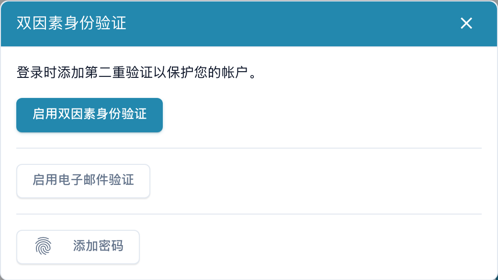
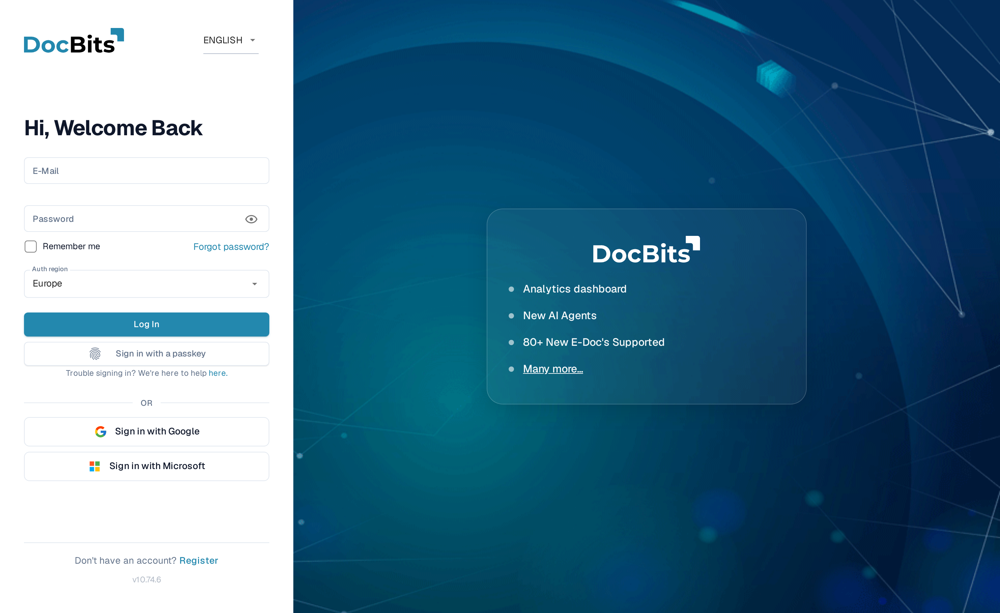

# 双重身份验证（2FA）

## 概述

双重身份验证（2FA）会在登录时增加第二个步骤。输入密码后，DocBits 会要求你提供只有你拥有的第二种验证方式：身份验证器应用中的验证码、发送到你邮箱的验证码，或通行密钥（Touch ID、Windows Hello、YubiKey、1Password）。即使有人得知了你的密码，没有第二种验证方式也无法登录。

2FA 对**每位用户均为可选**，也可以由**组织管理员设为必需**。单点登录（SSO）登录方式（Google、Microsoft、SAML）不受此要求限制，因为你的身份提供方已实施自己的 MFA。

你可以注册多种验证方式。DocBits 支持以下方式：

* **身份验证器应用（TOTP）** — Google Authenticator、Microsoft Authenticator、1Password、Authy 等。
* **邮箱验证码** — 发送到你账户邮箱的 6 位验证码。
* **通行密钥（WebAuthn/FIDO2）** — Touch ID、Windows Hello、硬件密钥（YubiKey）或密码管理器。

启用第一种验证方式时，DocBits 还会提供**十个备用码**，以便你在无法使用验证方式时登录。

## 查找位置

打开你的**个人资料 / 账户设置**（右上角账户菜单 → **编辑个人资料**），然后选择**双重身份验证**。2FA 对话框会显示当前状态以及可添加的验证方式。

<figure><figcaption>
可用的双因素身份验证方式。 “添加密码”按钮实际用于添加 Passkey，并非设置新的登录密码；本例未启用或添加身份验证方式。
</figcaption></figure>

## 设置身份验证器应用（TOTP）

1. 在 2FA 对话框中，点击**启用 2FA**。
2. 使用身份验证器应用扫描二维码（Google Authenticator、1Password、Authy 等）。如果无法扫描，请使用二维码下方显示的**手动密钥**。
3. 输入应用显示的 6 位验证码并确认。
4. DocBits 会启用 2FA 并显示你的**备用码**（见下文）。

## 设置邮箱验证

1. 在 2FA 对话框中，点击**启用邮箱验证**。
2. DocBits 会向你的账户邮箱发送一封包含 6 位验证码的邮件。
3. 输入验证码进行确认。邮箱验证现已启用。

## 添加通行密钥

1. 在 2FA 对话框中，点击**添加通行密钥**。
2. 浏览器或设备会提示你使用 Touch ID、Windows Hello、硬件密钥或密码管理器进行确认。
3. 通行密钥已保存。你可以添加多个通行密钥，之后也可以为它们重命名或将其移除。

## 备用码

启用**第一种**验证方式时，DocBits 会**仅显示一次****十个备用码**。每个备用码只能使用一次；如果无法使用身份验证器或手机，你可以用备用码登录。

* 将备用码保存在安全的地方（密码管理器是理想选择）。
* 你可以随时使用**重新生成备用码**创建一组新码（旧码将失效）。


备用码只会在生成时显示。DocBits 无法再次显示这些备用码，请立即保存。


## 使用 2FA 登录

1. 像往常一样输入邮箱和密码。

    <figure><figcaption>
登录页面。你也可以点击<strong>使用通行密钥登录</strong>，无需密码即可登录。
</figcaption></figure>
2. DocBits 会要求你提供第二种验证方式。选择一种方式：
   * **身份验证器** — 输入应用当前显示的 6 位验证码。
   * **邮箱** — 点击**通过邮件发送验证码**接收验证码，然后输入验证码。
   * **通行密钥** — 点击**使用通行密钥**，并使用 Touch ID / Windows Hello / 密钥进行确认。
   * **备用码** — 如果无法使用常用验证方式，请使用备用码。

3. 验证成功后，你便会登录。

### 邮箱验证码的样式

如果选择**邮箱**，DocBits 会发送一封包含 6 位验证码的邮件，该验证码会在 10 分钟后过期：

## 信任此设备

在第二步验证页面，你可以勾选**记住此设备**。此后 2FA 将在这台设备上跳过**30 天**。更改密码后，系统会自动取消对该设备的信任；你也可以随时自行撤销信任（见下文）。

## 管理通行密钥和受信任设备

打开 2FA 对话框并点击**管理**，即可查看已注册的验证方式。

* **通行密钥** — 点击通行密钥名称即可重命名，也可以将其删除。删除最后一个剩余的验证方式会关闭 2FA。
* **受信任设备** — 撤销对单台设备的信任，或点击**撤销所有设备**，以便在所有设备上重新触发 2FA 验证。

## 关闭 2FA

在 2FA 对话框中点击**禁用 2FA**，然后使用当前的身份验证器验证码或备用码进行确认。关闭 2FA 也会清除你的备用码并撤销对受信任设备的信任。


如果你的组织**要求**使用 MFA，那么在设置至少一种验证方式之前，你无法使用密码登录。如果不确定组织是否强制要求 MFA，请咨询管理员。


## 无密码登录（可选）

设置通行密钥后，你可以在登录页面点击**使用通行密钥登录**，**无需输入密码**即可登录。密码仍可用作备用方式。无密码登录需要通过通行密钥验证你的身份（Touch ID / Windows Hello / PIN），因此速度更快，也能抵御网络钓鱼。

安全保存恢复代码，并与身份验证设备分开存放。每个恢复代码仅可使用一次。

在双因素身份验证窗口中配置邮件验证。输入自己账户收到的代码，并按流程确认。

在双因素身份验证窗口中配置身份验证应用。仅在获准的应用中保存密钥，并使用当前临时代码确认。
