# Analyse-Dashboard

## Übersicht

Das **Analyse-Dashboard** bietet vollständige Transparenz über die Leistung Ihrer Dokumentenverarbeitung. Es verfolgt, wie lange Dokumente in jeder Phase ihres Wegs verbleiben – vom Import bis zum Export – und hilft Ihnen, Engpässe zu identifizieren, die Leistung über Organisationen, Dokumenttypen und Lieferanten hinweg zu vergleichen und Ihre Ergebnisse mit dem **globalen DocBits-Durchschnitt** zu vergleichen.

Jedes Dokument durchläuft verschiedene Phasen:

**Neu** (importiert) → **Verarbeitung** (in Bearbeitung) → **Bereit zur Validierung** (wartet auf Benutzerprüfung) → **Genehmigung ausstehend** (wartet auf Genehmigung) → **Exportiert** (abgeschlossen & exportiert)

In jeder Phase vergeht Zeit – das Analytics Dashboard sagt Ihnen genau, **wie viel** und **wo** Sie Ihre Verbesserungen ansetzen sollten.

### Zwei Arten von Engpässen

Das Dashboard hilft Ihnen, zwischen folgenden zu unterscheiden:

* **System-Engpässe** – Wie lange DocBits mit der automatischen Verarbeitung beschäftigt ist (OCR & Textextraktion, Dokumentenklassifizierung, Feldextraktion, automatische Validierung). Optimierbar durch Konfiguration und Systemressourcen.
* **Benutzer-Engpässe** – Zeit, die für manuelle Validierung und Genehmigung aufgewendet wird (Wartezeit in der Warteschlange, manuelle Datenkorrektur, Prüfung & Validierung, Genehmigungsworkflows). Optimierbar durch Workflow- und Ressourcenzuweisung.

## So aktivieren Sie es

Das Analytics Dashboard wird über eine Moduleinstellung gesteuert. Nach der Aktivierung erscheint ein Eintrag **Analyse-Dashboard** in der linken Seitenleiste.

1. Navigieren Sie zu **Einstellungen → Dokumentenverarbeitung → Modul → Dashboard und Analytics**.
2. Aktivieren Sie die Option **Analyse-Dashboard**.

<mark style="color:red;">**Hinweis**</mark>: Das Analytics Dashboard erfordert ein **AI Dashboard Abonnement**.

<mark style="color:red;">**Hinweis**</mark>: Der Zugriff auf das Analytics Dashboard ist auf Benutzer mit **Administrator**-Rechten beschränkt.

## Flow-Typen

Wählen Sie die passende Perspektive für Ihre Analyse. Jeder Flow-Typ bietet Ihnen eine andere Sichtweise auf dieselben Daten.

| Flow-Typ | Zweck | Schlüsselfrage |
| --- | --- | --- |
| **Status** | Verfolgung des Dokumentenlebenszyklus vom Import bis zum Export | *"Wie lange dauern meine Dokumente insgesamt vom Import bis zum Export?"* |
| **Verarbeitung** | Technische Modul-Leistungsanalyse | *"Welche Verarbeitungsschritte sind Engpässe?"* |
| **Benutzerinteraktion** | Menschliche Berührungspunkte und Wartezeiten | *"Wie lange warten Dokumente auf Benutzer?"* |

Verwenden Sie die Registerkarten **Verarbeitung**, **Benutzerinteraktion** und **Status** oben im Dashboard, um zwischen den Perspektiven zu wechseln.

<figure>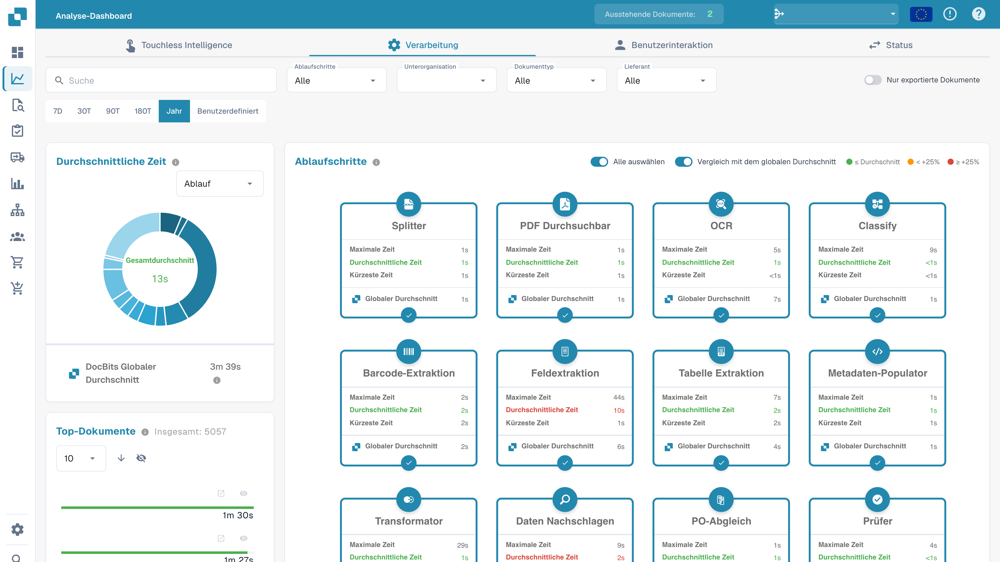<figcaption>
Auswahl der Analyseansichten Module, Status und Benutzer.
</figcaption></figure>

### Status-Flow

Verfolgt den Dokumentenweg von **Neu** bis **Exportiert** – nützlich für eine End-to-End-Lebenszyklusanalyse.

<figure>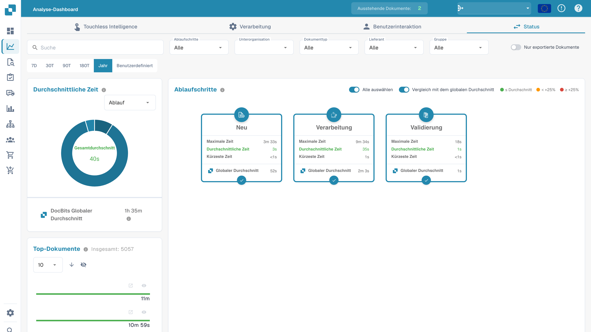<figcaption>
Statusansicht der Analyse.
</figcaption></figure>

### Verarbeitungs-Flow

Analysiert die Leistung über alle **technischen Verarbeitungsmodule** (OCR, Klassifizierung, Extraktion, Validierung) hinweg – nützlich zur Identifizierung systemseitiger Engpässe.

<figure><figcaption>
Modulansicht mit aggregierten Schritten des Verarbeitungsablaufs.
</figcaption></figure>

### Benutzerinteraktions-Flow

Konzentriert sich auf **menschliche Berührungspunkte** – Wartezeit in der Warteschlange, manuelle Validierung, Prüfung und Genehmigung – nützlich zur Identifizierung von Workflow- und Personal-Engpässen.

<figure>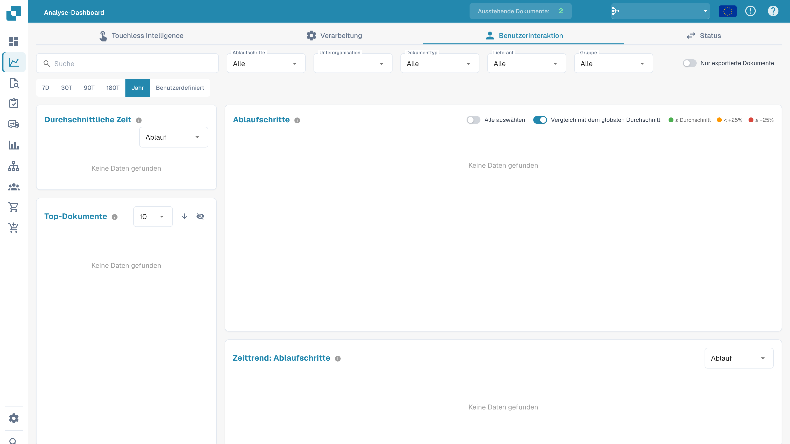<figcaption>
Benutzeransicht der Analyse; für die gewählten Filter liegen keine Daten vor.
</figcaption></figure>

## Filteroptionen

Das Dashboard unterstützt leistungsstarke mehrdimensionale Filterung. Alle Diagramme, Karten und Tabellen aktualisieren sich in Echtzeit basierend auf den aktiven Filtern.

### Suche

Lokalisieren Sie sofort jedes Dokument anhand des **Namens** oder der **eindeutigen ID**.

<figure>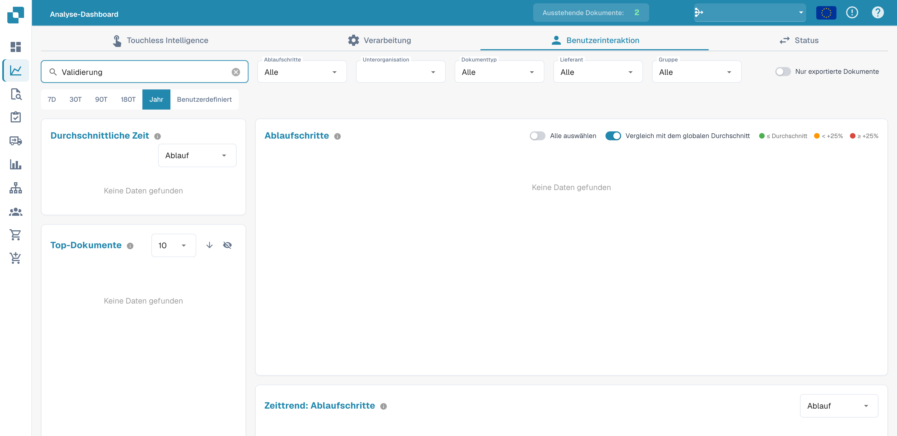<figcaption>
Analyse nach dem Begriff Validierung filtern.
</figcaption></figure>

### Flow-Schritte

Wählen Sie bestimmte Schritte aus, um Ihre Analyse zu fokussieren. Das Ein-/Ausschalten von Schritten berechnet auch die Zeitmetriken der anderen Komponenten des Dashboards neu.

<figure>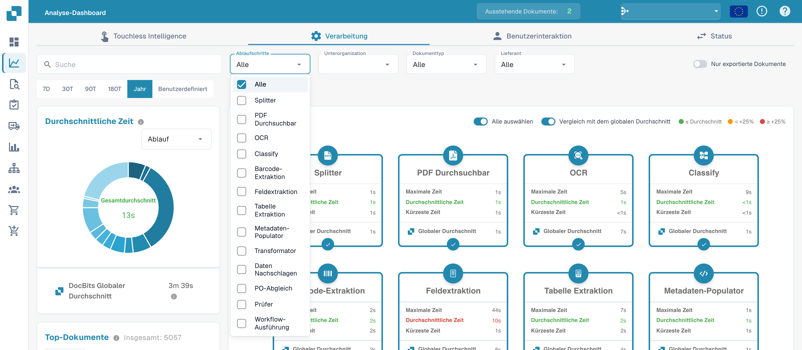<figcaption>
Filter für Ablaufschritte oberhalb der Analyse.
</figcaption></figure>

### Unterorganisation, Dokumenttyp, Lieferant, Gruppe

Vergleichen Sie die Leistung über:

* **Unterorganisationen** – verschiedene Geschäftsbereiche oder Mandanten
* **Dokumenttypen** – Rechnungen, Bestellungen, Lieferscheine usw.
* **Lieferanten** – um zu identifizieren, welche Lieferanten die längsten Verarbeitungszeiten verursachen
* **Gruppen** – um die Leistung über zugewiesene Benutzergruppen zu vergleichen (verfügbar für die Flow-Typen **Status** und **Benutzerinteraktion**)

<figure>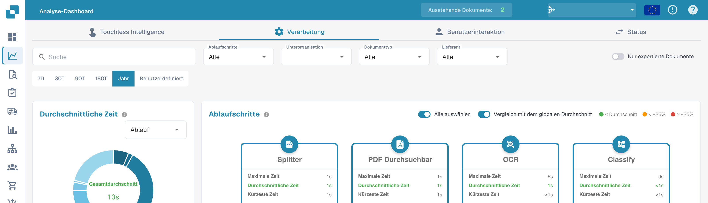<figcaption>
Analysefilter für Ablaufschritte, Unterorganisation, Dokumenttyp und Lieferant.
</figcaption></figure>

<mark style="color:red;">**Hinweis**</mark>: Der Filter **Gruppe** gilt nur für Dokumente, die **direkt einer Gruppe zugewiesen** sind. Dokumente, die einem einzelnen Benutzer zugewiesen sind – selbst wenn dieser Benutzer Mitglied einer Gruppe ist – sind **nicht** in den Gruppenfilterergebnissen enthalten.

### Nur exportierte Dokumente

Standardmäßig aktiviert – nur Dokumente, die den Export abgeschlossen haben, werden in den Dashboard-Metriken berücksichtigt.

<mark style="color:red;">**Hinweis**</mark>: Das Deaktivieren dieser Option kann zu ungenauen Durchschnittswerten führen, da auch Dokumente, die noch nicht abgeschlossen sind, in die Berechnungen einbezogen werden.

<figure>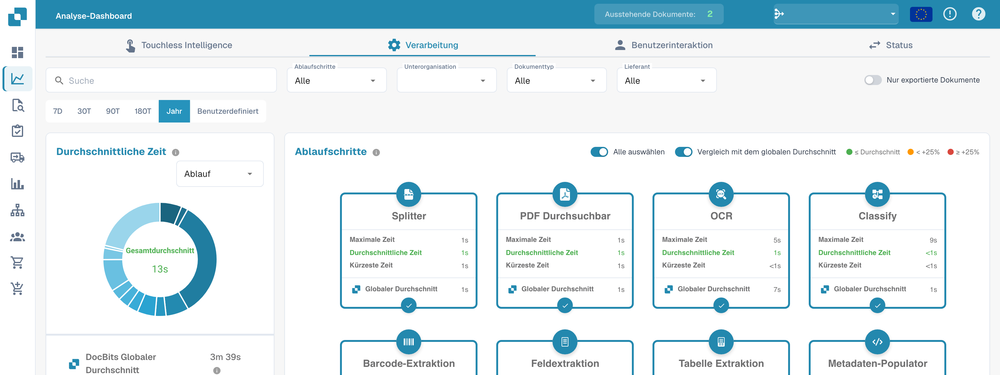<figcaption>
Schalter Nur exportierte Dokumente in der Analyse.
</figcaption></figure>

### Zeitbereich

Analysieren Sie einen beliebigen Zeitraum von **7 Tagen** bis zu einem **vollen Jahr**, oder legen Sie einen **benutzerdefinierten Bereich** mit der Datumsauswahl fest.

<figure>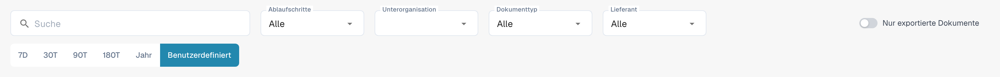<figcaption>
Benutzerdefinierter Zeitraum in der deutschen Filterleiste.
</figcaption></figure>

### Filter werden gemerkt

Das Dashboard speichert Ihre Filter und den Zeitbereich in diesem Browser, getrennt für jeden Benutzer und jede Organisation. Öffnen Sie das Dashboard erneut, wird Ihre letzte Auswahl wiederhergestellt, auch ein benutzerdefinierter Datumsbereich im Datumsfeld.

Wählen Sie oben rechts im Dashboard **Auf Standardwerte zurücksetzen**, um die gespeicherte Auswahl zu löschen: Filter, Zeitbereich und benutzerdefinierte Daten kehren zu ihren Standardwerten zurück.

<mark style="color:red;">**Hinweis**</mark>: Die Auswahl liegt im Browser, nicht auf dem Server. Sie wird nicht mit anderen Geräten oder Browsern synchronisiert.

<figure>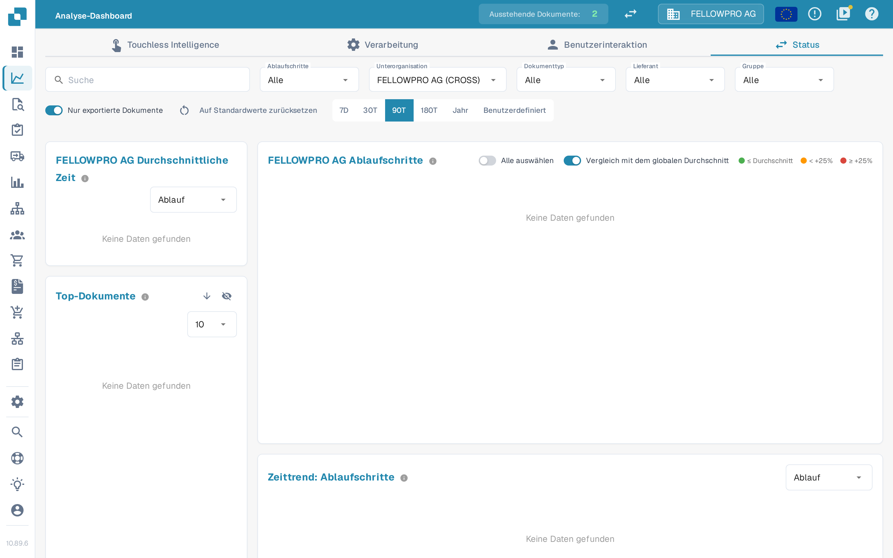<figcaption>
Beim erneuten Öffnen des Dashboards werden die Filter wiederhergestellt. Auf Standardwerte zurücksetzen löscht sie.
</figcaption></figure>

## Flow-Schritt-Karten

Jede Karte repräsentiert einen Flow-Schritt basierend auf dem ausgewählten **Flow-Typ**. Die Karten passen sich Ihrer Auswahl an – sie zeigen Lebenszyklusphasen für *Status*, Verarbeitungsmodule für *Verarbeitung* oder Benutzerberührungspunkte für *Benutzerinteraktion*.

Jede Karte zeigt:

* **Min, Durchschnitt, Max**-Zeiten für den Schritt
* Einen Vergleich zwischen **Ihrer durchschnittlichen Zeit** und dem **globalen DocBits-Durchschnitt** (wenn der Vergleichsumschalter aktiviert ist)
* Einen Auswahlkreis, um den Schritt aus den aggregierten Zeitberechnungen, die vom Durchschnittszeit-Diagramm, Zeittrend-Diagramm und der Datentabelle verwendet werden, **einzubeziehen oder auszuschließen**

Ein **Alle auswählen**-Schalter im Header ermöglicht es Ihnen, alle Schritte gleichzeitig ein- oder auszuschließen.

<figure>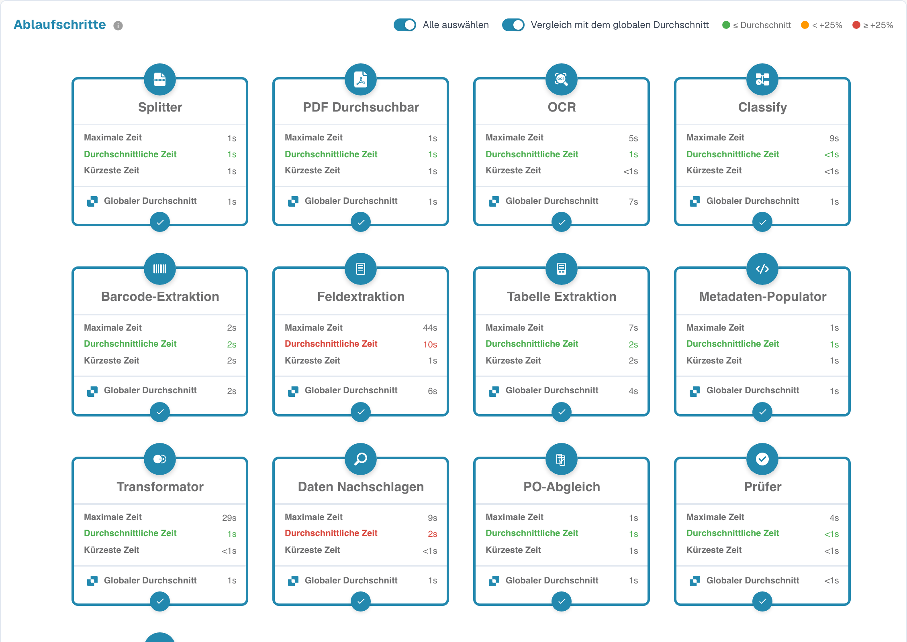<figcaption>
Karte Ablaufschritte mit aggregierten Verarbeitungszeiten.
</figcaption></figure>

### Mit Global Average vergleichen

Der Schalter **Vergleich mit dem globalen Durchschnitt** steuert, ob der DocBits Global Average auf den Karten und im Diagramm angezeigt wird. Wenn aktiviert, wird die durchschnittliche Zeit auf jeder Karte farblich codiert:

* **Grün** – Ihre durchschnittliche Zeit liegt bei oder unter dem Global Average
* **Orange** – Ihre durchschnittliche Zeit liegt bis zu **+25 %** über dem Global Average
* **Rot** – Ihre durchschnittliche Zeit liegt **+25 %** oder mehr über dem Global Average

<figure>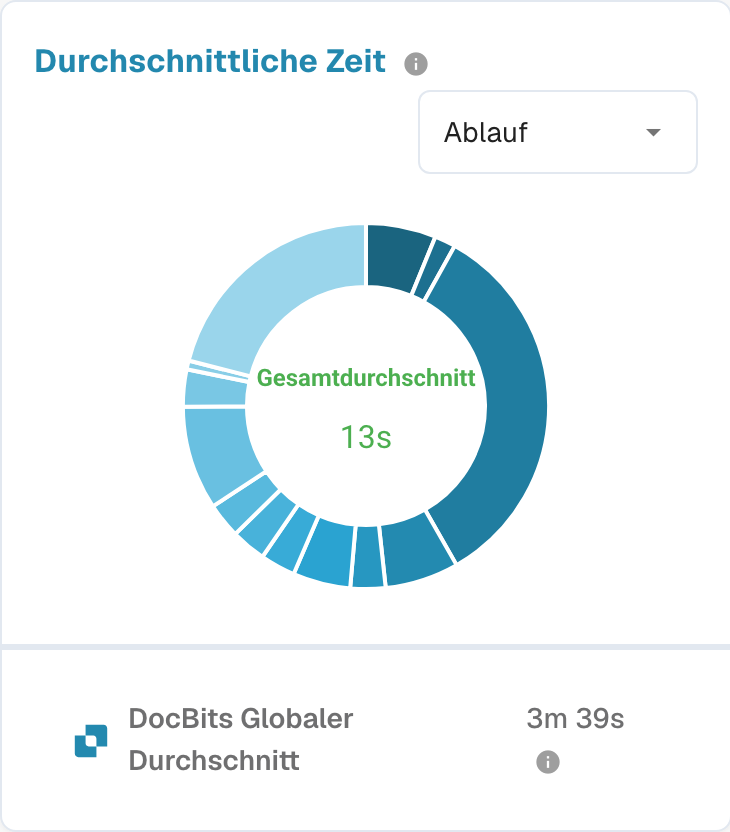<figcaption>
Vergleich der durchschnittlichen Verarbeitungszeit mit dem globalen Durchschnitt.
</figcaption></figure>

## Durchschnittszeit-Diagramm

Das Durchschnittszeit-Diagramm visualisiert, wie sich die Verarbeitungszeit auf die ausgewählten Flow-Schritte verteilt. Verwenden Sie den **Gruppieren nach**-Selektor, um über verschiedene Dimensionen hinweg zu vergleichen:

* **Flow-Schritte** – sehen Sie, welche Schritte die meiste Zeit beanspruchen
* **Unterorganisation** – identifizieren Sie Abweichungen zwischen Geschäftsbereichen
* **Dokumenttyp** – vergleichen Sie Verarbeitungszeiten über Dokumenttypen hinweg
* **Lieferant** – entdecken Sie, welche Lieferanten die längsten Verarbeitungszeiten haben
* **Gruppe** – vergleichen Sie über zugewiesene Benutzergruppen (nur Flow-Typen Status und Benutzerinteraktion)

Wenn **Vergleich mit dem globalen Durchschnitt** aktiviert ist, zeigt das Diagramm auch den DocBits Global Average als Benchmark an.

## Top-Dokumente

Die Karte **Top-Dokumente** listet einzelne Dokumente auf, die dem aktiven Filtersatz entsprechen, sortiert nach insgesamt aufgewendeter Zeit.

* **Sortierreihenfolge**-Schalter – wechseln Sie zwischen **absteigend** (langsamste zuerst) und **aufsteigend** (schnellste zuerst).
* **Seitengröße**-Dropdown und Paginierung – blättern Sie durch die Ergebnismenge.
* **Dokument ausblenden / anzeigen** über das Augensymbol daneben – ausgeblendete Dokumente sind von allen Zeitberechnungen im Dashboard ausgeschlossen.
* **Alle Dokumente ausblenden / anzeigen** im Filter über das Augensymbol im Header.
* **Klicken Sie auf ein Dokument** (Dateiname oder Fortschrittsbalken), um seine Document ID in die Zwischenablage zu kopieren.

## Zeittrend-Diagramm

Verfolgen Sie Leistungstrends im Zeitverlauf und erkennen Sie Anomalien. Das Zeittrend-Diagramm zeigt die **durchschnittliche Zeit** der aktuell ausgewählten Flow-Schritte und kann gruppiert werden nach:

* **Flow-Schritte** – eine Linie pro ausgewähltem Schritt
* **Unterorganisation**
* **Dokumenttyp**
* **Lieferant**
* **Gruppe** (verfügbar für die Flow-Typen **Status** und **Benutzerinteraktion**)

Dadurch lässt sich leicht ein plötzlicher Anstieg bei einem bestimmten Lieferanten oder ein allmählicher Anstieg bei einem bestimmten Dokumenttyp erkennen, bevor er zu einem kritischen Problem wird.

## Datentabelle

Die Datentabelle bietet vollständigen Zugriff auf alle zugrunde liegenden Zeilendaten für den aktiven Filtersatz.

* **Ziehen Sie Spalten in das Panel „Ausgeblendete Spalten"** (links neben der Tabelle), um sie aus der Ansicht zu entfernen. Ausgeblendete Spalten werden zur Aggregation verwendet – **Min / Max / Durchschnitt**-Zeiten werden dynamisch basierend auf den sichtbaren Spalten neu berechnet. Ziehen Sie einen Chip zurück in die Tabelle (oder klicken Sie auf das **+**-Symbol), um die Spalte wiederherzustellen.
* **Sortieren** Sie durch Klicken auf Spaltenüberschriften und **ordnen Sie Spalten neu** per Drag-and-Drop.
* **CSV herunterladen** über die Schaltfläche im Karten-Header – nur die aktuell sichtbaren Spalten werden exportiert.

<figure>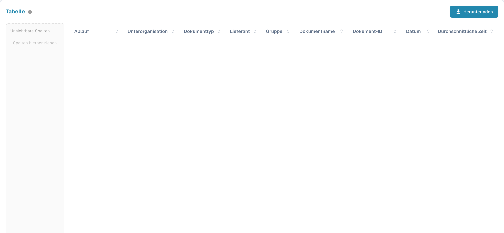<figcaption>
Datentabelle der Analyse mit deutschen Spaltenüberschriften; Dokumentwerte sind ausgeblendet.
</figcaption></figure>

## Touchless Intelligence

Der Tab **Touchless Intelligence** zeigt, wie viele Dokumente ohne menschliches Zutun durch DocBits laufen und warum die anderen stehen bleiben. Siehe [Touchless Intelligence](touchless-intelligence.md).
