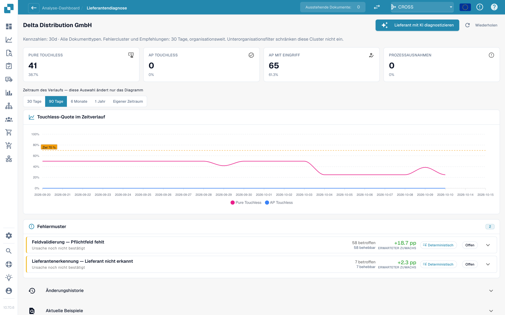
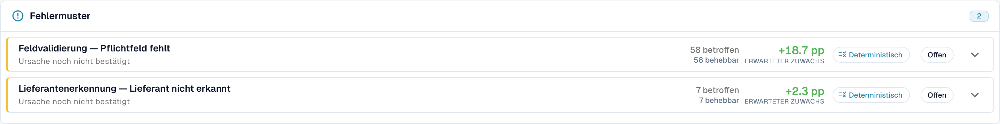

# Lieferantendiagnose und Fehlermuster

Klicken Sie in der Warteschlange auf einen Lieferanten, um dessen Diagnoseseite zu öffnen.

<figure><figcaption>
Die Seite Lieferantendiagnose: Ergebniskacheln, Trend mit Zeitraumauswahl und zwei Fehlermuster, nach erwartetem Zuwachs geordnet. Beispielorganisation mit Demodaten; die Lieferantennamen sind frei erfunden.
</figcaption></figure>

Die Seite zeigt:

* **Sechs Ergebniskacheln** (Pure Touchless, AP Touchless, AP mit Eingriff, Prozessausnahme, In Bearbeitung, Nicht berücksichtigt), jeweils mit Link zu den Dokumenten.
* **Den Trend** mit eigener Zeitraumauswahl: 30 Tage, 90 Tage, 6 Monate, 1 Jahr oder ein eigener Zeitraum (bis zu zwei Jahre). Das ändert nur das Diagramm.
* **Fehlermuster** (Issue clusters, siehe unten).
* **Änderungshistorie** (Change history): die Änderungen, die Sie für diesen Lieferanten angewendet haben, und was sie bewirkt haben.
* **Aktuelle Beispiele** (Recent examples): Beispieldokumente in zwei Tabs: **Brauchte Eingriff** und **Lief touchless**.
* **Lieferant mit KI diagnostizieren** (Diagnose supplier with AI): analysiert alle Cluster des Lieferanten (Administratoren).

Ein kurzer Hinweis erklärt eine leere Seite, zum Beispiel: _5 Dokumente dieses Lieferanten werden noch verarbeitet und haben noch kein Analyseergebnis._ oder _Alle 40 abgeschlossenen Dokumente dieses Lieferanten liefen touchless: Es gibt nichts zu diagnostizieren._

### Fehlermuster

Ein **Cluster** fasst die Dokumente eines Lieferanten zusammen, die aus dem **gleichen ersten Grund** stehen geblieben sind. Statt 40 Einzelproblemen sehen Sie „3 Probleme“.

<figure><figcaption>
Eine geöffnete Cluster-Karte: der erste Blocker, <strong>Was zu ändern ist</strong> (What to change) und ein <strong>Änderungsvorschlag</strong> (Change proposal) mit Risiko, Geltungsbereich und offenen Fragen. Hier umfasst das Cluster 58 Dokumente und ist +18,7 PP wert. Beispielorganisation mit Demodaten; die Lieferantennamen sind frei erfunden.
</figcaption></figure>

**Beispiel-Cluster (zur Veranschaulichung).**

* **Überschrift**: _Pflichtfeld fehlt_ im Schritt _Feldvalidierung_
* **Betroffen**: 28 Dokumente. **Rückgewinnbar**: 28 Dokumente. **Erwarteter Zuwachs**: +2,8 PP
* **Vermutete Ursache**: Der Lieferant druckt die Bestellnummer unterhalb der Tabelle, wo die Extraktion nicht sucht
* **Was zu ändern ist**: _Stammdatenänderung_: das Layout dieses Lieferanten hinzufügen. **Öffnen** führt Sie zur richtigen Einstellungsseite
* **Verantwortlich**: Consultant. **Konfidenz**: Mittel. **Quelle**: Hypothese

Was eine Cluster-Karte zeigt:

| Teil                                               | Bedeutung                                                                                                                                                                                                                                                                            |
| -------------------------------------------------- | ------------------------------------------------------------------------------------------------------------------------------------------------------------------------------------------------------------------------------------------------------------------------------------ |
| **Erster Blocker** (First blocker) und **Schritt** | Der Grund und der Pipeline-Schritt, an dem die Dokumente stehen bleiben. Es gibt mehr als 30 Gründe, zum Beispiel _Lieferant nicht erkannt_, _Bestellung nicht gefunden_, _Stückpreis außerhalb der Bestell-Toleranz_, _Vom ERP abgelehnt_, _E-Rechnungs-Validierung fehlgeschlagen_ |
| **Betroffen / Rückgewinnbar / Erwarteter Zuwachs** | Wie viele Dokumente, wie viele davon zurückgewonnen werden können und wie viele Prozentpunkte das bringen würde                                                                                                                                                                      |
| **Vermutete Ursache / Bestätigte Ursache**         | Was DocBits für den Grund hält (oder was eine Person als Grund bestätigt hat)                                                                                                                                                                                                        |
| **Nachweis** und **Fehlende Evidenz**              | Worauf der Befund beruht und was DocBits **nicht** feststellen konnte. Lesen Sie **Fehlende Evidenz**, bevor Sie dem Rest vertrauen                                                                                                                                                  |
| **Was zu ändern ist**                              | Konkrete Schritte mit **Öffnen**-Links zu den Einstellungen. Ein Chip nennt die Art: _Konfigurationsänderung_, _Stammdatenänderung_, _Lieferanten-Template anpassen_, _Prozessänderung_, _Aktion des Lieferanten erforderlich_, _Nicht behebbar_                                     |
| **Verantwortlich**                                 | DocBits, Kunde, Consultant, Lieferant oder Nicht zugewiesen                                                                                                                                                                                                                          |
| **Beispieldokumente**                              | Echte Dokumente des Clusters zum Ansehen                                                                                                                                                                                                                                             |

**In DocBits behebbar** und **Nur Lieferantenaktion** werden in zwei Gruppen angezeigt. Bei _Nur Lieferantenaktion_ ändert nichts in DocBits das Ergebnis: Der Lieferant muss das Dokument korrigieren und erneut senden.

### Woher kommt eine Empfehlung

Jede Ursache zeigt ihre **Quelle**, damit Sie einen abgeleiteten Befund von einer Vermutung unterscheiden können:

| Quelle                                 | Bedeutung                                                                                                                                 |
| -------------------------------------- | ----------------------------------------------------------------------------------------------------------------------------------------- |
| **Deterministisch** / **Regelbasiert** | Eine Regel hat sie aus der aufgezeichneten Pipeline-Evidenz abgeleitet. Es war kein Sprachmodell beteiligt                                |
| **Hypothese**                          | Ein Sprachmodell hat sie aus der Cluster-Evidenz vorgeschlagen. Betrachten Sie sie als Anhaltspunkt und prüfen Sie sie, bevor Sie handeln |
| **Bestätigt**                          | Eine Person hat die Evidenz geprüft und die Ursache bestätigt                                                                             |

KI-Texte werden in der Sprache Ihrer Organisation verfasst. Wurde ein Cluster in einer anderen Sprache analysiert, verwenden Sie **In dieser Sprache analysieren**.

## Bestellabgleich-Cluster

Ist der erste Blocker eines Clusters ein Grund aus dem Bestellabgleich (zum Beispiel _PO-Positionsabweichung_ oder _Bestellung nicht gefunden_), zeigt die Cluster-Karte, wie DocBits versucht, die Rechnung mit der Bestellung abzugleichen. Siehe [Bestellabgleich-Diagnose](touchless-po-matching-diagnosis.md).

## Weiterführende Seiten

* [Touchless Intelligence](./)
* [Bestellabgleich-Diagnose](touchless-po-matching-diagnosis.md)
* [Dokumentverlauf](touchless-document-trace.md)
* [Änderungsvorschläge und Berichte](touchless-change-proposals.md)
