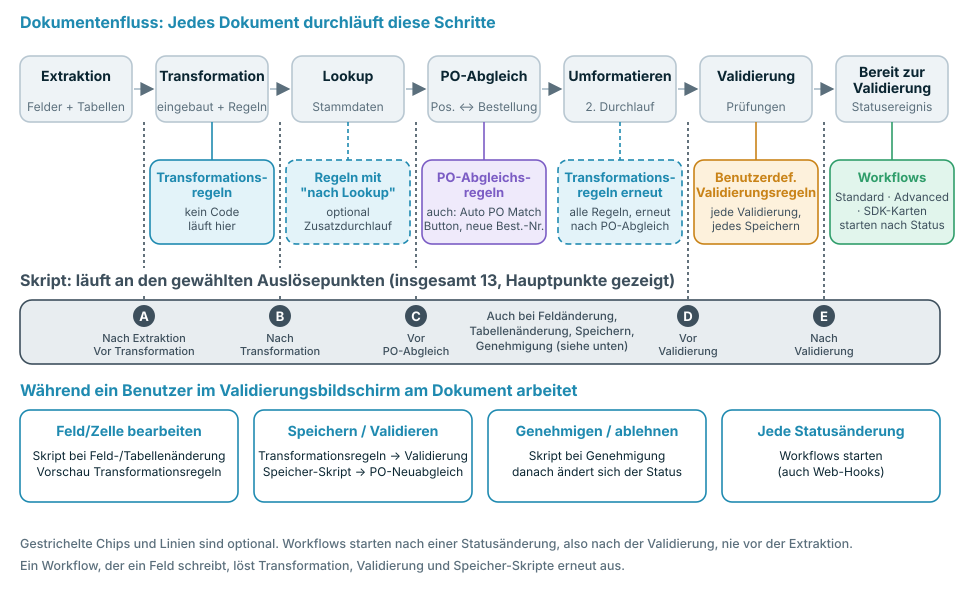
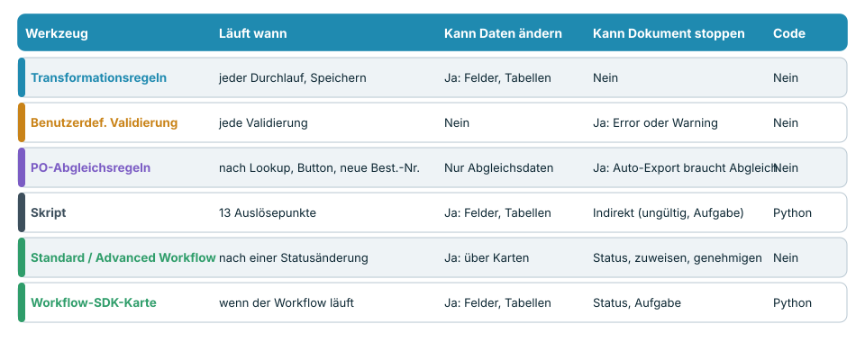
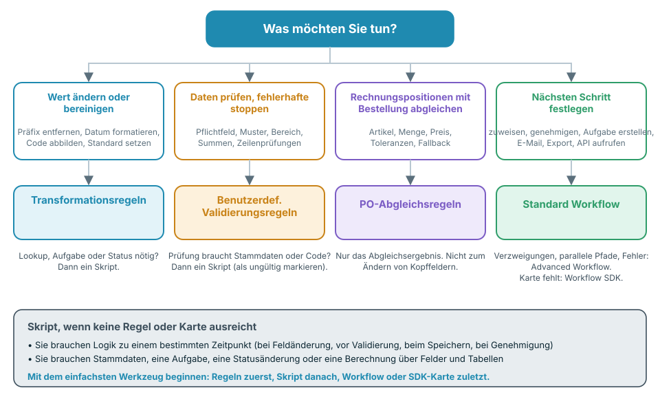

# Die richtige Automatisierung wählen



Das Video (fünf Minuten) behandelt dieselben Themen in vier Teilen: **0:00** wo jedes Werkzeug im Dokumentenfluss läuft, **1:34** Code, Workflows und der Vergleich, **2:49** was jedes Werkzeug kann und was nicht, **4:00** Best Practices und häufige Fehler.

DocBits bietet mehrere Möglichkeiten, Dokumente zu ändern, zu prüfen und weiterzuleiten: **Transformationsregeln**, **Benutzerdefinierte Validierungsregeln**, **PO-Abgleichsregeln**, **Skripte**, **Standard Workflows**, **Advanced Workflows** und **Workflow-SDK-Karten**. Sie überschneiden sich absichtlich. Diese Seite zeigt Ihnen, welches Werkzeug Sie wählen, **wann es jeweils im Dokumentenfluss läuft** und was es kann und was nicht.

## Die Kurzantwort

| Ich möchte … | Verwenden | Warum |
| --- | --- | --- |
| Einen Wert bereinigen oder umschreiben (Trimmen, Präfix, Datumsformat, Einheiten-Mapping, Standardwert) | [Transformationsregeln](settings/global-settings/document-types/transformation-rules.md) | Kein Code, Live-Vorschau, läuft bei jedem Durchlauf und jedem Speichern |
| Sicherstellen, dass Daten vollständig und plausibel sind, und Dokumente stoppen, bei denen das nicht der Fall ist | [Benutzerdefinierte Validierungsregeln](settings/global-settings/document-types/custom-validation-rules.md) | Deklarative Prüfungen, Error oder Warning, blockiert den Auto-Export |
| Rechnungspositionen mit Bestellpositionen abgleichen | [PO-Abgleichsregeln](settings/global-settings/document-types/more-settings/purchase-order/purchase-order-matching-rules.md) | Regelwerke mit Toleranzen, Fallbacks und einem visuellen Diagramm |
| Etwas tun, das eine Regel nicht ausdrücken kann: ein Lookup, eine Berechnung über Felder und Tabellen, eine Aufgabe, eine Statusänderung zu einem exakten Zeitpunkt | [Skript](settings/global-settings/document-types/script/README.md) | Python an 13 Auslösepunkten im Ablauf |
| Entscheiden, **was als Nächstes** mit einem Dokument passiert: zuweisen, genehmigen, eine Aufgabe erstellen, eine E-Mail senden, exportieren, eine API aufrufen | [Standard Workflow](workflow/standard-workflow-builder.md) | When-/And-/Then-Karten auf Statusereignisse |
| Dasselbe mit Verzweigungen, mehreren Bedingungen und Fehlerpfaden | [Advanced Workflow](workflow/advanced-workflow-builder.md) | Visueller Node-Graph |
| Eine Aktion benötigen, die keine eingebaute Karte bietet | [Workflow SDK (Card SDK)](workflow/card-sdk.md) | Ihre eigene Karte, von DocBits geprüft |

**Faustregel: Verwenden Sie das am wenigsten mächtige Werkzeug, das die Aufgabe erledigt.** Zuerst Regeln, dann Skript, zuletzt Workflow oder SDK-Karte. Regeln sind leichter zu lesen, leichter zu testen und können ein Dokument nicht beschädigen; Code kann mehr und braucht daher mehr Sorgfalt.

## Wo jedes Werkzeug im Dokumentenfluss läuft

Jedes Dokument durchläuft dieselben Schritte. Jedes Werkzeug hat seinen eigenen Platz in diesem Ablauf, und dieser Platz bestimmt, was es sehen und was es noch ändern kann.

<figure><figcaption></figcaption></figure>

In Worten:

1. Die **Extraktion** liest Kopffelder und Tabellen aus dem Dokument. Ein Skript kann **nach der Extraktion** laufen.
2. Die **Transformation** wendet die eingebaute Formatierung und Ihre **Transformationsregeln** an. Skripte können davor und danach laufen.
3. Der **Stammdaten-Lookup** füllt Felder wie den Lieferanten. Transformationsregeln, die mit **nach dem Lookup ausführen** markiert sind, erhalten hier einen zusätzlichen Durchlauf.
4. Der **Bestellabgleich** läuft nur, wenn der Bestellabgleich für den Dokumenttyp aktiv ist. Hier arbeiten die **PO-Abgleichsregeln**. Ein Skript kann **vor dem Bestellabgleich** laufen.
5. **Neu formatieren**: Alle Transformationsregeln laufen erneut, sodass auch die vom Lookup oder vom Abgleich geschriebenen Werte formatiert werden.
6. Die **Validierung** führt Ihre **Benutzerdefinierten Validierungsregeln** aus. Skripte können **vor** und **nach** der Validierung laufen.
7. Das Dokument erhält den Status **Bereit zur Validierung**. Das ist der erste Moment, in dem ein **Workflow** starten kann. Workflows reagieren auf Statusänderungen, daher laufen sie immer **nach** der Validierung, nie vor der Extraktion.

Während eine Person im Validierungsbildschirm arbeitet, greifen weitere Auslöser: Das Bearbeiten eines Felds oder einer Tabellenzelle führt Skripte für Feld- und Tabellenänderungen aus und aktualisiert die Vorschau der Transformationsregeln. **Speichern** und **Validieren** führen Transformationsregeln, Validierung und Speicher-Skripte erneut aus und gleichen die Bestellung erneut ab, wenn sich die Bestellnummer geändert hat. **Genehmigen** führt Genehmigungs-Skripte aus, bevor sich der Status ändert.


Ein Workflow, der ein Feld schreibt, verhält sich wie eine Person, die das Dokument speichert: Transformationsregeln, Validierung, Benutzerdefinierte Validierungsregeln und Speicher-Skripte laufen für diesen Schreibvorgang erneut. Berücksichtigen Sie das, wenn ein Workflow und eine Regel dasselbe Feld ändern.


## Die Werkzeuge im Vergleich

<figure><figcaption></figcaption></figure>

| | Transformationsregeln | Benutzerdefinierte Validierungsregeln | PO-Abgleichsregeln | Skript | Standard Workflow | Advanced Workflow | SDK-Karte |
| --- | --- | --- | --- | --- | --- | --- | --- |
| **Läuft wann** | Bei jedem Transformationsdurchlauf und jedem Speichern | Bei jeder Validierung | Nach dem Lookup, **Auto PO Match**, neue Bestellnummer | 13 Auslösepunkte | Nach einer Statusänderung | Nach einer Statusänderung | Wenn der zugehörige Workflow läuft |
| **Kann lesen** | Kopffelder, Tabellenspalten | Felder, Tabellenzellen, Summen über Zeilen | Tabellen, Bestellnummern, Bestellpositionen, Toleranzen | Die gesamten extrahierten Daten, Lookups, Benutzer, Gruppen, Volltextsuche | Dokumentdaten, Benutzer, Gruppen, Variablen | Dasselbe, plus Ergebnisse früherer Nodes | Felder, Tabellen, Lookups, Benutzer, Gruppen |
| **Kann schreiben** | Feld- und Spaltenwerte, Zeilen, Unterorganisation | Nichts: nur Markierungen gültig / ungültig | Nur Abgleichsdaten | Felder, Tabellen, Aufgaben, Status | Felder, Status, Zuweisung, Aufgaben, Export, E-Mail, API-Aufruf | Dieselben Karten, plus Logik und Variablen | Felder, Tabellen, Status, Aufgaben |
| **Kann ein Dokument stoppen** | Nein | Ja, Errors blockieren Auto-Export und **Validieren** | Ja, ohne vollständigen Abgleich wartet der Auto-Export, wenn der Bestellabgleich aktiv ist | Indirekt: ein Feld als ungültig markieren, eine Aufgabe erstellen | Setzt Status, weist zu, genehmigt, lehnt ab | Dasselbe | Wie der Kartentyp |
| **Braucht Code** | Nein | Nein | Nein | Ja, eingeschränktes Python | Nein | Nein | Ja, Python in einer Sandbox |
| **Typischer Einsatz** | Werte normalisieren | Pflichtfelder, Formate, Summen | Positionsabgleich | Spezielle Logik | Weiterleitung und Genehmigung | Weiterleitung mit Verzweigungen | Aktionen für Partner |

## Entscheiden mit vier Fragen

<figure><figcaption></figcaption></figure>

1. **Muss ein Wert geändert werden?** Verwenden Sie **Transformationsregeln**. Braucht die Änderung Stammdaten, eine Aufgabe oder einen Status, verwenden Sie ein **Skript**.
2. **Muss ein Wert geprüft werden?** Verwenden Sie **Benutzerdefinierte Validierungsregeln**. Sie stoppen ein Dokument, ändern es aber nie. Braucht die Prüfung Stammdaten oder Code, kann ein **Skript** das Feld als ungültig markieren.
3. **Müssen Rechnungspositionen mit einer Bestellung abgeglichen werden?** Verwenden Sie **PO-Abgleichsregeln**. Sie erzeugen nur Abgleichsergebnisse. Um ein Kopffeld vor dem Abgleich zu korrigieren, verwenden Sie eine Transformationsregel.
4. **Hängt der nächste Schritt vom Dokument ab?** Verwenden Sie einen **Workflow**. Wählen Sie **Advanced**, wenn Sie Verzweigungen, mehrere Bedingungen oder Fehlerpfade brauchen. Wählen Sie eine **SDK-Karte** nur, wenn keine eingebaute Karte leistet, was Sie brauchen.

## Werkzeug für Werkzeug

### Transformationsregeln

* **Verwenden Sie sie, wenn** ein Wert inhaltlich richtig, aber in der Form falsch ist: Präfixe, Leerzeichen, Datumsformate, Einheitencodes, Standardwerte, eine Bestellnummer im falschen Feld oder Tabellen, die zu einer Summenzeile zusammengefasst werden müssen.
* **Sie laufen** beim ersten Transformationsdurchlauf, in einem optionalen Durchlauf nach dem Stammdaten-Lookup, erneut nach dem Bestellabgleich und bei jedem Speichern. Der Validierungsbildschirm zeigt eine Vorschau.
* **Sie können** Kopffelder, Tabellenspalten und -zeilen sowie die Unterorganisation ändern. Jede Regel lässt sich auf bestimmte Lieferanten oder Bedingungen beschränken.
* **Sie können nicht** ein Dokument stoppen, andere Systeme aufrufen, Stammdaten-Lookups verwenden oder Aufgaben erstellen. Eine Regel, die sich nicht anwenden lässt, belässt den Wert unverändert.
* **Mehr dazu:** [Transformationsregeln](settings/global-settings/document-types/transformation-rules.md)

### Benutzerdefinierte Validierungsregeln

* **Verwenden Sie sie, wenn** ein Dokument mit falschen Daten nicht weiterlaufen darf: Pflichtfelder, Muster, Zahlenbereiche, erlaubte Werte, Vergleich zwischen zwei Feldern, Summen, die stimmen müssen.
* **Sie laufen** bei jeder Validierung: in der Pipeline, bei jedem Speichern und nachdem ein Workflow Daten geschrieben hat.
* **Sie können** ein Feld oder eine Tabellenzelle als **Error** markieren (blockiert Auto-Export und **Validieren**, sofern nicht umgangen) oder als **Warning** (sichtbar, blockiert nicht).
* **Sie können nicht** Daten ändern, Stammdaten nachschlagen oder Dienste aufrufen. Korrigieren Sie die Daten zuerst mit einer Transformationsregel und prüfen Sie sie danach.
* **Mehr dazu:** [Benutzerdefinierte Validierungsregeln](settings/global-settings/document-types/custom-validation-rules.md)

### PO-Abgleichsregeln

* **Verwenden Sie sie, wenn** Rechnungspositionen mit Bestellpositionen abgeglichen werden müssen: Einzel-, Mehrfach- und Gesamtabgleich, Toleranzen für Menge und Preis, Fallbacks, wenn die erste Regel nicht greift.
* **Sie laufen** nach dem Stammdaten-Lookup, wenn Sie auf **Auto PO Match** klicken, und wenn sich die Bestellnummer beim Speichern ändert.
* **Sie können** das Abgleichsergebnis und die Daten erzeugen, die die Genehmigung braucht. Die Diagrammansicht zeigt, welche Regel in welcher Stufe gilt.
* **Sie können nicht** Kopffelder umschreiben, einen Status setzen oder eigene Logik ausführen. Ohne vollständigen Abgleich wartet der Auto-Export, wenn der Bestellabgleich aktiv ist.
* **Mehr dazu:** [PO-Abgleichsregeln](settings/global-settings/document-types/more-settings/purchase-order/purchase-order-matching-rules.md)

### Skript

* **Verwenden Sie es, wenn** keine Regel die Logik ausdrücken kann: eine Berechnung über Felder und Tabellen, ein Lookup, eine Aufgabe für einen Benutzer, eine Statusänderung zu einem exakten Zeitpunkt oder eine Reaktion auf eine Bearbeitung im Validierungsbildschirm.
* **Es läuft** an den Auslösepunkten, die Sie wählen: nach der Extraktion, vor und nach der Transformation, vor dem Bestellabgleich, vor und nach der Validierung, bei Feld- und Tabellenänderungen, beim Speichern und bei der Genehmigung.
* **Es kann** das gesamte Dokument lesen, Stammdaten-Lookups und die Volltextsuche nutzen, Felder, Flags und Tabellen ändern, Aufgaben erstellen und den Status ändern.
* **Es kann nicht** Module importieren oder externe Dienste aufrufen. Es ist eingeschränktes Python. Ein Fehler in einem Skript wird protokolliert und stoppt die Verarbeitung des Dokuments nie. Ein Skript ist daher **kein** verlässlicher Weg, ein Dokument zu blockieren: Markieren Sie stattdessen das Feld als ungültig oder erstellen Sie eine Aufgabe.
* **Mehr dazu:** [Skript](settings/global-settings/document-types/script/README.md)

### Standard Workflow

* **Verwenden Sie ihn, wenn** der nächste Schritt vom Dokument abhängt: einem Benutzer oder einer Gruppe zuweisen, genehmigen oder ablehnen, eine Aufgabe erstellen, eine E-Mail senden, exportieren, einen Status setzen, eine API aufrufen.
* **Er läuft**, wenn ein Dokument einen von Ihnen gewählten Status erreicht, also nach der Validierung. Er kann auch über einen Web-Hook, einen Zeitplan oder manuell starten.
* **Er kann** eine Kette von Karten ausführen: **When** (Start), **And** (Bedingungen, alle müssen erfüllt sein), **Then** (Aktionen der Reihe nach).
* **Er kann nicht** verzweigen, auf mehrere Bedingungen warten oder in einem separaten Pfad auf einen Fehler einer Karte reagieren. Verwenden Sie dafür einen Advanced Workflow.
* **Mehr dazu:** [Standard Workflow](workflow/standard-workflow-builder.md)

### Advanced Workflow

* **Verwenden Sie ihn, wenn** ein Dokument unterschiedliche Pfade braucht: Verzweigungen nach Bedingung, mehrere Bedingungen kombiniert mit ALL / ANY und ein Pfad für Fehler oder nicht erfüllte Bedingungen.
* **Er läuft** bei denselben Ereignissen wie ein Standard Workflow. Er benötigt das Abonnement DocFlow Advanced.
* **Er kann** dieselben Karten wie ein Standard Workflow verwenden, plus Logik- und Variablenkarten, dargestellt als Graph.
* **Er kann nicht** erledigen, was vor der Validierung geschieht: Er startet nach einer Statusänderung. Logik vor der Validierung gehört in ein Skript oder eine Regel.
* **Mehr dazu:** [Advanced Workflow](workflow/advanced-workflow-builder.md)

### Workflow SDK (Card SDK)

* **Verwenden Sie es, wenn** Sie eine Karte brauchen, die es nicht gibt, zum Beispiel eine Bedingung oder Aktion für eine bestimmte Partneranwendung.
* **Es läuft** immer dann, wenn ein Workflow läuft, der die Karte enthält.
* **Es kann** Felder und Tabellen lesen und schreiben, das Dokument speichern, den Status ändern und Aufgaben erstellen.
* **Es kann nicht** Netzwerkverbindungen öffnen. Ein Lauf ist auf 60 Sekunden und 200 SDK-Aufrufe begrenzt. Eine Karte geht erst live, nachdem DocBits sie geprüft und genehmigt hat.
* **Mehr dazu:** [Card SDK](workflow/card-sdk.md)

## Best Practices

* **Beginnen Sie mit dem einfachsten Werkzeug.** Für Formatierung ist eine Transformationsregel besser als ein Skript. Für eine Prüfung ist eine Benutzerdefinierte Validierungsregel besser als ein Skript. Greifen Sie nur dann zu einem Skript oder einer SDK-Karte, wenn eine Regel oder eine eingebaute Karte es nicht leisten kann.
* **Erst korrigieren, dann prüfen, zuletzt weiterleiten.** Transformationsregeln und Skripte bereiten die Daten vor, Benutzerdefinierte Validierungsregeln beurteilen sie, Workflows entscheiden, was mit dem Dokument geschieht. Das ist die Reihenfolge des Ablaufs.
* **Ein Besitzer pro Feld.** Wenn eine Transformationsregel und ein Skript dasselbe Feld schreiben, hängt das Ergebnis von der Reihenfolge ab. Geben Sie jedem Feld einen Besitzer.
* **Reparieren Sie Daten nicht mit einem Workflow.** Workflows starten nach der Validierung, die Reparatur kommt also spät und löst eine neue Validierung aus. Reparieren Sie Daten vor der Validierung in einer Regel oder einem Skript.
* **Validieren Sie mit einer Regel, nicht mit einem Skript.** Ein Skriptfehler stoppt ein Dokument nie. Eine Benutzerdefinierte Validierungsregel schon.
* **Halten Sie Skripte klein und benennen Sie sie nach ihrem Zweck.** Ein Skript pro Aufgabe, mit dem Auslösepunkt im Namen, lässt sich leicht abschalten, wenn etwas auffällig aussieht.
* **Testen Sie zuerst auf dev oder sandbox.** Verwenden Sie einige echte Dokumente, prüfen Sie das Ergebnis im Validierungsbildschirm und aktivieren Sie die Regel oder den Workflow erst dann für die Produktion.
* **Prüfen Sie die Protokolle.** Das Dokumentprotokoll und das Workflow-Protokoll zeigen, was gelaufen ist und was sich geändert hat.

## Häufige Fehler

| Fehler | Besser |
| --- | --- |
| Ein Skript, das Werte trimmt und mit einem Präfix versieht | Eine Transformationsregel |
| Ein Workflow, der nach der Validierung ein Feld setzt | Eine Transformationsregel oder ein Skript vor der Validierung |
| Ein Skript, von dem erwartet wird, dass es ein ungültiges Dokument stoppt | Eine Benutzerdefinierte Validierungsregel |
| Eine Benutzerdefinierte Validierungsregel, von der erwartet wird, dass sie einen Wert korrigiert | Eine Transformationsregel, danach die Validierungsregel |
| Die Bestellnummer in einer PO-Abgleichsregel umschreiben | Eine Transformationsregel auf dem Feld *Purchase Order*, vor dem Abgleich |
| Ein Advanced Workflow für ein einzelnes *When → Then* | Ein Standard Workflow |
| Eine SDK-Karte für etwas, das eine eingebaute Karte kann | Die eingebaute Karte |

## Verwandte Seiten

* [Transformationsregeln](settings/global-settings/document-types/transformation-rules.md)
* [Benutzerdefinierte Validierungsregeln](settings/global-settings/document-types/custom-validation-rules.md)
* [PO-Abgleichsregeln](settings/global-settings/document-types/more-settings/purchase-order/purchase-order-matching-rules.md)
* [Skript](settings/global-settings/document-types/script/README.md)
* [Workflow](workflow/README.md)
