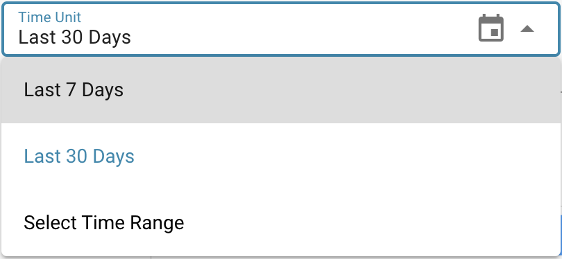
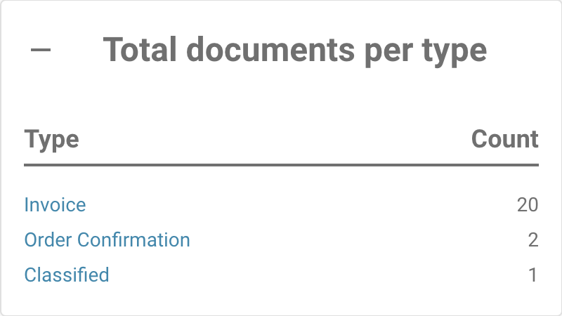

# Berichtsseite



### 1. Berichtsseite aktivieren

Gehen Sie zu **Settings** → **Document Processing** → **Module** → **Document Type** → **Show Report** und schalten Sie die Option ein, um diese Einstellung zu aktivieren.

<figure><figcaption></figcaption></figure>

### 2. **Zugriff auf die Berichtsseite**

Gehen Sie wie folgt vor, um in DocBits auf die **Berichtsseite** zuzugreifen:

1. **Bei DocBits anmelden**
   * Öffnen Sie DocBits und melden Sie sich mit Ihren Zugangsdaten an.
2. **Auf das Berichtssymbol klicken**
   * Suchen Sie in der linken Seitenleiste das **Report**-Symbol (dargestellt als Graph oder Diagramm) und klicken Sie darauf.

<figure><figcaption></figcaption></figure>

### **3. Den Zeiteinheitenfilter verwenden**

*   Am oberen Seitenrand können Sie den Filter **Time Unit** anpassen, um den Zeitraum für Ihren Bericht auszuwählen:

    * **Last 30 Days** (letzte 30 Tage)
    * **Last 7 Days** (letzte 7 Tage)
    * **Custom Time Frame** (benutzerdefinierter Datumsbereich)

    <figure><figcaption></figcaption></figure>

### **4. Anzeige neuer Dokumente**

* Neben dem Filter **Time Unit** befindet sich eine Informationsanzeige mit der Bezeichnung **New Documents**. Sie zeigt die Anzahl der neuen Dokumente, die im gewählten Zeitraum importiert wurden.

<figure><figcaption></figcaption></figure>

### **5. Anzeige der durchschnittlichen Systemzeit**

* Nach der Anzeige **New Documents** finden Sie die Anzeige **Average System Time**. Sie zeigt die durchschnittliche Zeit in Sekunden, die das System im gewählten Zeitraum für die Verarbeitung eines neuen Dokuments benötigt hat.

<figure><figcaption></figcaption></figure>

### **6. Bereich „Changed Fields“**

* Unterhalb der zeitbezogenen Informationen finden Sie den Bereich **Changed Fields**. Dieser zeigt ein Diagramm, aus dem hervorgeht, wie häufig jedes Dokumentfeld im gewählten Zeitraum manuell von Benutzern geändert wurde.
* Jedes Feld wird mit der entsprechenden Anzahl an Änderungen als Balken im Diagramm dargestellt.

<figure><figcaption></figcaption></figure>

* **Download-Optionen für das Diagramm**
  * Rechts neben dem Diagramm **Changed Fields** befindet sich ein kleines Menü, mit dem Sie das Diagramm in verschiedenen Formaten herunterladen können. Sie können das Diagramm herunterladen als:
    * **SVG**
    * **PNG**
    * **CSV**
  * Um das Diagramm herunterzuladen, klicken Sie auf das Menü und wählen Sie das gewünschte Dateiformat.

### **7. Weitere Berichtsbereiche**

Unterhalb des Bereichs **Changed Fields** finden Sie vier weitere Schaltflächen, die beim Anklicken detailliertere Informationen anzeigen. Jede Schaltfläche klappt beim Anklicken auf und zeigt weitere Informationen.

1.  **Total Documents per Type**

    * Diese Schaltfläche zeigt die Gesamtzahl der Dokumente für jeden Dokumenttyp (z. B. Rechnung, Bestellung usw.) im gewählten Zeitraum.
    * Beim Anklicken klappt sie auf und zeigt eine Liste der Dokumenttypen mit der jeweiligen Anzahl der im gewählten Zeitraum verarbeiteten Dokumente.

    <figure><figcaption></figcaption></figure>
2.  **Daily Average per Doctype**

    * Diese Schaltfläche zeigt die durchschnittliche tägliche Anzahl verarbeiteter Dokumente, gegliedert nach Dokumenttyp.
    * Beim Anklicken klappt sie auf und zeigt die Dokumenttypen mit ihrem jeweiligen Tagesdurchschnitt.

    <figure><figcaption></figcaption></figure>
3.  **Status Statistic**

    * Diese Schaltfläche zeigt die Statusverteilung für jeden Dokumenttyp (z. B. Rechnung, Bestellung usw.). Beim Anklicken klappt sie auf und zeigt den Status der Dokumente innerhalb jedes Dokumenttyps, d. h. wie viele Dokumente sich in welcher Statuskategorie befinden.

    <figure><figcaption></figcaption></figure>
4.  **Export Statistic**

    * Mit dieser Schaltfläche können Sie Exportstatistiken für Ihre Dokumente anzeigen. Beim Anklicken klappt sie auf und zeigt Daten zu Dokumentenexporten, etwa die Anzahl der Exporte, Erfolgs- und Fehlerraten und weitere relevante Informationen.

    <figure><figcaption></figcaption></figure>
