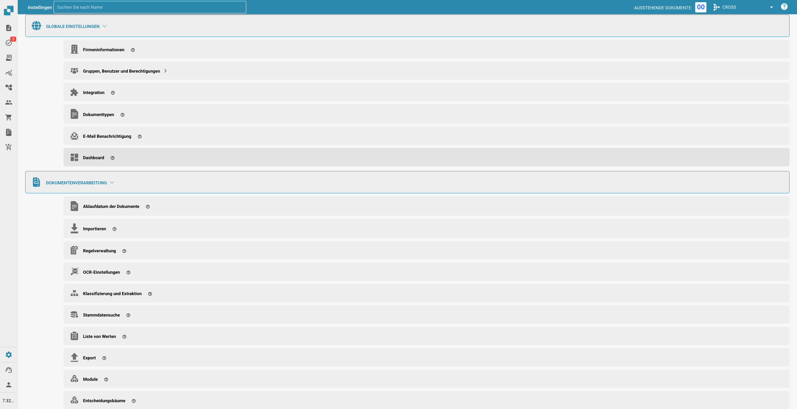

# Einstellungen

<figure><figcaption></figcaption></figure>

1. **Globale Einstellungen**:
   * **Firmeninformationen**: Grundlegende Details über das Unternehmen definieren und bearbeiten, wie Name, Adresse und andere Identifikatoren.
   * **Gruppen, Benutzer und Berechtigungen**: Benutzerrollen und -berechtigungen verwalten, um unterschiedliche Zugriffsebenen auf verschiedene Funktionen innerhalb von Docbits zu ermöglichen.
   * **Integration**: Einrichten und Konfigurieren von Integrationen mit anderen Software- oder Systemen, um die Funktionalität von Docbits mit externen Diensten zu erweitern.
   * **Dokumententypen**: Verschiedene Arten von Dokumenten festlegen und verwalten, die von Docbits verarbeitet werden, wie Rechnungen, Bestellungen usw.
   * **E-Mail-Benachrichtigung**: Einstellungen für E-Mail-Benachrichtigungen und Benachrichtigungen im Zusammenhang mit den Aktivitäten zur Dokumentenverarbeitung konfigurieren.
   * **Dashboard**: Das Dashboard mit Widgets und Metriken anpassen, die für die Benutzer wichtig sind.
2. **Dokumentenverarbeitung**:
   * **Dokumentenablauf**: Regeln festlegen, wie lange Dokumente aufbewahrt werden, bevor sie archiviert oder gelöscht werden.
   * **Import**: Konfigurieren, wie Dokumente in Docbits importiert werden, einschließlich Quelleinstellungen und Dateitypen.
   * **OCR-Einstellungen**: Einstellungen für die optische Zeichenerkennung (OCR) anpassen, die Bilder von Text in maschinenlesbaren Text umwandelt.
   * **Klassifizierung und Extraktion**: Festlegen, wie Dokumente kategorisiert werden und wie Daten aus Dokumenten extrahiert werden.
   * **Stammdaten-Suche**: Suchen einrichten, um extrahierte Daten mit vorhandenen Stammdaten zu validieren oder zu ergänzen.
   * **Wertelisten**: Vordefinierte Listen verwalten, die bei der Dateneingabe und -validierung verwendet werden.
   * **Export**: Konfigurieren, wie und wohin verarbeitete Dokumente und Daten exportiert werden.
   * **Modul**: Zusätzliche Module, die konfiguriert werden können, um die Funktionalität zu erweitern.
3. **API-Lizenzen**: API-Schlüssel verwalten und die Nutzungstatistiken für von Docbits verwendete APIs überwachen.
4. **Lieferanteneinstellungen**: Einstellungen spezifisch für Lieferanten konfigurieren und verwalten, möglicherweise in Integration mit Lieferantenmanagementsystemen.
5. **Cache-Verwaltung**: Einstellungen im Zusammenhang mit dem Zwischenspeichern von Daten anpassen, um die Leistung des Systems zu verbessern.
