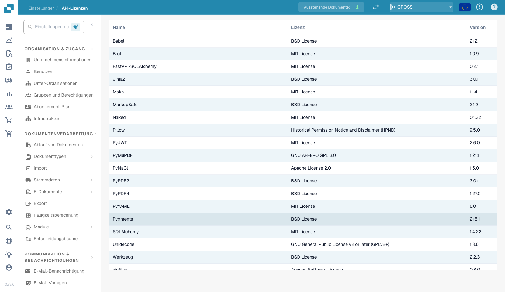

# System Licenses

<figure><figcaption>
Seite „System Licenses“
</figcaption></figure>

Die Seite „System Licenses“ (auch API Licenses genannt) zeigt alle von DocBits verwendeten Softwarepakete von Drittanbietern, einschließlich ihrer Versionsnummern und der zugehörigen Open-Source-Lizenzen. Diese Informationen dienen der Compliance und Transparenz.
