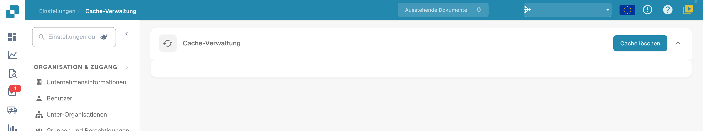

# Cache-Verwaltung

Öffnen Sie **Einstellungen → Cache-Verwaltung**, um die aktuelle Wartungsaktion aufzurufen.

<figure><figcaption>
Aktuelle deutsche Cache-Verwaltung mit „Cache löschen“. Es gibt in dieser Ansicht keine Tabelle mit Objekt- oder TTL-Einstellungen; der Cache wurde nicht geleert.
</figcaption></figure>

## Cache löschen

Verwenden Sie **Cache löschen**, wenn Sie zwischengespeicherte Daten zurücksetzen möchten. Anschließend müssen Daten gegebenenfalls erneut geladen werden. Prüfen Sie danach die betroffene Ansicht und das erwartete Ergebnis.

Die abgebildete Version bietet diese globale Aktion. Sie zeigt keine Tabelle einzelner Cache-Objekte, keine objektspezifischen Schalter und keine bearbeitbaren TTL-Werte. Für die Abbildung wurde kein Cache geleert.
