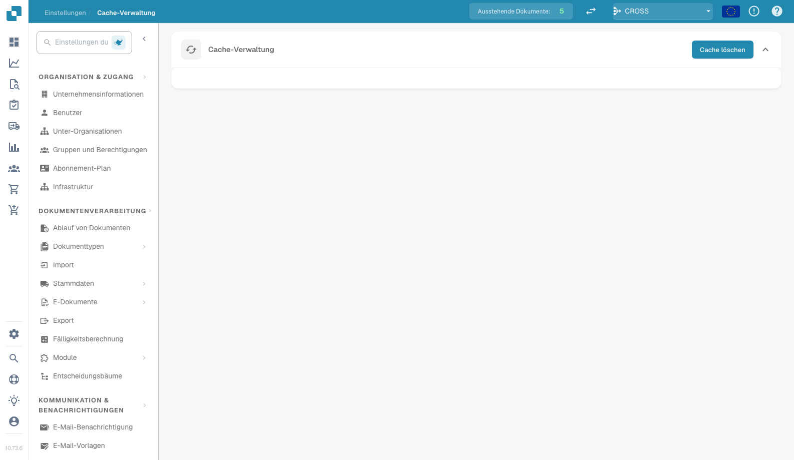

# Cache-Verwaltung

<figure><figcaption>
Seite „Cache Management“
</figcaption></figure>

Cache Management steuert das automatische Leeren von Caches für häufig abgerufene Daten. Die Aktivierung des Cachings verbessert die Leistung, da wiederholte API-Aufrufe reduziert werden.

## Cache leeren

Klicken Sie auf die Schaltfläche **Clear Cache** (oben rechts), um alle zwischengespeicherten Daten sofort manuell zu invalidieren.

## Cache-Tabelle

| Spalte | Beschreibung |
|--------|--------------|
| **Object** | Der Typ der zwischengespeicherten Daten (z. B. Receive Delivery Cache, Purchase Order Cache). |
| **Status** | Schalter zum Aktivieren oder Deaktivieren des Cachings für dieses Objekt. |
| **TTL** | Time to Live in Minuten, d. h. wie lange zwischengespeicherte Daten gültig bleiben, bevor sie automatisch aktualisiert werden. Setzen Sie den Wert auf `0`, um den automatischen Ablauf zu deaktivieren. |

## Verfügbare Caches

| Cache | Beschreibung |
|-------|--------------|
| **Receive Delivery Cache** | Speichert Wareneingangsdaten zwischen, die beim PO-Matching verwendet werden. |
| **Purchase Order Cache** | Speichert Bestelldaten zwischen, um die Suche bei der Dokumentenverarbeitung zu beschleunigen. |
| **Task and Notification Cache** | Speichert Aufgabenzähler und Benachrichtigungsdaten zwischen, die im Dashboard angezeigt werden. |
