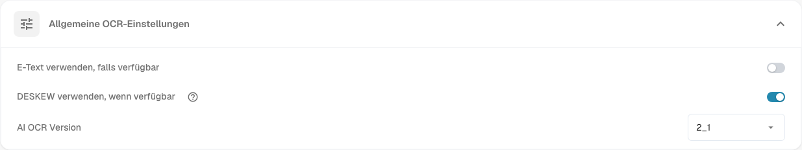

# Dokumentenverarbeitung

Die **Dokumentenverarbeitung** steuert, wie DocBits Dokumente liest, mit weiteren Daten anreichert und exportiert. Öffnen Sie die **Einstellungen** und wählen Sie unter **Dokumentenverarbeitung** den passenden Bereich.

* [OCR-Einstellungen](ocr-settings.md): wie Text aus Dokumenten gelesen wird.
* [Stammdaten-Lookup](master-data-lookup.md): wie extrahierte Werte mit Ihren Stammdaten abgeglichen werden.
* [Fälligkeitsberechnung](due-date-calculation.md): wie Fälligkeiten ermittelt werden.
* [Export](export.md): wohin und wie verarbeitete Dokumente exportiert werden.

Öffnen Sie zum Beispiel **OCR-Einstellungen**, um die **Allgemeinen OCR-Einstellungen** zu prüfen. **E-Text verwenden, falls verfügbar** nutzt eingebetteten elektronischen Text. **DESKEW verwenden, wenn verfügbar** richtet gescannte Seiten gerade aus. **AI OCR Version** wählt die Version der Texterkennung aus. Einzelheiten finden Sie unter [OCR-Einstellungen](ocr-settings.md).

<figure><figcaption>
Die allgemeinen OCR-Einstellungen sind ein Bereich der Dokumentenverarbeitung. Die gewählten Werte hängen von Ihrer Organisation ab.
</figcaption></figure>

Weitere Bereiche sind [Importieren](import/README.md), [Klassifizierung und Extraktion](classification-and-extraction/README.md), [Regelverwaltung](rule-manager/README.md), [Wertelisten](list-of-values.md) und [Modul](module/README.md).

Wenn sich eine Einstellung nicht wie erwartet verhält, prüfen Sie sie zuerst mit einem Testdokument. Eine Änderung kann jedes neue Dokument der Organisation betreffen.
