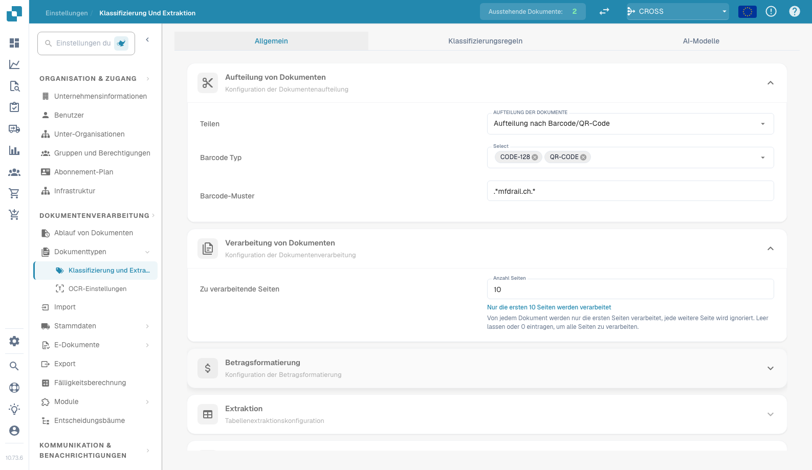
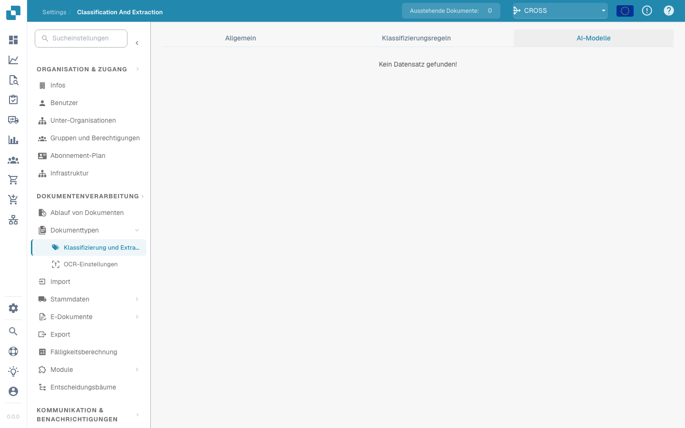

# Klassifizierung und Extraktion

<figure><figcaption>
Seite „Klassifizierung und Extraktion“
</figcaption></figure>

## Übersicht

In den Einstellungen für **Classification and Extraction** (Klassifizierung und Extraktion) können Sie:

* die **Dokumentenaufteilung** (Document Splitting) auf Basis von QR-Codes aktivieren
* die **Betragsformatierung** konfigurieren
* die **Tabellenextraktion** einrichten
* die Verarbeitung nicht unterstützter **ZUGFeRD**-Dateien ein- oder ausschalten
* spezielle Klassifizierungsregeln definieren
* die individuell trainierten **KI-Modelle** überwachen, die im Klassifizierungsprozess verwendet werden

Diese Seite erklärt alle verfügbaren Einstellungen im Detail.

## **Zugriff auf die Einstellungen für Klassifizierung und Extraktion**

Um die Einstellungen für **Classification and Extraction** zu öffnen, gehen Sie zu:\
**Settings → Document Processing → Classification and Extraction**

<figure><figcaption></figcaption></figure>

## Dokumentenaufteilung

Im Abschnitt **Document Splitting** legen Sie fest, ob ein hochgeladenes Dokument in mehrere Dokumente aufgeteilt werden soll, sobald auf einer seiner Seiten ein **Barcode** erscheint.

So aktivieren Sie diese Funktion:

1. Gehen Sie zum Abschnitt **Document Splitting**.
2.  Öffnen Sie das Dropdown-Menü.

    <figure><figcaption></figcaption></figure>
3.  Wählen Sie **Split by Barcode/QR Code**.

    <figure><figcaption></figcaption></figure>

Anschließend können Sie:

* einen oder mehrere Barcode-Typen auswählen, die erkannt werden sollen.
*   ein Regex-Muster angeben, dem der Barcode entsprechen muss, damit die Dokumentenaufteilung ausgelöst wird.

    <figure><figcaption></figcaption></figure>

## Betragsformatierung

Im Abschnitt **Amount Formatting** stehen Ihnen zwei Optionen zur Verfügung:

* **Allow Rounding During Amount Comparison:**\
  Wenn aktiviert, ist beim Betragsvergleich eine Toleranz von ±0,5 zulässig.\
  Wenn deaktiviert, gilt eine Standardtoleranz von ±0,05.
* **Require Exact Match for Amount Comparison:**\
  Wenn aktiviert, müssen die Beträge ohne jede Toleranz exakt übereinstimmen.\
  Wenn deaktiviert, ist eine Toleranz von ±0,05 zulässig.

<mark style="color:red;">**Hinweis**</mark>: Es kann immer nur eine dieser Einstellungen aktiv sein.

## Tabellenextraktion


**Voraussetzungen für eine funktionierende Tabellenextraktion**

* Der Dokumenttyp hat **Tabellenspalten** (Settings → Global Settings → Document Types → [Tabellenspalten](../../global-settings/document-types/table-columns/README.md)). Ohne Spalten gibt es nichts, in das extrahiert werden könnte.
* **Table Extraction** oder **AI Table Extraction** ist unten für die gesamte Organisation eingeschaltet.
* Das Dokument enthält lesbaren Text: OCR wurde ausgeführt, oder bei digital erzeugten PDFs wird E-Text verwendet ([OCR-Einstellungen](../ocr-settings.md)).
* Training und KI-Modelle gelten **pro Lieferant**. Eine trainierte Tabelle wird nur auf Dokumente des Lieferanten angewendet, für den sie trainiert wurde.


Sie können Tabellen aus Dokumenten extrahieren, indem Sie entweder **Table Extraction** oder **AI Table Extraction** aktivieren. Eine trainierte Tabelle (ob KI-basiert oder manuell) ist immer an einen bestimmten Lieferanten gebunden.

**Table Extraction:** Aktiviert die regelbasierte Tabellenextraktion. Tabellen werden pro Lieferant im Validierungsbildschirm trainiert (*Go to table extraction view*).\
Mehr zum Training erfahren Sie [hier](../../../setup/document-training/training-line-fields-table-training/defining-tables-and-columns.md).

**AI Table Extraction:** Nutzt KI, um die Tabelle beliebiger Lieferanten ohne Training zu extrahieren. Wenn die Ergebnisse für einen Lieferanten nicht genau genug sind, trainieren Sie die Tabelle dieses Lieferanten; die gespeicherten Regeln haben dann für diesen Lieferanten Vorrang vor der KI.

**Use Table Extraction Vision (AI):** Die KI liest das Seitenbild statt der Textebene. Hilft bei gescannten Dokumenten und Tabellen ohne klare Textstruktur; langsamer.

**Use Structured Extraction (AI):** Die KI liefert die Tabelle in einer festen Struktur, die direkt auf die konfigurierten Tabellenspalten abgebildet wird. Empfohlen, wenn die Spaltenüberschriften auf den Dokumenten stark variieren.

**Table Extraction for Costing Element:** Wenn aktiviert, kann DocBits Kostenelemente aus Tabellen auf Positionsebene extrahieren und entsprechend klassifizieren.\
Eine ausführliche Erklärung finden Sie [hier](table-extraction-for-costing-element.md).

**Auto Extract Tax Code:** Wenn aktiviert, füllt das System das Feld **Tax Code** im Validierungsbildschirm automatisch aus, sofern ein Steuercode-Feld konfiguriert ist.\
Weitere Informationen zu dieser Einstellung finden Sie [hier](auto-extract-tax-code.md).

**Save extraction rules (Admin only):** Nur Administratoren können im Tabellentraining auf *Save Rules* klicken. Schalten Sie diese Einstellung ein, wenn Benutzer immer wieder Regeln speichern, welche die Extraktion eines Lieferanten beeinträchtigen.

**AI Model:** Wählt die KI-Stufe für die Tabellenextraktion: **Fast** (Standard), **Full** (höchste Genauigkeit, langsamer) oder **Nexus** (optionale dritte Stufe). Die Tabelle unterhalb der Auswahl zeigt:

* welche **Lieferanten** welches KI-Modell verwenden
* ob sie E-Text verwenden
* Optionen, um einen Eintrag zu löschen oder die Trainingsdaten zurückzusetzen

Diese Einstellung wird [hier](ai-model.md) ausführlich erklärt.

### Warum sieht die Tabelle pro Lieferant anders aus?

Alles, was DocBits über eine Tabelle lernt, wird **pro Lieferant** gespeichert:

* **Gespeicherte Regeln** (Tabellentraining): Position der Tabelle und Zuordnung ihrer Spalten im Layout dieses Lieferanten.
* **KI-Tabellen-Tags und Formatierungsregeln**: Hinweise, die der Benutzer für die KI-Tabelle dieses Lieferanten gespeichert hat.
* **Lieferantenspezifisches KI-Modell**: die Stufe, die für diesen Lieferanten unter *More settings* im Validierungsbildschirm gewählt wurde.

Lieferant A mit gespeicherten Regeln zeigt daher im Tab *Extracted table* des Validierungsbildschirms eine deterministische Tabelle, während Lieferant B ohne Regeln die *AI Extracted table* erhält. Damit sich Lieferant B wie A verhält, trainieren Sie die Tabelle von B einmal. Um einen Lieferanten zurückzusetzen, löschen Sie seine Regeln im Validierungsbildschirm oder setzen Sie seine Trainingsdaten in der Tabelle AI Model zurück.

### Preference-Schlüssel

Jeder Schalter in diesem Abschnitt wird als Organisations-Preference gespeichert. Verwenden Sie den Schlüssel, wenn Sie den Wert über die API (`/preferences/set_preference`), ein Skript oder den DocBits MCP (`get_preference` / `set_preference`) setzen.

| Einstellung (UI-Bezeichnung) | Preference-Schlüssel | Werte |
|---|---|---|
| Table Extraction | `TABLE_EXTRACTION_SETTING` | `true` / `false` |
| AI Table extraction | `USE_AI_TABLE_EXTRACTION` | `true` / `false` |
| Use Table Extraction Vision (AI) | `TABLE_EXTRACTION_USE_VISION` | `true` / `false` |
| Use Structured Extraction (AI) | `USE_STRUCTURED_EXTRACTION` | `true` / `false` |
| Table extraction for costing element | `CHARGES_TABLE_EXTRACTION` | `true` / `false` |
| Auto extract tax code | `AUTO_EXTRACT_TAX_CODE` | `true` / `false` |
| Save extraction rules (Admin only) | `ONLY_ADMIN_CAN_SAVE_RULES` | `true` / `false` |
| AI Model | `AI_MODEL` | `gpt-5.4-mini` (Fast), `gpt-5.5` (Full), `qwen3.8-max` (Nexus) |
| Table extraction version (Bestätigungsdialog) | `TBL_EXT_VERSION` | Versionszeichenfolge |
| OCR Settings → Use AI data for tables if available | `USE_AI_DATA_FOR_TABLE` | `true` / `false` |
| OCR Settings → Use E-Text if available | `USE_ETEXT_IF_AVAILABLE` | `true` / `false` |

Hinweise:

* Boolesche Preferences werden als Zeichenfolgen `true` / `false` gespeichert; ein Schlüssel, der nie gesetzt wurde, gilt als `false`. Wenn Sie `1` oder `0` senden, speichert DocBits `true` / `false`.
* Ein nicht gesetzter `AI_MODEL` bedeutet **Fast**.
* Eine Änderung eines Schlüssels wirkt sich auf Dokumente aus, die danach verarbeitet werden. Starten Sie ein Dokument neu, um es mit der neuen Einstellung erneut zu extrahieren.
* Lieferantenspezifische Auswahlen (E-Text, KI-Modell, gespeicherte Regeln) sind keine Organisations-Preferences; sie werden im Validierungsbildschirm unter *More settings* für ein Dokument dieses Lieferanten festgelegt.

## Elektronisches Dokument

**Process Unsupported ZUGFeRD PDF:** Wenn aktiviert, werden nicht unterstützte **ZUGFeRD**-Versionen als Standard-PDFs verarbeitet, und das eingebettete XML wird ignoriert.

Die Liste der unterstützten **ZUGFeRD**-Versionen finden Sie [hier](../../global-settings/document-types/edi/zugferd/README.md).

## **Klassifizierungsregeln**

Im Abschnitt **Classification Rules** können Sie bestimmte **Regex**-Muster und Kriterien definieren, die dem System helfen, Dokumente während der Verarbeitung automatisch zu klassifizieren.

Um diesen Abschnitt zu öffnen, klicken Sie oben auf der Seite auf den Tab **Classification Rules**.

<figure><figcaption></figcaption></figure>

### **Neue Klassifizierungsregel hinzufügen**

So erstellen Sie eine neue Regel:

1.  Klicken Sie oben rechts auf **Add**.

    <figure><figcaption></figcaption></figure>
2. Füllen Sie die folgenden Felder aus:
   * **Pattern**: Das Regex-Muster, nach dem das System suchen soll, um die Klassifizierung auszulösen.
   * **Type**: Wo nach dem Muster gesucht werden soll (z. B. **Barcode**).
   * **Sub Organization** _(optional)_: Legen Sie fest, für welche Unterorganisation die Regel gilt.
   * **Document Type**: Legen Sie den Dokumenttyp fest, der zugewiesen wird, wenn das Muster zutrifft.
   *   **Sub Document Type** _(optional)_: Geben Sie einen Untertyp für eine detailliertere Klassifizierung an.

       <figure><figcaption></figcaption></figure>
3.  Klicken Sie auf **Save**, um Ihre Klassifizierungsregel zu speichern.

    <figure><figcaption></figcaption></figure>

### **Klassifizierungsregel bearbeiten**

So bearbeiten Sie eine vorhandene Regel:

1.  Klicken Sie in der Spalte **Actions** auf die drei Punkte.

    <figure><figcaption></figcaption></figure>
2.  Wählen Sie **Edit**.

    <figure><figcaption></figcaption></figure>
3. Nehmen Sie die gewünschten Änderungen vor.
4.  Klicken Sie auf **Save**, um die Änderungen zu übernehmen.

    <figure><figcaption></figcaption></figure>

### **Klassifizierungsregel löschen**

So löschen Sie eine Regel:

1.  Klicken Sie in der Spalte **Actions** auf die drei Punkte.

    <figure><figcaption></figcaption></figure>
2.  Wählen Sie **Delete**.

    <figure><figcaption></figcaption></figure>

## KI-Modelle

Der Abschnitt **AI Models** zeigt alle individuell trainierten Modelle an, die gezielt auf Ihre Anforderungen abgestimmt wurden.

### Zugriff auf den Abschnitt „AI Models“

Um diesen Abschnitt zu öffnen, klicken Sie oben auf der Seite auf den Tab **AI Models**.

<figure><figcaption></figcaption></figure>

### Modellkategorien

Die Modelle sind in Kategorien organisiert. Unter jedem Kategorienamen wird die Anzahl der enthaltenen Modelle angezeigt.\
Klicken Sie auf eine Kategorie, um deren Details anzuzeigen.

<figure><figcaption></figcaption></figure>

Oben auf der Seite der ausgewählten Kategorie sehen Sie wichtige Informationen zu jedem Modell:

* **Type**: Der Typ des Modells.
* **First Page Only**: Gibt an, ob das Modell nur die erste Seite eines Dokuments verarbeitet.
* **Version**: Die Versionsnummer des Modells.

### Modelltabelle

Alle Modelle einer Kategorie werden in einer Tabelle aufgelistet, die folgende Informationen enthält:

* **Name**: Der Name des Modells.
* **Next Model**: Das Modell, das die Ausgabe des aktuellen Modells weiterverarbeitet.
* **Document Type**: Der primäre Dokumenttyp, den das Modell bei der Klassifizierung zuweist.
* **Document Sub Types**: Die Untertypen, in die das Dokument weiter klassifiziert wird.
* **Priority**: Die Prioritätsstufe, die die Position des Modells in der Klassifizierungswarteschlange bestimmt.

<figure><figcaption></figcaption></figure>

### Ein Modell bearbeiten

So bearbeiten Sie ein Modell:

1.  Klicken Sie in der Spalte **Actions** auf das Stiftsymbol neben dem Modell, das Sie bearbeiten möchten.

    <figure><figcaption></figcaption></figure>
2. Aktualisieren Sie die verfügbaren Felder:
   * **Next Model**: Wählen Sie das Modell, das die Ausgabe des aktuellen Modells verarbeiten soll.
   * **Document Type**: Wählen Sie den Dokumenttyp, als den das Modell die Eingabe klassifizieren soll.
3.  Klicken Sie auf **Save**, um Ihre Änderungen zu übernehmen.

    <figure><figcaption></figcaption></figure>
